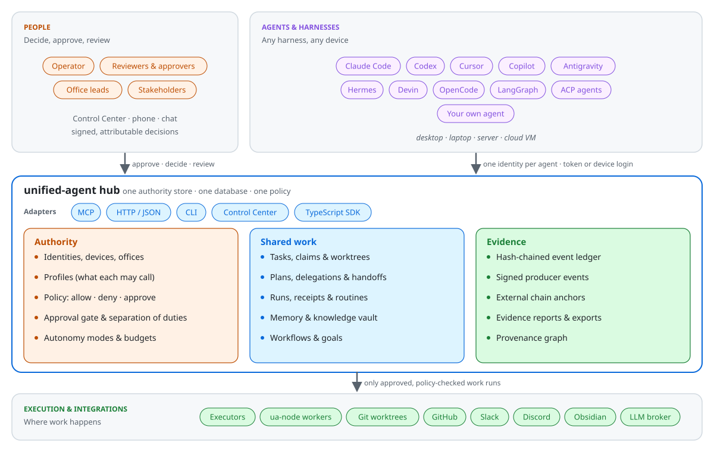
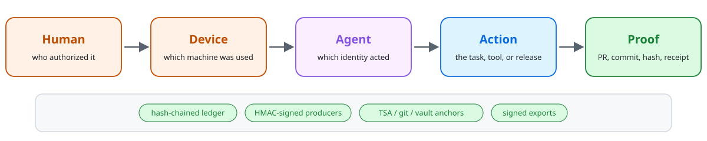
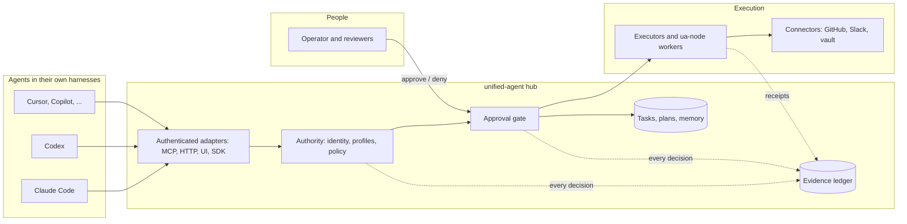

<div align="center">

# unified-agent

**The meta harness for AI agents.**<br>
Organize every agent, harness, device, and person behind one hub.
Automate the work, and keep proof of every human decision.


[Quickstart](docs/getting-started.md) ·
[Concepts](docs/concepts.md) ·
[Human in the loop](docs/human-in-the-loop.md) ·
[Documentation](docs/README.md) ·
[Build on it](docs/building-on-unified-agent.md)

</div>

---

`unified-agent` is an agent-operations platform: a **meta harness** that sits
above the harnesses your agents already run in, such as Claude Code, Codex,
Cursor, Copilot, Antigravity, Hermes, and Devin. It works across every device
those agents run on and every person who directs them. One hub holds the
**authority store** (identity, profiles, and policy), an **approval gate** for
the actions a human must sanction, the shared work objects (tasks, plans,
delegations, runs, and memory), and a tamper-evident **evidence ledger** that
records who authorized what. Agents, people, and programs reach it through
adapters: MCP, HTTP/JSON, a CLI, the web **Control Center**, and a TypeScript
SDK. Authenticated hub adapters apply policy to the shared state; local
operator commands read or maintain the database on the machine where they run.

<p align="center">
  <picture>
    <source media="(prefers-color-scheme: dark)" srcset="docs/assets/overview-dark.svg">
    
  </picture>
</p>

## Why a meta harness

Most teams now run several AI agents at once, often in different tools on
different machines. Each harness keeps its own memory, permissions, and
history. The result is familiar:

- **Agents start cold.** One agent cannot see what another decided yesterday.
- **Work collides.** Two agents edit the same files, or pick up the same task.
- **Policy drifts.** Each tool has its own sandbox and approval rules, so the
  weakest configuration sets the real limit.
- **Oversight is unprovable.** When someone asks "who approved this change?",
  the answer is scattered across chat logs, if it exists at all.

`unified-agent` does not replace your harnesses. It gives them one shared
place for identity, work, policy, and evidence, so that they behave like one
coordinated team with a human clearly in charge.

## What you get

| | Capability | What it means in practice |
|---|---|---|
| 🧭 | **One roster of agents, devices, and people** | Every agent has its own verified identity and bearer token. Devices sign in with a phone-approved device code. People belong to offices with named decision rights. |
| 🗂️ | **Shared, durable work** | Tasks with atomic claims, per-task git worktrees, plans, delegations, handoffs, routines, and goals, all in one SQLite store that every agent reads and writes. |
| 🧠 | **Shared memory and knowledge** | Hybrid full-text and semantic memory search across agents, plus a sandboxed bridge to an Obsidian-style knowledge vault. |
| 🛂 | **Human-in-the-loop control** | A hub-side approval gate, declarative policy rules (`allow`, `deny`, `require_approval`, thresholds, rate limits), per-session profiles, autonomy modes, budgets, and separation of duties. |
| 🧾 | **Evidence you can hand to an auditor** | A hash-chained event ledger, HMAC-signed producer events, external chain anchors, and a five-link report (human → device → agent → action → proof) in JSON, Markdown, CSV, or PDF. |
| ⚙️ | **Governed automation** | Executors that run each agent's own headless CLI in a prepared worktree, device workers (`ua-node`), YAML workflows, LangGraph runs, a review pipeline, and a kill switch. |
| 🖥️ | **A Control Center** | A React web app for the queue, Kanban, approvals, sessions, evidence, provenance, devices, costs, and more, with live updates and a WCAG 2.2 AA accessibility gate. |
| 🧩 | **Built to extend** | Nearly 200 MCP tools, a documented HTTP API, a typed TypeScript client, connector manifests with a conformance harness, and a platform object model. |

<p align="center">
  <picture>
    <source media="(prefers-color-scheme: dark)" srcset="docs/assets/evidence-chain-dark.svg">
    
  </picture>
</p>

## Start here

You need Python 3.11 or later (the declared floor in `pyproject.toml`),
[`uv`](https://docs.astral.sh/uv/), and git. Development, CI, and the hub
image pin Python 3.14 (`.python-version` and `python:3.14-slim`). Building the
Control Center from source needs Node.js 22.22.2 or newer (`packages/web`
`engines`); CI's JavaScript job uses Node 26.

### 1. Try it locally (about 2 minutes)

```bash
# Set UA_REPO_URL to this repository's clone URL.
git clone "$UA_REPO_URL" unified_agent
cd unified_agent
uv sync
uv run mcp dev src/unified_agent/server.py   # opens the MCP Inspector
```

The Inspector lists every tool and lets you call them by hand. Try
`system_doctor`, then `task_add` and `task_list`. Nothing here is persistent
beyond a local `~/.unified_agent/` directory.

### 2. Run a governed hub

```bash
# Build the Control Center web app first (Node.js >= 22.22.2; CI uses 26) so the install packages
# it and serves /ui itself; no UA_WEB_DIST_DIR is needed. Without this build
# the install still succeeds, but /ui answers 503 with a build hint.
(cd packages/protocol && npm ci && npm run build)
(cd packages/client && npm install && npm run build)
(cd packages/web && npm ci && npm run build)

uv tool install .
unified-agent init --interactive    # your name and label, a workspace, the database, two tokens
chmod 600 ~/.unified_agent/service.env
```

For this fresh two-identity hub, create a matching organization chart:

```bash
cat > ~/.unified_agent/org.yaml <<'YAML'
schema_version: 1
offices:
  - id: home
    name: Home
    lead: $operator          # your login label from settings.toml
    members: [$operator, my_claude]
    owned_epics: []
    default_lanes: [default]
    decision_rights: [Operate this hub and review agent work]
YAML
```

An existing fleet should keep its own chart and roster. Every agent in the
chart must be in `UA_AGENT_LABELS`, and every active identity must have an
office. The human operator (`$operator`) is the exception: keep it out of the
roster, because a label in `UA_AGENT_LABELS` names a worker and is refused as
the operator. The doctor's org check counts the operator as a member without
it.

Add a roster and an approval gate to `~/.unified_agent/service.env`:

```dotenv
UA_TRANSPORT=http
UA_HTTP_HOST=127.0.0.1
UA_HTTP_PORT=8765
UA_ENFORCE_AUTH=1
UA_ORG_REGISTRY_PATH=~/.unified_agent/org.yaml
UA_AGENT_LABELS=my_claude
UA_AGENT_TOKENS=Desktop_Operator:<your-token>,my_claude:<agent-token>
UA_APPROVAL_TOOLS=run_cmd:fs_write:git_merge_task:task_delete
```

`UA_WEB_DIST_DIR` is only for serving a custom or development UI build; it
overrides the packaged one, so a stale path keeps serving an older build.

> [!IMPORTANT]
> `Desktop_Operator` stands for you, the human operator: use the label `init`
> wrote to `settings.toml` (`unified-agent settings get operator.label`). Only
> that identity counts as human, and only a human may approve. See
> [Settings](docs/settings.md) and
> [Getting started, step 3](docs/getting-started.md#step-3-define-who-is-who).

Then start it and check its health:

```bash
mkdir -p ~/.config/systemd/user
cp deploy/unified-agent.service ~/.config/systemd/user/
systemctl --user daemon-reload && systemctl --user enable --now unified-agent
unified-agent doctor                # expect no MISCONFIGURED or DEGRADED rows
```

Open the Control Center at <http://127.0.0.1:8765/ui>. Prefer containers? See
[Docker](docs/installation.md#docker).

### 3. Connect an agent

For Claude Code, add this entry under the top-level `mcpServers` key of
`~/.claude.json` with an editor, replacing the placeholder with the agent token
from your `service.env`, and keep the file private. Editing the file keeps the
token out of shell history and the process list:

```json
{ "mcpServers": { "unified-agent": {
  "type": "http",
  "url": "http://127.0.0.1:8765/mcp",
  "headers": { "Authorization": "Bearer <agent-token>" } } } }
```

Codex, Cursor, Antigravity, Copilot, Hermes, and others connect the same way.
See [Connecting agents and harnesses](docs/harnesses.md).

### 4. Make one governed action

Ask the agent to call `profile_status`, create a task, and then run a command.
Because `run_cmd` is in `UA_APPROVAL_TOOLS`, the call does not run. It parks
as **pending** in the Control Center's Approvals pane. Approve it there, and
the agent's retry of that exact call spends the one-time pass and runs. Deny
it, and nothing happens. Finish with:

```bash
unified-agent evidence --task <id> --markdown
```

Run this operator command on the hub host: it reads that host's local ledger.
It reports task-linked evidence. The standalone `run_cmd` above takes no task
id, so its approval appears in `event_log_query`, not in this task report.
An open task with no completion can correctly have empty evidence links.
A task-aware gated call such as `git_merge_task` produces task-linked approval evidence.

The full walkthrough is in [Getting started](docs/getting-started.md).

## Ways to use it

MCP, the Control Center, HTTP/JSON, and the SDK reach the shared hub.
CLI setup, doctor, evidence, and audit commands run locally; run them on the
hub host to inspect its state. The TUI can connect to a hub or use its local
fallback. [Interfaces and state boundaries](docs/interfaces.md) explains each path.

| Interface | For | Start with |
|---|---|---|
| **MCP** | Agents in Claude Code, Codex, Cursor, Copilot, Antigravity, and other harnesses | `claude mcp add ... http://127.0.0.1:8765/mcp` |
| **Control Center** | People: queue, Kanban, approvals, sessions, evidence, devices, costs | `http://127.0.0.1:8765/ui` |
| **CLI** | Operators and scripts: setup, health, evidence, audits, workers | `unified-agent doctor`, `unified-agent evidence`, `unified-agent-*` |
| **TUI** | A terminal dashboard for coordination at a glance | `unified-agent-tui` |
| **HTTP/JSON API** | Programs and integrations | `GET /api/tasks`, `POST /api/action/*` |
| **TypeScript SDK** | Application developers | [`ua-rust`](https://github.com/anonb3ll/ua-rust) → `sdk/typescript` (this repo's `packages/` builds the Control Center and in-repo clients, not the public SDK) |
| **Chat and mobile** | Following and steering work away from a desk | Slack, Discord, Telegram, and the mobile routes |

[Ways to use unified-agent](docs/interfaces.md) tours each one.

## How it fits together



Authenticated hub calls pass through the shared pipeline.
The hub verifies the caller, checks the session profile, and applies policy.
It parks the call for a human if required, runs it inside the sandbox, and
writes the outcome to the ledger. [Architecture](docs/architecture.md)
explains each layer.

## Documentation

| I want to... | Read |
|---|---|
| Understand what this is and the words it uses | [Overview](docs/overview.md), [Concepts](docs/concepts.md), [Glossary](docs/glossary.md) |
| Pick an interface: MCP, CLI, TUI, web UI, API, SDK | [Ways to use unified-agent](docs/interfaces.md) |
| Install it and make a first governed call | [Getting started](docs/getting-started.md), [Installation](docs/installation.md) |
| Plan a deployment across machines and people | [Deployment topologies](docs/topologies.md) |
| Connect Claude Code, Codex, Cursor, and others | [Connecting agents and harnesses](docs/harnesses.md) |
| Put humans in charge and prove it | [Human in the loop and evidence](docs/human-in-the-loop.md) |
| Operate the Control Center | [Web control center](docs/web-ui.md) |
| Automate work safely | [Automation](docs/automation.md), [Routines](docs/routines.md), [Autonomy modes](docs/autonomy-modes.md) |
| Build a tool, connector, workflow, or client | [Building on unified-agent](docs/building-on-unified-agent.md) |
| Look up a tool, command, or setting | [Tools](docs/tools-reference.md), [CLI](docs/cli-reference.md), [Configuration](docs/configuration.md) |
| Harden a deployment | [Security model](docs/security.md) |
| Fix a problem | [Troubleshooting](docs/troubleshooting.md), [FAQ](docs/faq.md) |

The [documentation home](docs/README.md) lists every page.

## Design principles

- **Authority stays in one place.** Harnesses, SDKs, and connectors are
  adapters. None of them carries a second copy of policy.
- **Humans hold the keys.** Merges, deploys, deletions, restarts, secrets, and
  releases can be gated, and a submitter can never approve its own release.
- **Fail closed.** Missing identity, a malformed policy file, or an unverifiable
  signature is a denial, never a silent pass.
- **Evidence over assertion.** A receipt shows that the hub recorded a
  request. Only verified evidence shows what actually happened, and reports
  say which is which.
- **Local first.** Everything runs on hardware you control, with SQLite as
  the store. Remote reach goes through your own tailnet or reverse proxy.

## Project status

`unified-agent` is at **0.3.2** and runs a real multi-agent fleet every day.
Its interfaces are stable enough to build on, but it is pre-1.0, so expect
some breaking changes between minor versions. The [changelog](CHANGELOG.md)
records every change. The [architecture decision records](docs/architecture/)
record which guarantees are enforced today and which are deferred.

## Contributing and security

- Read [CONTRIBUTING.md](CONTRIBUTING.md) and the
  [developer guide](docs/developer-guide.md) before you open a pull request.
- Report vulnerabilities privately as described in [SECURITY.md](SECURITY.md).

```bash
uv sync
uv run pytest -q                           # the Python suite
uv run ruff check . && uv run ruff format --check .
uv run unified-agent-audit . --fail-on high  # the security audit CI enforces
```
