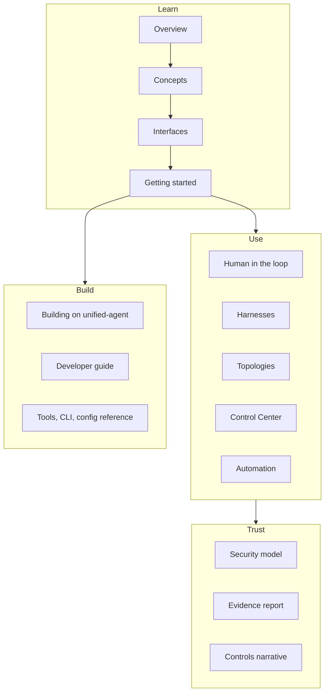

# unified-agent documentation

`unified-agent` is a meta harness: one hub that organizes many agents,
harnesses, devices, and people, automates their work, and keeps evidence of
every human decision and authorization. This site explains how to run it, use
it, and build on it.

The platform's MCP adapter exposes 201 tools. The same operations are also
reachable through the HTTP/JSON API, the CLI, the Control Center, and a
TypeScript client. The registered interface is defined in
[`server.py`](../src/unified_agent/server.py). When a page and the running code
disagree, the code and its tests win. Please report the page as a bug.

## New here? Read these in order

| Step | Page | You will learn |
|---|---|---|
| 1 | [Overview](overview.md) | What a meta harness is, the problems it solves, and what it does not try to be. |
| 2 | [Concepts](concepts.md) | The dozen ideas everything else builds on: identities, profiles, tasks, approvals, evidence, and more. |
| 3 | [Ways to use unified-agent](interfaces.md) | The interfaces: MCP for agents, the Control Center, CLI, TUI, HTTP API, SDK, chat, and mobile. |
| 4 | [Getting started](getting-started.md) | Run a hub, connect an agent, gate one action behind your approval, and read its evidence. |
| 5 | [Human in the loop and evidence](human-in-the-loop.md) | Every control that keeps a person in charge, and how the platform proves it. |
| 6 | [Building on unified-agent](building-on-unified-agent.md) | The extension points: tools, workflows, connectors, executors, the HTTP API, and the SDK. |

## Map of the documentation



## Get started

| Page | Use it to |
|---|---|
| [Getting started](getting-started.md) | Go from a fresh clone to a governed, evidenced action in about 15 minutes. |
| [Installation](installation.md) | Install from source or Docker, register hosts, run a persistent hub, and set up backups. |
| [Installable governance](installable-governance.md) | Take the shortest path to a governed hub with authentication and the Control Center. |
| [FAQ](faq.md) | Answer the questions new operators ask most. |
| [Troubleshooting](troubleshooting.md) | Fix known problems with transports, host configs, executors, and the review pipeline. |

## Understand the platform

| Page | Explains |
|---|---|
| [Overview](overview.md) | The meta-harness idea, who it is for, and the design principles. |
| [Concepts](concepts.md) | The core objects and how they relate. |
| [Ways to use unified-agent](interfaces.md) | Every interface: MCP, Control Center, CLI, TUI, HTTP API, TypeScript packages and SDK, chat, and mobile. |
| [Architecture](architecture.md) | Components, the request pipeline, control layers, profiles, telemetry, and execution planes. |
| [Glossary](glossary.md) | Every term with a one-line definition. |
| [Platform object model](platform-object-model.md) | How platform objects are discovered and served. |
| [Task lifecycle contract](task-lifecycle-contract.md) | Task states, ownership, and the transitions between them. |
| [Memory, tasks, and vault](memory-tasks-vault.md) | The persistent-state layer in depth. |
| [System diagrams](diagrams/README.md) | Interactive diagrams of the server stack, control layers, and vault flow. |

## Run agents, devices, and people

| Page | Covers |
|---|---|
| [Deployment topologies](topologies.md) | Single machine, shared hub, multi-device fleets, cloud sessions, and multiple people. |
| [Fleet console daily loop](fleet-console.md) | Run sessions on every host from the Control Center: morning fleet check, start, answer, steer, cancel, evidence, and what is not covered yet. |
| [Connecting agents and harnesses](harnesses.md) | Registering Claude Code, Codex, Cursor, Copilot, Antigravity, Hermes, Devin, and others; executor backends; device workers. |
| [Collaboration protocol](COLLABORATION.md) | How agents claim work, use worktrees, record decisions, and avoid collisions. |
| [Agent access and managed secrets](agent-access.md) | Administrative access, token issue and rotation, and secrets. |
| [Agent lifecycle](agent-lifecycle.md) | Pause, resume, or terminate an agent. |
| [Credential pool](credential-pool.md) | Register and revoke shared provider credentials. |
| [Project repositories](project-repositories.md) | Bind projects to source repositories. |
| [Codex sessions](codex-sessions.md) | Run a Codex remote session over stdio. |

## Keep humans in the loop and prove it

| Page | Covers |
|---|---|
| [Human in the loop and evidence](human-in-the-loop.md) | Approvals, receipts to the requester, work proposals, policy, profiles, autonomy modes, separation of duties, and the evidence chain in one place. |
| [Autonomy modes](autonomy-modes.md) | Per-mission modes: `observe`, `exception`, `checkpoint`, and `action-review`. |
| [Trust presets](trust-presets.md) | Tightening-only presets for native execution. |
| [Costs and budgets](budgets.md) | Per-agent cost roll-ups and hard-stop budgets. |
| [Config revisions](config-revisions.md) | Immutable history for policy, profile, and org documents. |
| [Recording decisions](decisions.md) | Where a human decision is written so agents act on it. |
| [Evidence report](evidence-report.md) | The five-link chain, signing, anchoring, and export formats. |
| [Provenance graph](provenance-graph.md) | The same chain as a queryable graph. |
| [Work product release](work-product-release.md) | Named-reviewer approval and release for documents and files. |
| [Controls narrative](controls-narrative.md) | How the evidence features map to the EU AI Act, ISO 42001, and SOC 2. |
| [Security model](security.md) | Sandboxes, allowlists, profiles, prod-action gates, SSRF limits, and authentication. |
| [Security posture](security-posture.md) | The current posture summary. |

## Automate work

| Page | Covers |
|---|---|
| [Automation](automation.md) | The review pipeline, validate-and-hold policy, executors, and what stays human. |
| [Work queue](work-queue.md) | Honest queue reads, intake, and backpressure. |
| [Routines](routines.md) | Durable, tracked recurring work. |
| [Self-pickup runs](self-pickup-runs.md) | What is running, how runs ended, and cancellation. |
| [Bug worker](bug-worker.md) | The system bug worker. |
| [Planning loop](planning-loop.md) | The weekly planning loop. |
| [Joint planning](joint-planning.md) | The joint planning contract. |
| [Task search](task-search.md) | Ranked task search. |
| [Skills registry](skills-registry.md) and [Skills & teams catalog](skills-teams-catalog.md) | Reusable agent skills and team definitions. |
| [Team specs](team-spec.md) | Declare a team's seats, harnesses and edges, preview the boot plan, and boot it behind one approval. |
| [Agent scorecards](scorecards.md) | Score agents and record eval runs. |
| [LongMemEval scorecard](evals/longmemeval.md) | Memory retrieval quality on the public LongMemEval-S benchmark, with settings, misses and rerun commands. |
| [LLM provider broker](llm-provider-broker.md) | Route model calls through the hub with quota and spend tracking. |
| [Quota metadata](quota-metadata.md) | Read provider quota metadata. |

## Operate the hub

| Page | Covers |
|---|---|
| [Web control center](web-ui.md) | The Control Center's eight destinations and every page route, the shell, classic-link redirects, and the hub contracts behind each page. |
| [Control Center API](control-center-api.md) | Request, response and permission contracts of the `/api` routes the Control Center v2 write pages use. |
| [Work graph](work-graph.md) | The work graph view (`/ui/work?view=graph&scope=work`). |
| [Database operations](database-operations.md) | Online backup, restore, migrations, and concurrency. |
| [MCP 2.x operator guide](mcp-2x-operator-guide.md) | Progress, resources, and runtime behavior of the MCP adapter. |
| [MCP client capability matrix](mcp-client-capability-matrix.md) | Which MCP hosts support which features. |
| [Customer readiness](customer-readiness.md) | The pilot boundary, acceptance evidence, support, restore, and rollback. |
| [Pilot onboarding kit](pilot/README.md) | Policy templates, a reviewer guide, evidence checks, and rollback for a pilot organization. |
| [Hosted hub on Railway](deploy/railway.md) | Deploying the hub as the cloud control plane: image behaviour, `.railway/railway.ts`, first boot. |
| [Hosted capability boundary](deploy/hosted-capability-boundary.md) | What a hosted hub can do without a workspace, vault, or notification bridge. |
| [Node release roll](deploy/node-release-roll.md) | Rolling a host's `ua-node` through `~/.unified_agent/release/current`, rollback, and retiring old release worktrees. |

## Integrate and build

| Page | Covers |
|---|---|
| [Building on unified-agent](building-on-unified-agent.md) | Every extension point, with the smallest working example for each. |
| [Developer guide](developer-guide.md) | Source map, build and verify, and rules for tools and safety boundaries. |
| [Development](development.md) | Repository layout, hooks, CI, and worktree hygiene. |
| [Connectors](connectors.md) | The connector manifest, secrets, and conformance harness. |
| [Connector activation](connector-activation.md) and [Connector OAuth](connector-oauth.md) | Package activation and hub-brokered OAuth. |
| [Slack coordination](slack-coordination.md) | Signed Slack ingress and allowlists. |
| [Messaging bridges](messaging-bridges.md) | unified_brain threads and Hermes A2A gateways to and from hub mail. |
| [Task-space chat worker](ts-worker.md) | Discord and Telegram chat. |
| [Grok Bot connector](grok-bot-connector.md) | A public-HTTPS MCP client with the tightest profile. |
| [Open-core architecture](open-core-architecture.md) | The `UA_EDITION=core\|enterprise` seam. |
| [Mobile projection](mobile-projection-contract-v1.md) and [mobile action](mobile-action-contract-v1.md) contracts | The phone and watch surfaces. |
| [TypeScript client](../packages/client/README.md), [protocol](../packages/protocol/README.md), [conformance](../packages/conformance/README.md), [web app](../packages/web/README.md) | This repo's TypeScript packages. The SDK for outside applications lives in [`ua-rust`](https://github.com/anonb3ll/ua-rust) under `sdk/typescript`. |

## Reference

| Page | Contains |
|---|---|
| [Tools reference](tools-reference.md) | Every registered MCP tool: signature, limits, and return fields. |
| [Tool catalog](tool-catalog.md) | Every tool grouped by family. |
| [Launch guide](launch-guide.md) | Where to launch what: the hub, the Control Center, workers, timers and the SDK, and which layer each starts in. |
| [CLI reference](cli-reference.md) | Every console command and its exit behavior. |
| [Settings](settings.md) | `settings.toml`: personalize an install (operator identity, paths, server) without editing env files. |
| [Configuration](configuration.md) | Every environment variable and hard limit. |
| [Capability catalog](capability-catalog/README.md) | The evidence-backed capability ledger. |
| [Changelog](../CHANGELOG.md) | Every change, newest first. |

## Architecture decisions

| Record | Decision |
|---|---|
| [Layer map](architecture/layers.md) | Five layers (adapters, runtime, services, integrations, core), imports only point down, enforced in CI with a shrinking baseline. What was fixed, what is left, and when the package can be split. |
| [Kernel split spec](architecture/kernel-split-spec.md) | Epic #2437: every module belongs to one component, the kernel imports no other component, and CI certifies a change by the components it touches. Phases K1 to K7 with acceptance criteria and measured baseline. |
| [Table tenancy](architecture/tenancy.md) | Every table declares its tenancy (partitioned, derived, accelerator or global) in `tenant_tables.py`; a test fails on an unclassified table, and the pending gaps may only shrink. |
| [Platform invariants](architecture/platform-invariants-adr.md) | Which invariants are enforced now, with tests, and which are deferred, with triggers. |
| [LangGraph execution plane](architecture/langgraph-execution-plane-adr.md) and [isolated pilot](architecture/langgraph-execution-pilot.md) | LangGraph runs work; identity, tasks, approvals, and policy stay in the hub. |
| [Approved dispatch](architecture/approved-dispatch-state-machine.md) and [enablement](architecture/approved-dispatch-enablement.md) | The dispatch state machine, authority contract, and rollback. |
| [TypeScript platform strategy](architecture/typescript-platform-strategy-adr.md) | A TypeScript product layer over the Python core, not a rewrite. |
| [Platform rework review (2026-10-03)](architecture/platform-rework-review-2026-10-03.md) | What is still MCP-shaped after the platform move: governance composed in the MCP adapter, context-variable identity, `ToolError` as the domain error, tool-name authorization, no data-access layer. Ranked, with the rework for each. |
| [ACP interface](designs/acp-interface-decision.md) | The hub drives Agent Client Protocol agents as a client. |
| [Meta-router](designs/2026-09-29-meta-router-routing-decision.md) | How work is routed across harnesses. |
| [User-attributable accountability](designs/user-attributable-agent-accountability.md) | The founding thesis behind the evidence ledger. |
| [Meta-harness capability map (2026-11-10)](roadmaps/2026-11-10-meta-harness-capability-map.md) | The eight capabilities of the owner's meta-harness goal, compared with Paperclip, crewAI, clowder-ai and supermemory, with hub state, gaps, owning component, rewrite candidates and proposed tasks (#2447). |
| [Control Center v2 spec](designs/control-center-v2-spec.md) | The build contract for the current Control Center: eight destinations, routes, shell, writes, and the classic view map. |
| [Command Center design protocol](designs/command-center-design-protocol.md) and [reference](designs/command-center-reference.html) | Design tokens (§3) and truth states (§5) for the Control Center UI. Its shell and navigation sections are superseded by the v2 spec. |

## Deployment records for the reference fleet

The project runs its own multi-machine fleet. These pages document that one
deployment: its hosts, migrations, and runbooks. They are useful as worked
examples, but they name specific machines and are not general instructions.

- Cloud Agent5, [Cloud mirror](cloud-mirror.md), [LLM subscriptions leg](llm-subscriptions-leg-runbook.md)
- [Zulip coordination (deprecated)](zulip-coordination.md), [WorkOS pilot adapter](workos-pilot.md)
- [Browser projection contract](browser-projection-contract-v1.md), Pilot host verdict, [Appliance wedge](product/appliance-wedge.md)

## Historical records, designs, and proposals

These pages keep evidence for their date. They do not set current policy unless
a current source or runtime check confirms them.

- Assessments and baselines: 2026-08-12 assessment, 2026-08-07 baseline, salvage-cluster triage, [autonomy observation](autonomy-observation.md)
- Gates and acceptance: [Gate F retirement](gate-f-retirement-proposal.md), [Gate F soak packet](gate-f-soak-acceptance-packet.md), [S5 bounded autonomy gates](s5-bounded-autonomy-acceptance-gates.md), [bug worker dogfood](bug-worker-dogfood-487.md)
- Proposals and surveys: [future work](future.md), [deploy boundary](deploy-boundary-proposal.md), [execution substrate survey](execution-substrate-survey.md), [MCP transport spike](mcp-transport-modernization-spike.md), [MCP live verification](mcp-live-verification.md), [market-validation evidence](market-validation-evidence.md), [plan preview widget](plan-preview-widget.md), [compliance a11y runbook](compliance-a11y-remediation-runbook.md)
- Designs: [the `designs/` folder](designs/), including UX discovery, memory evaluation, and the fleet console
- Superseded Control Center designs (navigation and panes now follow the [v2 spec](designs/control-center-v2-spec.md)): [information architecture](designs/control-center-information-architecture.md), [Wayfinder pane-parity audit](designs/wayfinder-pane-parity-audit.md), [operator surface coverage](designs/operator-surface-coverage.md), [frontend overhaul 2026-10-07](designs/frontend-overhaul-2026-10-07.md) and its [wiring plan](designs/frontend-overhaul-wiring-plan.md)
- Worked samples: evidence reports and transcripts, [examples](examples/), audits

## Writing and checking documentation

Pages follow four reader modes: tutorials (learn by doing), how-to guides (do
one task), reference (exact facts), and explanation (why it works this way).
Write short, direct sentences. Define a term before its first use. Link to the
source file behind a design claim. Mark a proposal as a proposal.

Run these checks after a documentation change:

```bash
uv run pytest -q tests/test_docs_tool_count.py tests/test_docs_self_description.py
uv run ruff check .
uv run unified-agent-audit . --fail-on high
git diff --check
```

Diagrams in `assets/` are generated. Edit
[`scripts/render_doc_diagrams.py`](../scripts/render_doc_diagrams.py) and run
it. Do not hand-edit the SVGs.
