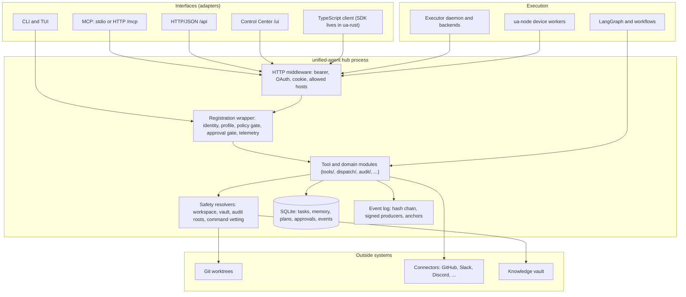
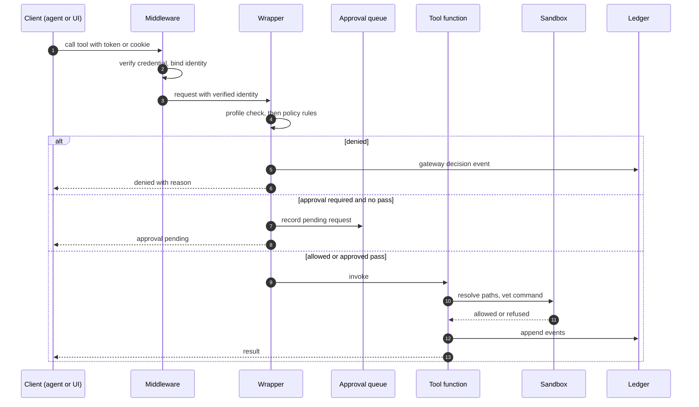

# Architecture and operating model

`unified-agent` is a control plane for an operator, their people, and their
agents. It does not make a model safe by itself. It applies limits at shared
code points that every interface passes through, and it keeps durable records
for later review. This page describes the components, the path a request
takes, and the design trade-offs. [Concepts](concepts.md) defines the
vocabulary used here.

## System at a glance

Every interface reaches the same registered functions through the same
wrapper. That single choke point is what makes one policy possible: a rule
does not need to be re-implemented per client.

## The life of a request

1. **Authenticate.** On an HTTP hub, the middleware checks the bearer token,
   OAuth grant, or browser cookie, and binds one identity to the request. The
   `/mcp` path accepts bearer and OAuth credentials only, never the cookie.
2. **Authorize.** The wrapper checks that the session's profile exposes the
   tool. It then evaluates policy rules: tool, role, threshold, rate limit,
   and scope bindings.
3. **Gate.** Gated calls consume a matching one-time approval or park as
   pending. Prod actions (merge, delete, restart) also need a scope grant.
4. **Contain.** The tool resolves every path and command through the safety
   resolvers before it touches the filesystem or runs a program.
5. **Record.** Outcomes, decisions, and signed producer events are appended to
   the hash-chained event log.

## Components

| Component | Role | Source |
|---|---|---|
| Server and registration | Registers every tool, wraps each one with identity, profile, policy, approval, and telemetry checks. Serves stdio or HTTP. | [`server.py`](../src/unified_agent/server.py) |
| Configuration | Reads environment settings, rosters, tokens, and limits. | [`config.py`](../src/unified_agent/config.py) |
| Safety | Workspace, vault, and audit-root resolvers; command vetting; the prod-action gate. | [`safety.py`](../src/unified_agent/safety.py) |
| Policy and approvals | Declarative rules and the approval queue. | [`policy.py`](../src/unified_agent/policy.py), [`tools/approvals.py`](../src/unified_agent/tools/approvals.py) |
| Profiles and org | Session capability overlays and the org chart. | [`profiles.py`](../src/unified_agent/profiles.py), [`org.yaml`](../src/unified_agent/org.yaml) |
| Storage | The SQLite schema, full-text and vector indexes, and migrations. | [`storage.py`](../src/unified_agent/storage.py) |
| Events and evidence | The event log, producer signing, anchors, reports, and the provenance graph. | [`events.py`](../src/unified_agent/events.py), [`audit/`](../src/unified_agent/audit/) |
| Tools | The public operations, grouped by family. | [`tools/`](../src/unified_agent/tools/) |
| Execution | Executor daemon and backends, approved dispatch, device workers, LangGraph. | [`executor/`](../src/unified_agent/executor/), [`dispatch/`](../src/unified_agent/dispatch/), [`node_agent.py`](../src/unified_agent/node_agent.py), [`langgraph_dispatch.py`](../src/unified_agent/langgraph_dispatch.py) |
| Web | The HTTP API, browser auth, server-sent events, and the SPA host. | [`webui/`](../src/unified_agent/webui/), [`packages/web`](../packages/web/) |
| Telemetry | A provider-neutral span contract on the event log. | [`telemetry/`](../src/unified_agent/telemetry/) |
| TypeScript packages | Protocol shapes, conformance fixtures, and a typed client. | [`packages/`](../packages/) |

Those rows are the running process. The vertical split of `src/unified_agent`
into sixteen loadable components is the [component map](architecture/components.md).
`UA_COMPONENTS` selects which of those a process loads (task #2603); unset loads
every one. See [configuration.md](configuration.md).

Long-running tools (`pi_run_task`, `langgraph_workflow_run`) report MCP 2.x
progress through the wrapper. Read-only board/task/run resources
(`unified-agent://board`, `unified-agent://tasks/{task_id}`,
`unified-agent://runs/{run_id}`) use the same profile permissions as
`task_list` / `dispatch_report_self`; clients listen for
`notifications/resources/updated`. See [tools-reference.md](tools-reference.md#mcp-resources-live-board-state).

## Durable state

[`storage.py`](../src/unified_agent/storage.py) owns the SQLite schema. The core
tables store memory, tasks, plans, events, approvals, delegations, and indexes.
The database uses WAL mode and FTS. Optional vector indexes improve semantic
search. The relational data remains the source of truth.

Each server uses its own `UA_HOME` directory. Two independent servers do not
share memory or tasks. A remote client of one HTTP hub does share that hub's
database. Use the vault for reader-facing cross-device notes. Use Git for
cross-device source changes.

## Transports

| Transport | Use it when | Important limit |
|---|---|---|
| Stdio | One host needs an isolated local process. | There is no HTTP hub middleware or web control center. |
| HTTP | Several approved clients must use one local service. | The operator must configure authentication and allowed hosts. |

The HTTP hub should bind to `127.0.0.1`. Tailscale can forward tailnet traffic
to that loopback service. Do not bind the hub to every interface.

## Control layers

| Layer | Function | Source |
|---|---|---|
| Path resolver | Rejects paths outside the workspace, vault, or (for selected reads) known project checkouts. | [`safety.py`](../src/unified_agent/safety.py) |
| Command vetter | Splits a command and accepts only allowlisted programs. | [`safety.py`](../src/unified_agent/safety.py) |
| Policy gate | Can hold selected calls for a one-time approval. | [`policy.py`](../src/unified_agent/policy.py), [`tools/approvals.py`](../src/unified_agent/tools/approvals.py) |
| Profile gate | Limits tools to the active session profile. | [`profiles.py`](../src/unified_agent/profiles.py) |
| Identity gate | Binds an HTTP request to a verified agent. | [`server.py`](../src/unified_agent/server.py), [`config.py`](../src/unified_agent/config.py) |
| Prod-action gate | Scopes, revocation, and forced one-shot approval for merge / delete / restart. | [`safety.check_prod_action_gate`](../src/unified_agent/safety.py) |
| Edition seam | Hides evidence/ledger features when `UA_EDITION=core`. | [`edition.py`](../src/unified_agent/edition.py) |
| Audit engine | Finds selected security and skill risks. | [`audit/`](../src/unified_agent/audit/) |

These layers have different roles. A command allowlist does not make command
arguments safe. An approval does not bypass path checks. An audit warns about
risks. It does not grant authority.

## Operational profiles

A profile is a capability overlay, not an identity. It lives in the hub process
and is keyed by the verified agent plus the MCP session id. Prompt text,
environment variables, and client-supplied labels cannot select it.
[`profiles.py`](../src/unified_agent/profiles.py) is the source.

Profile exposure applies only to authenticated HTTP sessions
(`UA_ENFORCE_AUTH=1`, a valid bearer token, and an MCP session id). Stdio and
unauthenticated HTTP keep the identity default with no tool-list filter, so a
local IDE process is not silently reduced.

| Profile | Built-in default for | Tool exposure | Vault write dirs |
|---|---|---|---|
| `developer` | `agent-cloud-agent17`, `cloud_agent15`, `cloud_agent16`, `agent-gcp-agent20`, and every other unmapped label | Deny list: high-impact governance, merge, notify, and migration tools. Legacy aliases hide behind consolidated managers. | `UA_VAULT_WRITE_DIRS` (default Inbox / Logs / Wiki) |
| `cto` | `agent-hermes`, `agent-server-agent5`, `agent-cloud-lead` | The developer surface plus `CTO_EXTRA_TOOLS`: review verdicts (`review_and_notify`), the review queue, security triage, evidence-chain and state verification, platform telemetry, and the skills registry. The rest of the developer deny list applies (`CTO_DENIED_TOOLS`), so no approvals, authority config, merge, direct `notify`, schedules or profile changes. Dispatched runs keep `cto`. | same as developer |
| `steward` | none; explicit activation | Broader deny list: no workspace writes, no `task_claim`, no plan mutation, no delegation. `task_update` is exposed (task #591) but refuses a task whose `claimed_by` is a different agent. `vault_write` stays available and is scoped to the same dirs as developer (task #544). | same as developer |
| `chief-of-staff` | `agent-cloud-coord`; `Laptop_Agent5` as the attended on-device backup | Full registered surface. Cloud-hosted boundaries below still apply to `agent-cloud-coord`. `Laptop_Agent5` is not cloud-hosted. | Inbox, Projects, Areas, Resources, Archive, Logs, Wiki |
| `operator` | `Desktop_Person` | **Allow list.** Approvals plus read-only status (`OPERATOR_ALLOWED_TOOLS`). No git, no task mutation, no vault writes. | none (`OPERATOR_WRITE_DIRS` is empty) |
| `cloud-assistant` | none; available as a policy downgrade | **Allow list.** `profile_status`, `task_list`, `memory_search/get/list`, `message_list/send`, and `observability_manage` context/agents only. Unknown tools/actions denied; no profile escalation. HTTP access is MCP-only, plus GET/HEAD health, API whoami and OAuth whoami; browser session creation and other Control Center routes denied. | none |
| `cloud-vault-steward` | none; the policy downgrade for the cloud-hosted identities (`agent-cloud-agent17`'s default before task #1799) | The eight `cloud-assistant` tools plus `vault_read/list/search/write/journal`. Reads, searches, embeds, templates and general writes are confined to unlocked Wiki notes. Other tools, profile changes and Control Center routes remain denied. | Wiki only; native journal appends to daily Logs notes |
| `research` | `agent-cloud-agent8`, `agent-gcp-agent5`, `agent-gcp-agent18`, `agent-gcp-agent19`, `agent-grok`, `agent-laptop-agent8` | **Allow list.** A tool that is not named in `RESEARCH_ALLOWED_TOOLS` is unreachable, including tools registered later. | Inbox and Logs only. Wiki stays curated. |
| `public` | `agent-server-agent8` (Grok Bot OAuth connector) | **Allow list, tightest.** `PUBLIC_ALLOWED_TOOLS` is tasks/projects status reads (`task_list`, `dash_*`) plus `task_add` to file proposals. No memory, vault, web, messaging, shell, approvals, or execution. | none (`PUBLIC_WRITE_DIRS` is empty) |

The built-in defaults (`DEFAULT_PROFILES_BY_IDENTITY` in
[`profiles.py`](../src/unified_agent/profiles.py)) name the reference fleet's
labels. On a new install every identity starts as `developer`. An agent can
use `profile_activate` to switch to a profile no more privileged than its
default. Only a human identity may activate a more privileged one. A
configurable identity-to-profile mapping is not available yet.

`developer` and `steward` are deny lists: a new tool stays reachable until someone
denies it. `research`, `operator`, both cloud profiles, and `public` invert that default so adding a
tool cannot widen those sessions by accident. Research cannot run commands,
mutate the workspace, claim a task (claiming creates a worktree), activate
another profile, or send notifications. `public` is the surface for a client
reachable from the public internet. The Mac hub has an authorized public
HTTPS route on port 443 through Tailscale Funnel (#2289), in addition to its
private tailnet routes. The public ingress serves MCP and OAuth, not the Control
Center UI or general API. Network reachability does not grant a profile:
interactive public OAuth grants are pinned to `agent-server-agent8` (`public`), while
provisioned client-credentials grants map to their configured bot identities.
`public` can read task/project status and file a proposal for a human to approve.
The fleet's current route map is in `~/agent-workspace/docs/topology.md`.
Steward can groom unclaimed or self-claimed
tasks through `task_update`; it cannot claim work to execute it, and it cannot
clear another agent's `claimed_by` (enforced in `tools/tasks.py`, not by hiding
the tool). `profile_reset` is the only way back to the
identity default from research. The Control Center login is `operator`, not
chief-of-staff: it can resolve approvals and read status, and it cannot write
the vault or the workspace.

`agent-cloud-coord` is the chief of staff; `Laptop_Agent5` keeps the chief-of-staff
profile as the operator's on-device backup (2026-11-14). `agent-cloud-agent8` stays a cloud-hosted
identity and defaults to research (executive assistant: notes, light reads,
and light coordination; no profile includes a calendar tool). `agent-cloud-agent17` is a
developer (operator decision 2026-11-11; chief of staff from 2026-10-02, task
#1799, until 2026-11-11). They run on a provider-hosted cloud computer, so
`config.CLOUD_HOSTED_IDENTITIES` keeps these boundaries on each identity,
whatever its profile (`agent-server-agent8` stays on `public` and is not how clients
reach the hub):

- Hub workspace access is always denied. `resolve_workspace_binding` returns
  DENY for it with no `UA_AGENT_WORKSPACES` entry, and ignores a path entry, so
  `fs_*`, `run_cmd` and `git_*` refuse even though the profile lists them.
  `resolve_for_audit` also refuses it, so `security_audit` (except with
  `vault=True`), `detect_dev_servers`, `skill_review` and skill registry
  publish/drift cannot read the hub's disk either. Other DENY identities keep
  their read-only audit (UA #891).
- HTTP access is MCP-only, plus GET/HEAD health, API whoami and OAuth whoami.
  Browser session creation and other Control Center routes are denied.
- `profile_activate` may keep its default or downgrade to `research`, `public`
  or a cloud profile. It refuses `developer`, `steward` and `operator`.
- Vault writes keep the cloud guards: the fail-closed lock check, no `force`
  (`vault_write`, `vault_move`), a canonical daily Logs target for
  `vault_journal`, journal dates within one day of today and single-line tags. Its write
  scope follows the profile: chief-of-staff includes PARA, research is inbox
  and logs, and developer keeps the installation baseline.
  `obsidian_append` is
  refused, because the plugin writes after the hub's lock check; append with
  `vault_write(mode="append")` instead. Reads follow the profile.
- Approvals, the `broadcast` tag, salience above 0.8 and token issuance stay
  human-only. Those checks use actor kind, not the profile.

A `profile_defaults` overlay can return it to `cloud-vault-steward` or
`cloud-assistant`.

`agent-cloud-agent1` (Claude Code on the web, task #2446) is on the same roster as a
**developer**, not a chief of staff. Every boundary above applies to it; its
vault write scope is the developer baseline, and `profile_activate` (denied to
developers anyway) could only step it down. It reaches the configured HTTPS
issuer with a client-credentials grant, using the authorized public 443 route
when the cloud environment has no tailnet; see
cloud-sessions.md.

`cloud-vault-steward` is a bounded capability, separate from an organizational
chief-of-staff role. Its canonical-path checks exclude PARA, Inbox, root and
hidden files, including symlink targets. List/search default to Wiki and filter
each target before exposing metadata or content. Locked notes are excluded from
reads and writes; `force` is refused. A note counts as locked if either the
hub's line-based `locked: true` check or a YAML parse says so. YAML lock
aliases/comments and ambiguous, malformed or frontmatter larger than 64 KiB
fail closed. Templates and embeds inherit the same checks. Wiki writes and the
journal exception are both intersected with `UA_VAULT_WRITE_DIRS`: the
installation setting can narrow this scope, and the profile never widens it.
The journal exception is internal to `vault_journal`: it accepts only today,
yesterday or tomorrow (local date), initializes a daily Logs note and appends
one verified-identity line under an OS file lock shared across callers/processes, flushing before releasing it,
refusing locked or redirected targets. It grants no general Logs read/write,
deletion, filesystem, execution, credential, administration or approval tools.
Deployment requires the existing review, human Approval Ledger and designated
deploy-steward gates. Clients must reconnect after deployment; a bearer token
alone neither creates network reachability nor registers MCP tools.

`profile_activate` requires an authenticated HTTP MCP session. See
[Security model](security.md#session-profiles) and
[Tools reference](tools-reference.md).

### Default-profile shrink (task #1230 / Epic B)

The `developer` profile is the default every engineering identity lands on, except the CTO seats, which land on `cto`.
`DEFAULT_PROFILE_PRUNED_TOOLS` in
[`profiles.py`](../src/unified_agent/profiles.py) removes additional names
from that profile so the exposed surface stays at **≤ 100 tools**
(`tests/test_profiles.py::test_default_profile_tool_count_is_capped_at_100`).
The set is the path to ≤ 60 by day 90: it grows only after the
deprecated-call log shows zero real consumers for a name.

Removal is by profile only. Every pruned name stays registered, remains
reachable under `steward` / `chief-of-staff`, and stays callable
in-process. A default-profile call is **denied and logged**
(`server.py` `policy_guarded`: `profile denied tool call: tool=… (pruned
from the default profile; still reachable under steward/chief-of-staff)`).
The log is the consumer-discovery mechanism — denials never fail silently.
The prune set does not overlap `DEVELOPER_DENIED_TOOLS` (names already
denied to developer contribute nothing to the shrink).

Current prune themes: retired Zulip transport, PARK'd Horizon-2 list
surfaces, unverified browser/canvas MCP tools, operator credential/token
lifecycle, notify family, in-process maintenance (`scan_for_reviewable_tasks`,
`event_log_verify`, `gcloud_inventory`, …), steward vault ingest, skill-cluster
proposals, and `work_product_submit` (always parks a
`require_approval` the submitter cannot approve).

## Telemetry

[`telemetry/`](../src/unified_agent/telemetry/) is a provider-neutral span
contract, not a second event store. Producers emit `TelemetrySpan` values onto
the existing event log under `agent.telemetry.<kind>`. The Control Center
(Runs → Telemetry, `/ui/runs/telemetry`) reads those events through a projection that returns inspectable evidence
references (ULID, channel, `created_at`) rather than raw payloads.

| Piece | Role | Source |
|---|---|---|
| Span schema | `trace_id`, `span_id`, `kind`, `name`, `outcome` required. Kinds: `run`, `model`, `tool`, `executor`, `chain`. | [`schema.py`](../src/unified_agent/telemetry/schema.py) |
| Usage | `tokens_in`, `tokens_out`, `tokens_total`, optional `cost_usd`. | same |
| Redaction | Secret patterns become `[REDACTED_SECRET]`. Strings cap at 500 chars; metadata at 8 KB. | [`redaction.py`](../src/unified_agent/telemetry/redaction.py) |
| Waterfall | Groups valid spans by `trace_id`, sums duration and usage. | [`projection.py`](../src/unified_agent/telemetry/projection.py) |
| Exception digest | Omits successful spans. Flags failure/retry/fallback/quarantine/cooldown/killed/waiting_review, latency ≥ 2 s, cost ≥ $0.01, repeated failures, fallback storms, and missing expected traces. | same |

`GET /api/telemetry` serves both views. Query `trace_id`, `task_id`, and
`limit` (max 500). Invalid payloads are dropped, not rendered. The contract
does not yet wrap every MCPServer tool call or LLM usage header; see
`telemetry.producers.producer_gap_report()` for the current producer list.

See [Web control center](web-ui.md#run-waterfall) for the operator surface.

## Horizon 2 integration boundary

[`horizon2.py`](../src/unified_agent/horizon2.py) (task #664) is a provider
envelope, not a second control plane. Adapters speak `ExecutionEnvelope`
(`ua.execution-envelope/v1`). A2A task payloads are observations only — they
are not Unified-Agent task rows and cannot establish a claim.
`A2AAdapter.discover` / `exchange` (task #666) fetch a well-known Agent Card
and JSON-RPC `GetTask`/`SendMessage`; imported status always uses the hub
`task_id` and `authority_revision`.
`adapter_for("codex"|"claude"|"agy"|"langgraph")` (task #665) returns
observation adapters that project `dispatch_runs` or LangGraph checkpoints
into that envelope. They never spawn a CLI or mutate a task.

MCP tools `horizon2_server_list` / `horizon2_server_register` /
`horizon2_server_revoke` / `horizon2_connector_authorize` persist a reviewed,
revocable connector in `governed_servers`. Register, revoke, and authorize
always consume a one-shot approval (`force=True`). Authorize checks an active
scope, review expiry (`UA_H2_REVIEW_TTL_DAYS`), and (when
`UA_H2_MCP_CONNECTIONS` is set) a bind to that live MCP inventory. It does
not start a provider, mutate a task, or bypass the policy gate.
`horizon2_package_list` / `horizon2_package_register` (task #669) wrap named
packages (Slack, Drive, Obsidian, Readwise, Granola) onto that same table.
Live Slack/Drive/Obsidian dogfood stays task #592.

See [Tools reference](tools-reference.md#horizon-2-connectors).

## LangGraph execution plane

LangGraph is a core hub dependency. MCP tools `langgraph_run`,
`langgraph_progress_note`, `langgraph_workflow_run`, and
`langgraph_checkpoints` wrap the governed adapter
([`langgraph_dispatch.py`](../src/unified_agent/langgraph_dispatch.py)) and the
pilot runner ([`langgraph_pilot.py`](../src/unified_agent/langgraph_pilot.py)).
Identity, claims, approvals, and task state stay in Unified-Agent. The
checkpoint SQLite file is separate from `memory.db`.
`OTLPTraceExporter` (task #668) maps recorded spans to OTLP JSON; it is
opt-in (`UA_H2_OTEL_EXPORT=1`) and never a source of task authority.
Spans cross the export boundary through `telemetry.schema.export_metadata`
(task #2255): allowlisted scalar metadata only, no tool arguments, results or
free-text errors unless `UA_TELEMETRY_FREEFORM_METADATA=1`. Approval id, policy
version/hash, device key fingerprint and artifact SHA become `ua.*` attributes
when a producer knows them.

The contract is
[LangGraph execution-plane ADR](architecture/langgraph-execution-plane-adr.md).
The isolated-pilot page records the original library boundary; the live MCP
registration is the later wiring, not a change of authority.

## Automation and human control

The executor, workflows, reviews, timers, and web UI support routine work.
They do not remove operator authority. [`automation.md`](automation.md) explains
which actions stay human-controlled. In particular, review evidence does not
equal merge, deployment, credential access, or a destructive vault action.

## Design trade-offs

- The system uses one code path for MCP and web dispatch. This reduces policy drift.
- It keeps a local database. This gives fast, private state but requires explicit cross-device bridges.
- It uses strict path resolution. This protects roots but can reject useful external paths.
- It gives agents automation tools. This helps throughput but requires bounded budgets and review.

See [Security model](security.md) for enforced limits and [Tools reference](tools-reference.md)
for each public interface.

## Long-term platform direction (proposed ADR, 2026-08-22)

An incremental **TypeScript product surface** over the existing **Python execution
core** is under review — not a wholesale rewrite. Policy enforcement stays in
Python. `packages/protocol` ships Zod + generated Pydantic shapes;
`packages/conformance` holds golden path and shell fixtures that TypeScript
parses without reimplementing policy; `packages/client` is a typed remote over
the Python HTTP hub. MCP extraction to TypeScript remains deferred.

The SDK for application developers is not in this repository: it is
[`anonb3ll/ua-rust`](https://github.com/anonb3ll/ua-rust) → `sdk/typescript`.
`packages/` here builds the Control Center and the in-repo clients, and the old
`unified-agent-sdk` repository is retired.

See [TypeScript platform strategy ADR](architecture/typescript-platform-strategy-adr.md)
for the full decision record, migration phases, and agent constraints. Package
READMEs under `packages/` are the operator surface for those trees.
