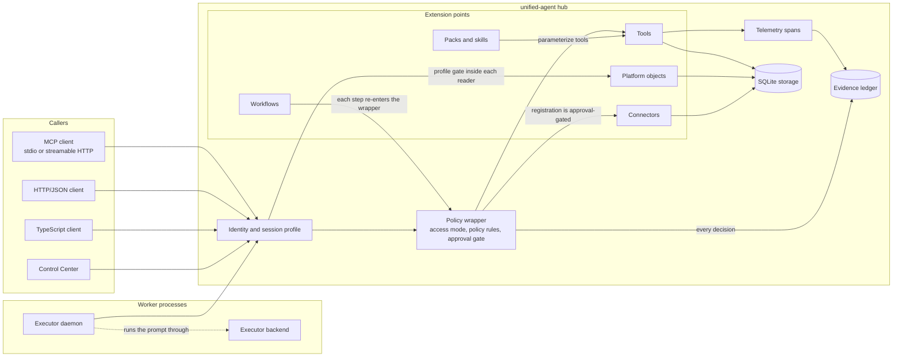

# Building on unified-agent

This page is for developers who extend the platform or build applications on top of it. For each
extension point it gives the use case, the smallest working example, the rules the extension must
follow, how to test it, and the deep reference. Read [Concepts](concepts.md) first, and
[Human in the loop and evidence](human-in-the-loop.md) if your extension can change state. The
[developer guide](developer-guide.md) has the source map and build commands.

Code marked **verified** ran against this checkout. Code marked **sketch** is illustrative: it uses
real modules and signatures, but no such file ships in the repository.

## Contents

| Extension point | Use it when |
|---|---|
| [1. Call the hub from your own program](#1-call-the-hub-from-your-own-program) | A script, service, or app must drive the hub. |
| [2. Add an MCP tool](#2-add-an-mcp-tool) | Agents need a new operation that runs on the hub. |
| [3. Gate an action behind a human](#3-gate-an-action-behind-a-human) | An operation must wait for a person's decision. |
| [4. Write a workflow](#4-write-a-workflow) | A repeatable job is a fixed sequence of existing tools. |
| [5. Add a connector](#5-add-a-connector) | The hub must link to an outside system. |
| [6. Add an executor backend](#6-add-an-executor-backend) | The executor must run a new agent CLI unattended. |
| [7. Serve a platform object](#7-serve-a-platform-object) | A new record type should be readable over MCP and HTTP. |
| [8. Emit telemetry](#8-emit-telemetry) | Your code should appear in the run waterfall. |
| [9. Add a work-product template pack](#9-add-a-work-product-template-pack) | Documents need a named review before release. |
| [10. Publish a skill](#10-publish-a-skill) | Agents should share reusable instructions. |
| [11. The edition seam](#11-the-edition-seam) | Your code touches the evidence layer. |
| [12. Rules that apply to every extension](#12-rules-that-apply-to-every-extension) | Always. |

## How extensions plug in

The **hub** is one process with one SQLite database. Every caller reaches it through an
**adapter** (MCP, HTTP/JSON, CLI, Control Center, TypeScript client). Every adapter verifies the
caller's identity, then runs the same registered functions through one **policy wrapper**. An
extension adds a function, a definition, or a declaration behind that wrapper. It never adds a
second door.



## 1. Call the hub from your own program

**Use it when** a program that is not an agent harness creates tasks, reads state, or requests
governed actions. A bearer token maps to one identity (`UA_AGENT_TOKENS`), and the caller cannot
choose it. The Control Center's cookie session works on `/ui` and `/api` only, and **`/mcp` never
accepts the cookie** ([`webui/auth.py`](../src/unified_agent/webui/auth.py)). A script should send
the bearer on every route. A cookie mutation also needs an `x-ua-csrf` header. A bearer call does not.

**MCP over streamable HTTP** is the path an agent uses. It needs the `mcp` 2.x package (**verified**):

```python
import asyncio, os
import httpx2
from mcp import ClientSession
from mcp.client.streamable_http import streamable_http_client


async def main() -> None:
    headers = {"Authorization": "Bearer " + os.environ["UA_AGENT_BEARER_TOKEN"]}
    async with httpx2.AsyncClient(headers=headers, timeout=httpx2.Timeout(10.0)) as http:
        url = os.environ["UA_HUB_URL"] + "/mcp"  # for example http://127.0.0.1:8765
        async with streamable_http_client(url, http_client=http) as (read, write):
            async with ClientSession(read, write) as session:
                await session.initialize()
                result = await session.call_tool("profile_status", {})
                print(result.content[0].text)  # profile_status has no output schema


asyncio.run(main())
```

A gated call returns `is_error=True` with text such as `request 1 is queued`. Wait for a human,
then repeat the identical call ([section 3](#3-gate-an-action-behind-a-human)). A stdio hub does not
authenticate callers, so use HTTP when you need an identity.

**HTTP and JSON.** The Control Center's routes are an API, and bearer auth works on every one
([route inventory](web-ui.md#route-inventory)). The read-only `/api/platform/manifest`,
`/api/platform/objects/{kind}[/{id}]`, and `/api/platform/provenance-graph` routes
([`platform_http.py`](../src/unified_agent/platform_http.py)) call the same readers as the MCP
resources, under the same profile gate. They answer 400 for a malformed request, 403 when the
profile denies the object, and 404 for an unknown kind or id (**verified**):

The bearer goes in a private header file read with `-H @file` (curl 7.55 or later), not in a
`-H` argument: curl's arguments are visible to every local user through `ps`. `printf` is a shell
builtin, so writing the file does not expose the token either.

```bash
AUTH="$(mktemp)"                                                     # created mode 0600
printf 'Authorization: Bearer %s\n' "$UA_AGENT_BEARER_TOKEN" > "$AUTH"
curl -sS -H @"$AUTH" -H 'Content-Type: application/json' -d '{"title": "Filed over HTTP"}' "$UA_HUB_URL/api/tasks"
curl -sS -H @"$AUTH" "$UA_HUB_URL/api/platform/objects/task/2"     # {"uri": ..., "task": {...}}
rm -f "$AUTH"
```

`unified-agent platform manifest|get|provenance-graph` wraps the same routes.

**TypeScript client.** `@unified-agent/client` is a typed remote with no policy of its own. It
belongs to this repository: it builds the Control Center and the clients used inside the repo.
For a new integration outside this repo, use the SDK in
[`ua-rust`](https://github.com/anonb3ll/ua-rust) under `sdk/typescript`; the retired
`unified-agent-sdk` repository is not a target, and this repository's `packages/` is not the
SDK other applications consume. The example below uses the in-repo client: build
`packages/protocol`, then `packages/client` (`npm ci && npm run build` in each), as the
[client README](../packages/client/README.md) describes. This example ran against a live hub
(**verified**):

```ts
import { HubAuthError, HubRpcError, UnifiedAgentClient } from "@unified-agent/client";

const origin = process.env.UA_HUB_URL!;                     // no /mcp suffix
const client = new UnifiedAgentClient({
  url: `${origin}/mcp`, bearerToken: process.env.UA_AGENT_BEARER_TOKEN!,
});
try {
  console.log((await client.profileStatus()).identity);
  await client.taskAdd({ title: "Try the SDK", priority: "low" });
  console.log((await client.taskList({ status: "open", limit: 5 })).map((t) => t.title));
} catch (error) {
  if (error instanceof HubAuthError) console.error("auth", error.status);
  else if (error instanceof HubRpcError) console.error("hub refused:", error.message);
  else throw error;
} finally {
  await client.close();
}
```

`HubRpcError` covers a tool error: bad arguments, a policy denial, or a parked approval.
`HubTransportError` is a network or gateway failure, `HubValidationError` a response that failed its
schema, and `HubNegotiationError` an unknown MCP version. All extend `UnifiedAgentClientError`.
`ControlCenterClient` wraps the `/api` routes, and `callTool` reaches any tool without a typed
wrapper. The client retries a transient failure only with `CallToolOptions.retryable` or an
`idempotency_key`.

**Rules.** Never embed a token in code or on a command line. Do not copy policy into your program:
send the call and let the hub decide. Handle a parked write.

**Test it.** Point the client at a throwaway hub with its own `UA_HOME`. `packages/client` has a
hermetic suite (`npm test`) and a live one (`npm run test:conformance:live`).
[`examples/sdk_consumer`](../examples/sdk_consumer/README.md) is a full program that proposes a
governed action, waits for a human, and exports the evidence.

**Reference.** [Ways to use unified-agent](interfaces.md),
[Security: hub token authentication](security.md#hub-token-authentication),
[MCP 2.x operator guide](mcp-2x-operator-guide.md),
[TypeScript platform strategy](architecture/typescript-platform-strategy-adr.md).

## 2. Add an MCP tool

**Use it when** agents need a new operation that runs on the hub, under its identity, sandbox, and
audit trail. Follow the [developer guide](developer-guide.md#add-or-change-a-tool). This read-only
sketch ran in a scratch copy of the checkout with the tests below passing:

```python
# src/unified_agent/tools/linecount.py  (sketch)
from mcp.server.mcpserver.exceptions import ToolError
from typing_extensions import TypedDict
from .. import config
from ..safety import resolve_for_project_read


class LineCountResult(TypedDict):
    path: str
    lines: int
    bytes: int


def fs_count_lines(path: str) -> LineCountResult:
    """Count the lines in one text file (read-only). Returns {path, lines, bytes}."""
    resolved = resolve_for_project_read(path)  # same reach and refusals as fs_read
    if not resolved.is_file():
        raise ToolError(f"{path!r} is not a file; pass a file path (use fs_list to browse)")
    size = resolved.stat().st_size
    if size > config.READ_MAX_BYTES:
        raise ToolError(f"file is larger than {config.READ_MAX_BYTES} bytes; count a smaller file")
    return {
        "path": path,
        "lines": len(resolved.read_text(errors="replace").splitlines()),
        "bytes": size,
    }
```

A function that is not in `REGISTERED_TOOLS` does not exist for MCP or the web dispatcher. These
edits go together:

| File | Change |
|---|---|
| `tools/<module>.py` | The function, a full docstring, a `TypedDict` return so MCPServer publishes an output schema, and `ToolError` messages that tell the caller what to do. |
| [`server.py`](../src/unified_agent/server.py) | Import the module and add the function to the registration tuple. Classify it in `_READ_ONLY_TOOLS` (pure read) or `_DESTRUCTIVE_TOOLS` (changes or removes data). A tool that is not read-only counts as a write, and one outside `_LOCAL_TOOLS` counts as a production operation, which the agent access mode can refuse. |
| [`toolsets.py`](../src/unified_agent/toolsets.py) | Add the name to exactly one `TOOLSET_MEMBERS` entry. The hub fails at import without it. |
| [`tool_classification.py`](../src/unified_agent/tool_classification.py) | Add the name to `BASELINE_OPERATOR_REACHABLE_TOOLS`, `WITHHELD_TOOLS` (high-impact writes), or `OMITTED_TOOLS`. Update the pinned counts in [`tests/test_tool_classification.py`](../tests/test_tool_classification.py). |
| [`profiles.py`](../src/unified_agent/profiles.py) | See below. |
| Docs and tests | A ``### `name(args) -> type` `` heading in [`tools-reference.md`](tools-reference.md), the tool count in [`docs/README.md`](README.md) (pinned by `tests/test_docs_tool_count.py`) and [`tool-catalog.md`](tool-catalog.md), and the name in `EXPECTED_TOOLS` in [`tests/test_server.py`](../tests/test_server.py). |

The developer guide lists the tools module, the registration tuple, the reference, and the docs
test. The toolset, classification, and `EXPECTED_TOOLS` steps come from the import check and the
tests.

**Profiles.** The default `developer` profile is a deny list capped at 100 tools
(`test_default_profile_tool_count_is_capped_at_100`), and this checkout sits near the cap. A tool
that would exceed it must replace a pruned name or join `DEFAULT_PROFILE_PRUNED_TOOLS` until it has
a verified consumer. The `research`, `operator`, and `public` profiles are allow lists, so a new
tool is unreachable there until you add it on purpose. Never add execution, workspace writes, or
`profile_activate` to `research`, and never add git, vault writes, or task mutation to `operator`
([profiles](architecture.md#operational-profiles)).

**Rules.**

- Route every path through a resolver in [`safety.py`](../src/unified_agent/safety.py):
  `resolve_for_project_read` for reads that return content, `resolve_in_workspace(path,
  for_write=True)` for writes, `resolve_in_vault`, or `resolve_for_audit` for read-only audits.
  Route commands through `vet_command` and run them with `shell=False`.
- Resolvers follow symlinks before they check containment. Do not add a path that skips them.
- Validate first, gate second, act third. Raise `ToolError`. Never return an error in a success
  payload.
- The wrapper adds the agent access mode, profile check, trust presets, policy gate, approval
  receipts, and performance sampling. It also rejects any argument your signature does not declare.

**Test it.** Test the function, then test the registered wrapper, which is what MCP and the web UI
call. `tests/conftest.py` gives each test a temporary workspace and `UA_HOME`. Cover an allowed case
and a rejected case:

```python
# tests/test_linecount.py
import pytest

from unified_agent import config, server
from unified_agent.policy import PolicyViolation


def test_wrapper_runs_the_tool_and_enforces_policy(tmp_path, monkeypatch):
    (config.workspace_root() / "notes.txt").write_text("a\nb\n")
    call = server.REGISTERED_TOOLS["fs_count_lines"]
    assert call(path="notes.txt")["lines"] == 2
    policy = tmp_path / "policy.yaml"
    policy.write_text("rules:\n  - {name: no, type: tool, tool: fs_count_lines, action: deny}\n")
    monkeypatch.setenv("UA_POLICY_FILE", str(policy))
    with pytest.raises(PolicyViolation):
        call(path="notes.txt")
```

```bash
uv run pytest -q tests/test_linecount.py tests/test_toolsets.py tests/test_tool_classification.py \
  tests/test_docs_tool_count.py tests/test_profiles.py tests/test_server.py tests/test_mcp2_compatibility.py
```

**Reference.** [Tools reference](tools-reference.md),
[Security: workspace sandbox](security.md#workspace-sandbox),
[Architecture: control layers](architecture.md#control-layers).

## 3. Gate an action behind a human

**Use it when** an operation must not run until an authorized person approves that exact request.
Pick the least code that fits:

| Lever | Where | Gates |
|---|---|---|
| **Policy rule** `require_approval` | A policy YAML file (`UA_POLICY_FILE`) | Any registered tool, by name, with no code. |
| **`UA_APPROVAL_TOOLS`** | Hub environment | Every call of a listed registered tool, through the registered-tool wrapper (task #1811), except tools in `_SELF_GATED_APPROVAL_TOOLS` (`server.py`), which apply their own per-action rules. See [the approval gate](human-in-the-loop.md#the-approval-gate). |
| **`check_approval_gate(..., force=True)`** | Inside your tool | Always, even when `UA_APPROVAL_TOOLS` is unset. |
| **Prod-action gate** | `PROD_ACTIONS` in `safety.py` | Adds scope and revocation checks before the forced approval. |

`UA_APPROVAL_TOOLS` is a list of tool names the registered-tool wrapper gates. Listing `task_add`
parks a direct `task_add` call and a workflow step that calls it. A tool you write that calls
`check_approval_gate` under its own name must be added to `_SELF_GATED_APPROVAL_TOOLS` in
`server.py`, or the wrapper gates it a second time with a different payload;
`tests/test_event_log_query_registered_gates.py` fails until it is listed.

**A policy rule** needs no code. A policy file that exists but cannot be parsed denies the call, and
deny beats allow ([policy rules](human-in-the-loop.md#policy-rules)). See
[`examples/policy.phase3.yaml`](../examples/policy.phase3.yaml) for role, threshold, and rate-limit
rules:

```yaml
version: 2
rules:
  - name: approve_fs_count_lines
    type: tool
    tool: fs_count_lines
    action: require_approval        # or: deny
```

**In code.** This sketch always parks for approval and ran under the tests below:

```python
# src/unified_agent/tools/archive.py  (sketch)
from mcp.server.mcpserver.exceptions import ToolError
from .. import config
from ..safety import get_active_worktree_path, resolve_in_workspace
from . import approvals


def archive_workspace_dir(path: str) -> dict:
    """Rename a directory to `<name>.archived`. Always parks for approval."""
    source = resolve_in_workspace(path, for_write=True)  # 1. your own checks first
    roots = {config.workspace_root().resolve()}  #    the workspace, and the
    worktree = get_active_worktree_path()  #    caller's task worktree
    if worktree is not None:
        roots.add(worktree.resolve())
    if source in roots or not source.is_dir():  #    never a root itself
        raise ToolError(f"{path!r} is not a directory inside a writable root")
    target = resolve_in_workspace(  #    resolve the destination
        str(source.with_name(source.name + ".archived")), for_write=True
    )
    if target.exists():
        raise ToolError(f"{target.name!r} already exists; remove or rename it first")
    approvals.check_approval_gate(  # 2. the human gate
        "archive_workspace_dir",
        {"source": str(source), "target": str(target)},
        requested_by=config.verified_agent_identity(),
        force=True,
    )
    source.rename(target)  # 3. the effect
    return {"archived": True, "path": str(target)}
```

The first call raises `ApprovalPendingError` and records a pending row. A person approves in the
Control Center or with `approval_resolve`. The retry, with the same payload, spends the one-time
pass and runs. A denial makes the retry fail with the recorded reason.
[`work_product.py`](../src/unified_agent/tools/work_product.py) and
[`horizon2.py`](../src/unified_agent/tools/horizon2.py) use this shape. The server wrapper gates
token issue through the managed-secret path, so
[`token_lifecycle.py`](../src/unified_agent/tools/token_lifecycle.py) does not call the gate itself.

**Prod actions** are `merge`, `delete`, `deploy`, `restart`, `revoke`, and `dispatch`. Add the tool
to `PROD_ACTIONS` and call `safety.check_prod_action_gate(tool, payload)` before the effect. It
refuses anonymous HTTP callers and revoked agents (`UA_REVOKED_AGENTS`), refuses an agent that
lacks the action when `UA_AGENT_SCOPES` is set, and then forces the approval
([prod-action gate](security.md#prod-action-policy-gate-task-773)).

**Rules.**

- The pass binds to the tool name and the exact payload. Put what a reviewer must see in the
  payload, and nothing secret: the payload is stored and shown.
- Gate after validation and before the first side effect. If the effect fails before it changes
  anything, call `approvals.restore_consumed_approval(approval_id)` so the retry keeps its pass.
- An approver must be a different, named human identity. The hub recognizes the configured
  operator (`operator.label`, its name and aliases; see [Settings](settings.md#the-human-operator)),
  so an ordinary agent label cannot approve.
- Approval never bypasses the sandbox. An approved write outside the workspace is still refused.
- Resolve every path the effect touches, not only the input. A rename, copy, or move has a
  destination too, and a resolver that allows a root as a *source* would let a sibling destination
  land outside it. The sketch refuses the workspace and task-worktree roots, and resolves the target
  with the same write resolver. It uses absolute paths, because a source can sit in the caller's
  active task worktree rather than under `UA_WORKSPACE`.

**Test it.** Assert four things: the call parks and nothing changes, the retry runs after a human
approves, a sandbox refusal (the workspace root, `..`, or an outside path) creates no approval row,
and the active task worktree's root is refused too. In tests, resolve as the configured operator:

```python
HUMAN = config.operator_label()
with pytest.raises(approvals.ApprovalPendingError) as parked:
    archive_workspace_dir("old")  # nothing has happened to "old" yet
approvals.approval_resolve(parked.value.approval_id, "approve", resolved_by=HUMAN)
assert archive_workspace_dir("old")["archived"]  # the retry spent the one-time pass
```

For the worktree root, patch the active worktree where both the resolver and your module look it
up. Otherwise the resolver refuses the path for a different reason and the test proves nothing:

```python
def test_refuses_the_active_worktree_root(tmp_path, monkeypatch):
    worktree = tmp_path / "task-4"
    worktree.mkdir()
    monkeypatch.setattr(safety, "get_active_worktree_path", lambda *a, **k: worktree)
    monkeypatch.setattr(archive, "get_active_worktree_path", lambda *a, **k: worktree)
    with pytest.raises(ToolError, match="writable root"):
        archive.archive_workspace_dir(str(worktree))
    assert approvals.approval_pending()["pending"] == []
```

This test fails if the root guard is removed.

**Reference.** [`tools/approvals.py`](../src/unified_agent/tools/approvals.py),
[`policy.py`](../src/unified_agent/policy.py),
[the approval gate](human-in-the-loop.md#the-approval-gate),
[separation of duties](human-in-the-loop.md#separation-of-duties).

## 4. Write a workflow

**Use it when** a repeatable job is a fixed sequence of existing tools. A **workflow** is a YAML
file whose steps each call one registered tool. It has no code of its own. It lives in
[`src/unified_agent/workflows/`](../src/unified_agent/workflows/) and changes only through a
reviewed diff, because there is no runtime path override. **Verified**:

```yaml
# src/unified_agent/workflows/doctor-to-task.yaml
name: doctor-to-task
description: "Runs system_doctor and files one follow-up task that records the check counts."
inputs:
  - priority
steps:
  - name: doctor
    tool: system_doctor
  - name: file_task
    tool: task_add
    retries: 1
    args:
      title: "Review system_doctor output"
      priority: "{{ inputs.priority }}"
      notes: "system_doctor counts: {{ steps.doctor.summary }}"
```

Run it with `workflow_run(name, inputs, author)` and list definitions with `workflow_list()`. The
schema ([`tools/workflow.py`](../src/unified_agent/tools/workflow.py)): `name` matches the file stem.
`inputs` is a list of names, all required, and an undeclared input is rejected. Each step has a
unique `name`, a `tool` from the curated registry (`_tool_registry()`), optional `args`, and
optional `retries` (capped at 3). `args` substitute `{{ inputs.x }}` and
`{{ steps.<step>.<field> }}`. A value that is exactly one placeholder keeps its type, and an
unresolvable placeholder fails the run. Steps run in order and stop at the first failure. The run
reports `done`, `failed`, `pending-approval`, or `denied`.

**Rules.**

- Every step runs through `server.REGISTERED_TOOLS`, so the access mode, profile, policy, and
  approval gate apply to each one. A parked step stops the run without burning retries. Re-run
  after the approval.
- `workflow_run`, the `approval_*` tools, destructive deletes, and the git commit, merge, and
  worktree tools cannot be steps. A workflow must not resolve its own gate.
- To let workflows call a new tool, add it to `_tool_registry()`. That is a code change and needs
  review. `author` inherits the authenticated caller, and a different claimed author is rejected.

**Test it.** Load and run the file, then assert the data passing and the rejected input. In the
verified test, `workflow_run("doctor-to-task", {"priority": "low"})` returned two `done` steps and
left one open task whose notes start with `system_doctor counts`, and an extra input raised
`undeclared inputs`. [`tests/test_workflow.py`](../tests/test_workflow.py) has the patterns, and
`system_doctor` reports every invalid definition.

**Reference.** [Automation](automation.md), [Routines](routines.md) (fire a job on a schedule).

## 5. Add a connector

**Use it when** the hub must link to an outside system, such as a chat service or an export sink,
with named secrets and a reviewed activation. A **connector** ships a `ConnectorManifest` that
declares what its code does. The manifest describes; it never grants: `default_enabled` is `False`.
[Connectors](connectors.md#the-manifest) lists every field. This sketch passed the conformance
harness (**verified**):

```python
# src/unified_agent/example_notify.py  (sketch)
import os


class ExampleNotifyError(RuntimeError):
    """A safe, actionable failure. Never includes a secret value."""


def send_message(text: str) -> dict:
    if not os.environ.get("EXAMPLE_NOTIFY_TOKEN"):  # refuse to run without the secret
        raise ExampleNotifyError("EXAMPLE_NOTIFY_TOKEN is required for example-notify")
    return {"sent": True, "chars": len(text)}  # call the service here


# appended to src/unified_agent/connectors.py, beside SLACK_MANIFEST
EXAMPLE_NOTIFY_MANIFEST = ConnectorManifest(
    name="example-notify",
    version="0.1.0",
    capabilities=frozenset({"outbound"}),
    required_secrets=frozenset({"EXAMPLE_NOTIFY_TOKEN"}),  # names only, never values
    entry_points={"outbound": "unified_agent.example_notify:send_message"},
    default_enabled=False,
)
register_manifest(EXAMPLE_NOTIFY_MANIFEST)
```

**Rules.**

- Register the manifest in `connectors.py`. Nothing else imports a connector module for you, and
  `system_doctor` and the Settings → Integrations page read `connectors.all_manifests()`.
- Declare only what the code does. Each capability needs exactly one entry point that resolves to a
  callable, or registration is refused. Secrets are environment variable names in `UPPER_SNAKE_CASE`.
  The framework never reads, stores, or logs a value.
- Your own code must refuse to run without its secrets. `connectors.ensure_can_start(manifest)`
  raises `ConnectorSecretsMissingError` for that check, but the hub does not call it for you.
- Activation is a human decision. `horizon2_server_register(server_id, connector, provenance,
  scopes, review_ref)` always waits for approval, validates your entry points, and appends to the
  ledger. `horizon2_connector_authorize` refuses a review older than `UA_H2_REVIEW_TTL_DAYS`.
- A manifest's capabilities and a Horizon 2 package's `scopes` are different vocabularies. Add to
  `horizon2.CONNECTOR_PACKAGES` only if you also want the generic scope catalog.

**Test it.** Run `uv run pytest tests/connectors -q`. Add one test that calls the harness, plus a
test of your secret refusal. Put the file in `tests/connectors/`, beside `harness.py`: the relative
import below only resolves inside that package.

```python
# tests/connectors/test_example_notify.py
from unified_agent import connectors
from .harness import assert_connector_conforms  # tests/connectors/harness.py


def test_example_notify_conforms(monkeypatch):
    assert_connector_conforms(connectors.require_manifest("example-notify"), monkeypatch)
```

The harness checks that the manifest registers, reports to `system_doctor` and the Integrations page,
refuses to start without its secrets, emits hash-chained lifecycle events, and stays invisible to
profiles that do not name it.

**Reference.** [Connectors](connectors.md#adding-a-new-connector),
[Connector activation](connector-activation.md), [`connectors.py`](../src/unified_agent/connectors.py),
[`tests/connectors/`](../tests/connectors/).

## 6. Add an executor backend

**Use it when** the Active Executor must run a new agent CLI unattended. The executor **daemon**
owns the lifecycle: it claims the task, prepares a git worktree, renews the lease, applies retry
and backoff, commits from the host, and hands the branch to review. It never marks a task `done`. A
**backend** only turns a prompt into a run inside the directory the daemon prepared
([`executor/backends.py`](../src/unified_agent/executor/backends.py)). This sketch wraps a headless
command and passed tests against a fake CLI (**verified**):

```python
# src/unified_agent/executor/mycli.py  (sketch)
import os
from typing import Any
from .. import config, trust_presets
from .backends import _child_env, _run_native_cli


def parse_mycli_output(stdout: str) -> dict[str, Any]:
    text = (stdout or "").strip()
    return {
        "text": text,
        "tools_used": [],
        "files_modified": [],
        "events_count": 1 if text else 0,
        "error": None if text else "mycli produced no output",
    }


class MyCliBackend:
    name = "mycli"
    session_kind = "mycli_run"

    def __init__(self, binary: str | None = None):
        self.binary = binary or os.environ.get("UA_MYCLI_BIN") or "mycli"

    def run(
        self,
        *,
        prompt,
        cwd,
        session_dir,
        session_id,
        agent_label,
        timeout_s,
        kill_check=None,
        model=None,
    ) -> dict[str, Any]:
        trust_presets.require_native_allowed(agent_label)
        cwd_abs = str((config.workspace_root() / cwd).resolve())
        return _run_native_cli(
            argv=[self.binary, "--print", prompt],
            cwd_abs=cwd_abs,
            env=_child_env(agent_label),
            timeout_s=timeout_s,
            kill_check=kill_check,
            parse_stdout=parse_mycli_output,
            bin_name="mycli",
        )
```

Register it by adding `"mycli": MyCliBackend` to `_BACKENDS`, then select it with
`UA_EXECUTOR_BACKEND=mycli` and `UA_EXECUTOR_AGENT=<label>`. To let a label choose it, extend
`_FAMILY_TO_BACKEND`. The return contract is a dict with `status` (`success`, `error`, `timeout`, or
`killed`), `text`, `tools_used`, `files_modified`, `events_count`, `exit_code`, and `error`.

**Rules.**

- Call `trust_presets.require_native_allowed(agent_label)` first. It refuses a launch that needs
  containment no native backend can provide.
- Run only in the `cwd` the daemon passes. Build the child environment with `_child_env`, which
  binds the agent's own bearer token and removes the hub's token table.
- Do not inject provider API keys. Never enable a "skip permissions" flag by default: the shipped
  backends read an opt-in variable and log a warning.
- Honor `kill_check`. When it returns true, stop the child and return `status="killed"`, so the
  daemon treats the stop as final and does not retry.
- Return an `error` result for a missing binary or a failed run. Do not raise.

**Test it.** Point the backend at a small shell script that stands in for the CLI. Assert `success`,
`killed` (with `kill_check=lambda: True`), an `error` result for a missing binary, and that
`get_backend("mycli")` resolves. [`tests/test_executor_backends.py`](../tests/test_executor_backends.py)
has the patterns, including real-subprocess kill tests.

**Reference.** [Executors](harnesses.md#unattended-work-executors),
[Automation: Active Executor backends](automation.md#active-executor-backends-native-headless-persona),
[`executor/daemon.py`](../src/unified_agent/executor/daemon.py).

## 7. Serve a platform object

**Use it when** a new kind of record should be readable through both MCP resources and the
read-only HTTP routes. The **object model** declares each record type once
([`object_model.py`](../src/unified_agent/object_model.py)). MCP resource registration, the profile
visibility gate, and the `/api/platform/*` manifest all derive from that declaration
([adding a served object](platform-object-model.md#adding-a-served-object)). This sketch serves
published skill versions as metadata only (**verified**):

```python
# object_model.OBJECT_TYPES  (sketch)
ObjectType(
    kind="skill_version",
    uri_template="unified-agent://skill-versions/{skill_version_id}",
    name="skill_version",
    title="Skill version",
    description="One published skill version, metadata only (same profile as skill_registry).",
    profile_tool="skill_registry",  # the tool whose profile permission gates this object
    served=True,
    table="skill_versions",
    id_param="skill_version_id",
    id_pattern=r"[1-9][0-9]*",
    schema={"type": "object", "required": ["uri", "skill_version"]},
    reader_path="unified_agent.platform_readers:read_skill_version",
)
```

The reader is a function in `platform_readers.py`. Copy the shape of `read_memory_note`: call
`deny("<profile_tool>")`, render the URI with `_uri_for`, read one row, raise
`ResourceNotFoundError` for a missing id, and return `{"uri": ..., "<kind>": row}`.

**Rules.**

- `served=True` requires a `reader_path`, and `validate_registry()` enforces it.
- Copy `lifecycle` from the backing table's SQL `CHECK` constraint. Leave it empty, and say why in
  `notes`, when no state machine exists.
- A reader is read-only and must not return more than the tool that gates it. The sketch omits the
  `SKILL.md` body, as `skill_registry list` does.
- Do not import the MCP adapter from the platform layer. Declare `writers` only for an action that
  already has a governed tool behind it.

**Test it.** Two pinned checks change when you add a served kind: the kind list in
`TestRegistryInvariants::test_served_set_is_the_full_object_model`, and the resources table in
[`tools-reference.md`](tools-reference.md), which `TestToolsReferenceResourcesPin` pins to
`served_types()`. Add a reader test for an allowed read, a missing id, and a denied profile, and run
`uv run pytest -q tests/test_object_model.py tests/test_mcp_live_state.py tests/test_platform_readers.py tests/test_webui_platform.py`.

**Reference.** [Platform object model](platform-object-model.md),
[Provenance graph](provenance-graph.md).

## 8. Emit telemetry

**Use it when** your code should appear in the run waterfall and the exception digest with timing,
tokens, and cost. **Telemetry** is a span contract, not a second store. `emit_telemetry_span` writes
a `TelemetrySpan` to the event log on the channel `agent.telemetry.<kind>`, and the Control Center
reads it back through `GET /api/telemetry` (`trace_id`, `task_id`, `limit` up to 500). This example
ran end to end (**verified**):

```python
from unified_agent.telemetry import (
    SpanKind,
    SpanOutcome,
    TelemetrySpan,
    UsageMetrics,
    telemetry_payload,
)
from unified_agent.telemetry.producers import emit_telemetry_span

span = TelemetrySpan(
    trace_id="trace-1",
    span_id="span-1",
    kind=SpanKind.TOOL,  # run | model | tool | executor | chain
    name="fs_count_lines",  # cut to 128 characters
    outcome=SpanOutcome.SUCCESS,  # success | failure | retry | fallback | killed | ...
    agent="example_agent",
    duration_ms=12.5,
    usage=UsageMetrics(tokens_in=10, tokens_out=5, cost_usd=0.0004),
    metadata={"path": "notes.txt"},
)
emit_telemetry_span(span)  # returns the event ULID, or None on failure
view = telemetry_payload(trace_id="trace-1")  # {"waterfall": ..., "exception_digest": ...}
```

**Rules.**

- `trace_id`, `span_id`, `kind`, `name`, and `outcome` are required. The projection drops an
  invalid span.
- The span redacts secret patterns to `[REDACTED_SECRET]`, redacts the value of any key that looks
  sensitive (`token`, `password`, `api_key`, and similar), caps strings at 500 characters, and caps
  metadata at 8 KB. Still put no prompts or secrets in metadata.
- `emit_telemetry_span` swallows failures, so telemetry cannot break a call. For a fact that must be
  durable, call `events.record_event`, which raises on a failed append.
- Telemetry is not authority. A span never claims a task or approves anything.

**Test it.** Emit a span, read it back with `telemetry_payload`, and assert the summary counts and
the redaction ([`tests/test_telemetry_contract.py`](../tests/test_telemetry_contract.py),
[`tests/test_telemetry_projection.py`](../tests/test_telemetry_projection.py)).

**Reference.** [Architecture: telemetry](architecture.md#telemetry),
[Control Center: run waterfall](web-ui.md#run-waterfall), [`telemetry/`](../src/unified_agent/telemetry/).

## 9. Add a work-product template pack

**Use it when** agents produce documents that a named person must review before release, and your
field needs its own required tags and reviewer role. A **template pack** is one YAML file that
parameterizes `work_product_submit` with no code change (**verified**):

```yaml
# grant-report.yaml
id: grant-report                 # must equal the file name without .yaml
title: Grant report
description: A progress report for a funder that a program director must approve.
reviewer_role: program_director  # descriptive; it does not grant approval rights
required_tags:                   # a submission missing any of these is rejected before storage
  - grant
  - funder
release_subfolder: grant-reports # a plain path segment under UA_WORK_PRODUCT_RELEASE_DIR
```

Point `UA_WORK_PRODUCT_TEMPLATE_DIR` at a directory of packs and set `UA_WORK_PRODUCT_ENABLED=1`.
Two synthetic packs ship in [`templates/work_product/`](../src/unified_agent/templates/work_product/),
and four field starting points live in [`docs/pilot/policy-templates/`](pilot/policy-templates/).

**Rules.**

- A pack must load through `work_product.load_template_pack`. It fails closed on a mismatched `id`,
  a missing `reviewer_role`, or an unsafe `release_subfolder`.
- `reviewer_role` is a label. Authority comes from the profile system and from who can reach
  `approval_resolve`. Extra keys in a pilot pack, such as a two-person rule, are notes the platform
  does not enforce.
- The submitter can deny its own request but never approve it, and `work_product_submit` always
  parks for approval. Ship no real client, matter, or system data in a pack.

**Test it.** Load the pack through the real loader with the environment variable set, and assert its
tags, as [`tests/test_pilot_policy_templates.py`](../tests/test_pilot_policy_templates.py) does for
each shipped pack. A pack whose `id` differs from its file name must raise `ToolError`.

**Reference.** [Work product release](work-product-release.md#template-packs),
[Pilot onboarding kit](pilot/README.md), [`tools/work_product.py`](../src/unified_agent/tools/work_product.py).

## 10. Publish a skill

**Use it when** agents should share reusable instructions that dispatch injects into a prompt. A
**skill** is a directory with a `SKILL.md`. Lint it with `skill_review`, then publish it with
`skill_registry`. This skill passed review and published (**verified**):

```markdown
---
name: release-notes
description: Drafts release notes from merged pull requests. Use when the user asks for release notes, a changelog entry, or a summary of what shipped.
---

# Release notes

1. List the pull requests merged since the last tag.
2. Group them by user-visible change.
```

```python
skill_review("skills/release-notes")  # {"status": "pass", "findings": [], ...}
skill_registry("publish", {"name": "release-notes", "path": "skills/release-notes"})
```

`skill_review(path, min_severity)` checks the frontmatter (a kebab-case `name` that matches the
directory, a `description` up to 1024 characters), trigger quality (the description says "use
when"), sibling overlap, body size, and broken links. `skill_registry` takes the actions `publish`,
`list`, `get`, `assign`, `unassign`, `resolve`, `drift`, `catalog`, `install`, and `team_install`.

**Rules.**

- Publish blocks on any high-severity finding. It returns `{ok: false, blocked: true, review}` and
  does not raise. Versions are immutable, and publishing the same content again returns the
  existing version.
- The registry rejects a `SKILL.md` that is not UTF-8, is over 64 KiB, or holds credential material.
- Assign a skill to an agent label or a profile. Dispatch injects it as read-only reference
  material, not as extra authority.
- List `skill_registry` in `UA_APPROVAL_TOOLS` to gate publish, assign, and install behind a human.

**Test it.** Run `skill_review` on the directory in a test and assert the status is not `fail`.
Publish in a temporary `UA_HOME` and check `list`.

**Reference.** [Skills registry](skills-registry.md), [Skills and teams catalog](skills-teams-catalog.md),
[Security: skill_review rules](security.md#skill_review-rule-set).

## 11. The edition seam

**Use it when** your extension reads or writes the evidence layer: the hash chain, re-anchoring, or
evidence reports. Most extensions never touch it. `UA_EDITION` is `enterprise` (the default) or
`core`, and `core` hides the evidence features. Guard evidence-only code with
`edition.require_feature("<feature>")`, which raises `FeatureNotAvailableError`. HTTP routes map it
to 403. A tool that needs a feature can declare it in `TOOL_REQUIRED_FEATURES` in `server.py`
(`event_log_verify` requires `audit_hash_chain`). Feature ids live in
[`edition.py`](../src/unified_agent/edition.py). Test both editions with
`monkeypatch.setenv("UA_EDITION", "core")`. See [Open-core architecture](open-core-architecture.md).

## 12. Rules that apply to every extension

- **Never widen a sandbox.** Read reach and write reach differ on purpose. A tool must not reach a
  path a resolver refuses. Add no flag that widens `UA_WORKSPACE`, and read no secrets, hook
  directories, or dependency trees.
- **Fail closed.** A missing identity, an unparseable policy, an unreadable gate, or an unverifiable
  signature is a denial. Never catch an error to make a gate pass.
- **One policy, in Python.** Authority lives in the hub. Clients, SDKs, and connectors are adapters,
  and the TypeScript packages are typed remotes with no local fallback
  ([ADR](architecture/typescript-platform-strategy-adr.md)).
- **Tighten only.** Profiles, presets, and modes narrow what a caller may do. Never loosen a lower
  layer.
- **Record events.** Durable facts go through `events.record_event`. Do not invent a second log.
- **Keep secrets out.** Approval payloads, telemetry, events, and manifests hold names and digests,
  not values.
- **Test both sides.** Every extension needs an allowed case and a rejected case. Test a gate
  through the registered wrapper, not only the bare function.
- **Update the docs in the same change.** Tool lists, counts, and tables have tests that fail on
  drift.

Run the focused tests first, then the full checks, before you open a pull request:

```bash
uv run pytest -q <focused tests>
uv run pytest -q
uv run ruff check .
uv run ruff format --check .
uv run unified-agent-audit . --fail-on high
git diff --check
```

MCP hosts load the tool list at session start. After a merged tool change, restart the hub only as
part of approved deployment work, then start fresh host sessions
([release and service refresh](developer-guide.md#release-and-service-refresh)).
