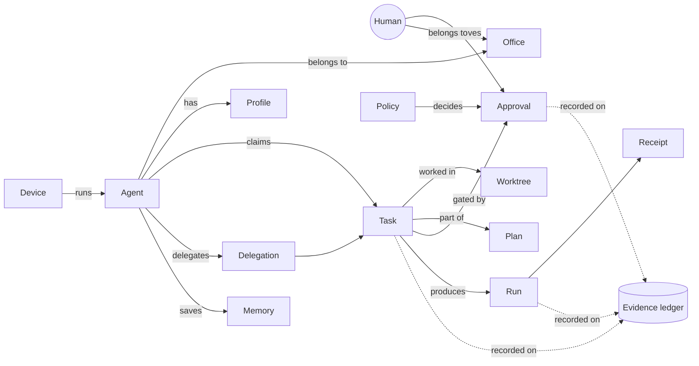
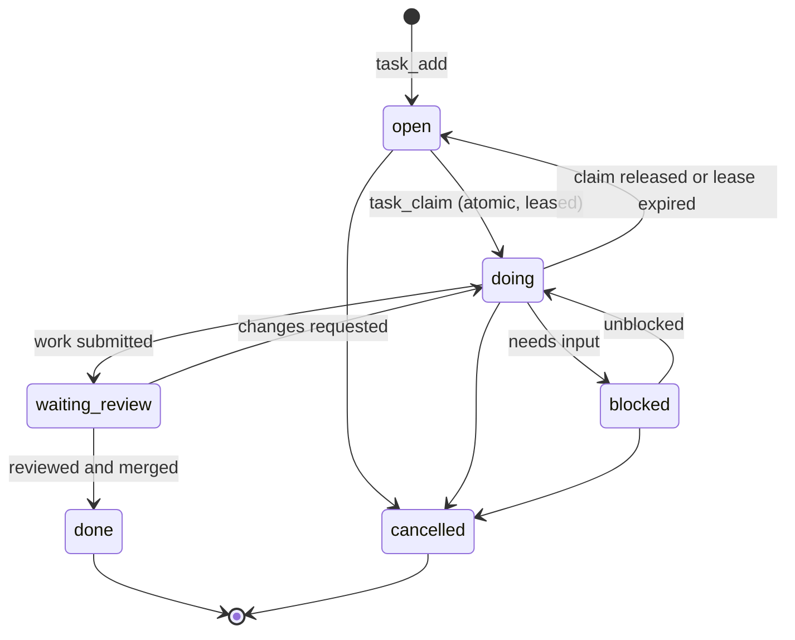

# Concepts

This page defines the ideas that the rest of the documentation builds on. Each
section says what the thing is, why it exists, and where to read more. For
one-line definitions, see the [Glossary](glossary.md).

## The hub and its adapters

The **hub** is one `unified-agent` process with one SQLite database. It is the
single authority for identity, policy, work, and evidence.

An **adapter** is a way into the hub:

| Adapter | Who uses it | Notes |
|---|---|---|
| **MCP** | Agent harnesses (Claude Code, Codex, Cursor, ...) | Over stdio for one isolated process, or streamable HTTP for a shared hub. |
| **HTTP/JSON** | Programs, the web app, mobile surfaces | Authenticated `/api/*` routes. The read-only platform routes live under `/api/platform/*`. |
| **CLI** | Operators and scripts | `unified-agent` and 31 `unified-agent-*` commands; the list is in [CLI reference](cli-reference.md). |
| **Control Center** | People | A React web app served by the hub at `/ui`. |
| **TUI** | Operators in a terminal | `unified-agent-tui`, a Textual dashboard over the local store or a remote hub. |
| **TypeScript SDK** | Application developers | `@unified-agent/client`, a typed remote over the MCP and HTTP adapters. |

Every adapter calls the same registered functions through the same policy
wrapper, so a rule applies no matter how a request arrives. [Ways to use unified-agent](interfaces.md)
tours each one.

**Transport.** A hub runs over **stdio** (one host spawns a private process)
or **HTTP** (one long-running process that many clients share). Only an HTTP
hub can authenticate callers, serve the Control Center, and give several
agents one governed, shared state. See [Deployment topologies](topologies.md).

## Identities: agents, people, and devices

An **agent identity** is a label such as `agent-claude` or `ci_reviewer`.
On an authenticated hub, each label maps to its own bearer token
(`UA_AGENT_TOKENS`) or OAuth grant. The hub attaches the verified identity to
every call. An agent cannot choose it by typing a name. `UA_AGENT_LABELS`
closes the roster: once it is set, an unknown label cannot send or receive
work. A common naming convention is `<Device>_<Harness>`: for example
`agent-laptop-agent2` or `agent-server-agent1`.

A **human identity** is a person who decides and approves, such as the
operator who signs in to the Control Center. The hub classifies each identity
as `human` or `agent`. Evidence reports keep this distinction strictly: an
agent's valid signature proves which *credential* acted, never that a *human*
authorized it. Organizations can verify people through an identity provider.
The WorkOS pilot adapter is the first one.

A **device** is a machine in the fleet. A device can sign in with
`unified-agent login`, an OAuth device-code flow approved from any browser.
It then runs `unified-agent node`, a worker that connects *out* to the hub,
reports its OS and the harnesses it has installed, heartbeats, and runs
dispatched work. The Control Center's Agents → Hosts page (`/ui/agents/hosts`)
shows each host with a
measured freshness label. See [Connecting agents and harnesses](harnesses.md).

## Offices

An **office** is a named group in the org chart
([`org.yaml`](../src/unified_agent/org.yaml)). The shipped file is the reference
fleet's org chart. Replace its offices and members with your own. It has a lead, members,
**decision rights** written in plain language, default lanes, and sometimes
owned epics. Offices let you ask "which tasks belong to platform
engineering?" and route work by role rather than by agent name. `system_doctor`
flags an active identity that belongs to no office.

## Profiles

A **profile** decides which tools a session can see and call. It is a
capability overlay on top of identity. It is not an identity itself. Profiles
apply to authenticated HTTP sessions:

| Profile | Shape | Typical holder |
|---|---|---|
| `developer` | Deny list. Coding tools stay; high-impact governance, merge, and notify tools go. Capped at 100 tools. | Engineering agents (the default). |
| `steward` | Broader deny list. No workspace writes or claims; may groom tasks it does not hold. | Reviewers and custodians. |
| `chief-of-staff` | The full surface. | A coordinating agent. |
| `operator` | Allow list. Approvals and read-only status only. | The Control Center login. |
| `research` | Allow list. No execution, no workspace writes, no claims. | Read-and-report agents. |
| `public` | The tightest allow list: status reads and proposals only. | A client reachable from the internet. |

Allow-list profiles stay safe as the platform grows: a newly added tool is
unreachable there until someone adds it on purpose. See
[Architecture](architecture.md#operational-profiles).

## The workspace sandbox

File and command tools resolve every path inside `UA_WORKSPACE`, or inside
the calling agent's active task worktree. Symlinks are resolved before the
containment check. Read-only file tools can also read known project
checkouts, but hook directories, dependency trees, and secret-bearing
filenames stay refused. Commands run with `shell=False` from an allowlist. See
[Security model](security.md#workspace-sandbox).

## Tasks, claims, and worktrees

A **task** is a durable unit of work with a title, notes, priority, project,
optional parent, and status.

A **claim** is atomic: two agents cannot both take the same task. A claim
carries a **lease** that the worker renews. When the lease lapses, the task
can be recovered. Paused or terminated agents, and agents over budget, cannot
claim.

A **worktree** is a separate git checkout on its own branch, created per task
when an agent starts code work. Agents that touch the same repository never
share a working directory.

**Lanes** say who acts on a task (for example `dispatch-ready` or a
human-only lane). **Projects** partition the queue into streams.
**Dependencies** order tasks. Subtasks nest to any depth, and a
`[project-spec]` root rolls up the status of its whole subtree.

## Plans, delegations, and handoffs

A **plan** is a stored list of steps with owners, dependencies, checkpoints,
and outputs. The hub does not run a plan. It stores the plan so that agents
can claim steps atomically and hand outputs to the next step.

A **delegation** is a request from one agent to another to do a piece of
work. It carries an audit trail and a ledger of outcomes. A **handoff** passes
a task specification to another agent with a deadline and priority.

A **goal**, or **mission**, is a higher-level outcome that tasks roll up to.
Each goal keeps a *why-chain* from its tasks up to the goal.

## Runs, executors, receipts, and routines

An **executor** is a daemon that turns an approved delegation or task into a
**run**. It claims the work, prepares a worktree, and calls a harness's own
headless CLI, such as `claude -p` or `codex exec`. It then renews the lease,
applies retry and back-off policy, and marks the result for review. The daemon
owns the lifecycle. The **backend** only runs the prompt.

A **receipt** is the hub's record that a run was dispatched and how it ended.
Receipts are idempotent. A receipt proves the request was recorded, not that
the outside effect happened.

A **routine** is recurring, tracked work with an intake policy, fired on a
schedule or over HTTP. A **workflow** is a reviewed YAML file of steps. Each
step calls a registered tool, so workflows pass through the same gates.

## Approvals, policy, and autonomy

The **approval gate** is a hub-side queue. A tool is gated by a policy
`require_approval` rule, by listing it in `UA_APPROVAL_TOOLS` (the registered-tool
wrapper gates a listed tool; a tool that gates itself applies its own per-action
rules), or by a built-in rule for
high-impact actions. A call to a gated tool does not run. It parks as *pending* until an authorized person approves or denies that
exact request. Approval creates a one-time pass that the retried call spends.

**Policy** is a YAML file of rules: `allow`, `deny`, or `require_approval`, by
tool, by role, or by a payload threshold. Rate limits and scope bindings (to
a company, agent, project, or task) sit on top. Deny always beats allow.

The **prod-action gate** covers `merge`, `deploy`, `delete`, and `restart`.
It requires a scope grant *and* a one-time approval.

**Separation of duties** means that, for releases, the identity that asked
can deny its own request but can never approve it.

**Autonomy modes** set, per mission, how much a human sees and must
acknowledge. They range from `observe` (see everything, pause nothing new) to
`action-review` (every side effect pauses). **Budgets** give a hard spending
stop per agent. **Agent lifecycle** controls pause, resume, or terminate an
agent outright.

All of these are covered together in
[Human in the loop and evidence](human-in-the-loop.md).

## Memory and the vault

**Memory** is a shared store of attributed notes with hybrid full-text and
semantic search. Notes carry tags, an author, salience, and optional expiry.
A guard stops one agent from silently overwriting another agent's note.

The **vault** is an Obsidian-style folder of Markdown notes. Agents can read
it anywhere and write it only in configured folders. Locked notes refuse
writes unless forced by an approved caller. Use the vault for writing meant
for people, and memory for facts meant for agents.

## Events and the evidence ledger

Every significant action appends an **event** to `event_log`. Each event
includes the hash of the one before it, so a change anywhere breaks the chain.
Approvals and completed delegations also write a **signed producer event**:
an HMAC over the verified identity and the approval or delegation it acted on.
It is keyed with that identity's `UA_AGENT_TOKENS` token. A WorkOS session
uses `WORKOS_COOKIE_PASSWORD` instead, a secret the operator configures on the
hub. When a token-keyed call comes over the tailnet, the event also records the
calling device. The hash chain, not the signature, protects that device record.

The chain head can be **anchored** outside the hub: in a trusted timestamp
authority, a separate git repository, or a locked vault note.

An **evidence report** reads this back as the five-link chain
**human → device → agent → action → proof**. The **provenance graph** serves
the same data as nodes and edges. See [Evidence report](evidence-report.md).

## Connectors

A **connector** links the hub to an outside system: GitHub, Slack, Discord,
Telegram, an evidence-export sink, or a mobile surface. Each connector ships a
**manifest** that declares its capabilities, required secrets, and entry
points. A conformance harness checks that the manifest matches the code.
Connectors are off by default. See [Connectors](connectors.md).

## The Control Center

The **Control Center** is the hub's web app for people. It covers the task
queue, Kanban, approvals, sessions, dispatch, flow metrics, evidence,
provenance, devices, executors, memory, cycles, costs, and org. It updates
live over server-sent events. Every button calls the same gated functions
that agents call. See [Web control center](web-ui.md).
