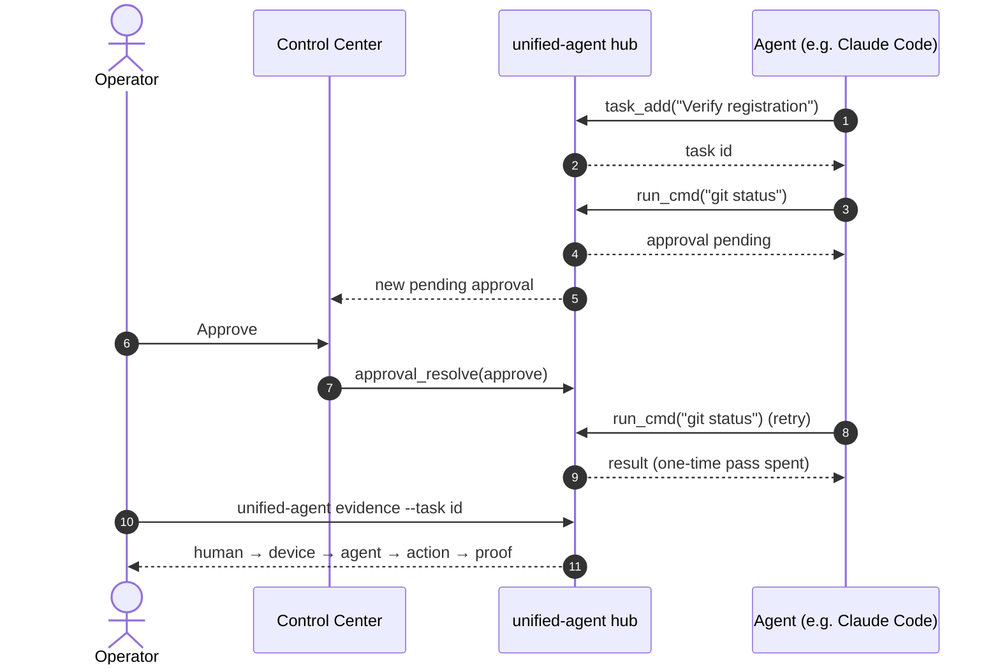

# Getting started

This tutorial takes you from a fresh clone to a governed hub with one connected
agent. You will gate an action behind your approval, approve it, and read back
the evidence. It takes about 15 minutes.

By the end you will have:

- a persistent hub with authentication and an approval gate,
- two identities: one for you, the operator, and one for an agent,
- an agent harness connected to the hub,
- one action that waited for your approval, and
- an evidence report that shows who approved it and what ran.



## Before you begin

You need:

- Linux or macOS,
- Python 3.11 or later (declared floor) and [`uv`](https://docs.astral.sh/uv/).
  Development, CI, and the hub image pin Python 3.14 (`.python-version`,
  `python:3.14-slim`),
- Node.js 22.22.2 or newer, to build the Control Center from source (not
  needed for a prepared wheel or sdist; CI's JavaScript job uses Node 26),
- git, and
- one MCP-capable harness, such as Claude Code, Codex, or Cursor.

The steps use a systemd user service to keep the hub running. On macOS, use
the launchd agents under `deploy/mac-hub/`, or
run the hub in a terminal. To use Docker instead, follow
[Installation: Docker](installation.md#docker) and continue at step 4.

## Step 1: Install

```bash
git clone https://github.com/anonb3ll/unified-agent
cd unified_agent
```

Build the Control Center first. It is a separate web app, and
`uv tool install .` packages it only when it is already built. Without this
step the install still succeeds, with a build warning, but `/ui` answers `503`
with a build hint until you build it and install again. You need Node.js
22.22.2 or newer (`packages/web` `engines`; CI uses Node 26),
and the packages build in dependency order:

```bash
(cd packages/protocol && npm ci && npm run build)
(cd packages/client && npm install && npm run build)
(cd packages/web && npm ci && npm run build)
```

Then install:

```bash
uv tool install .
```

`uv tool install` puts `unified-agent` and the `unified-agent-*` commands on
your `PATH`, and the installed package carries the Control Center build and the
capability catalog, so the hub serves `/ui` without `UA_WEB_DIST_DIR` or the
checkout. After you pull new source later, rebuild the web app and run
`uv tool install .` again: the service runs the installed package, not the
checkout. A prepared wheel or sdist installs without Node. The Docker image
does all of this for you.

## Step 2: Initialize the hub's home

```bash
unified-agent init --interactive          # or: --operator-name "Alex Example"
chmod 600 ~/.unified_agent/service.env
```

`init` creates `~/.unified_agent/` with an empty database (`memory.db`), a
private workspace (the sandbox root for file and command tools), and two
files:

- `settings.toml` personalizes the install: your name as the human operator,
  the label your own login resolves to (default `Desktop_<YourName>`), the
  workspace and an optional vault. It holds no secrets. Inspect or change it
  with `unified-agent settings show` and `unified-agent settings set`
  ([Settings](settings.md)).
- `service.env` holds secrets: one generated bearer token for this host's
  first agent, and one for **you**. Your token resolves to your operator
  label, which gets the `operator` profile and may approve gated actions.

It is safe to run again: it never rotates an existing token unless you pass
`--force`.

## Step 3: Define who is who

For this fresh two-identity hub, create a matching organization chart:

```bash
cat > ~/.unified_agent/org.yaml <<'YAML'
schema_version: 1
offices:
  - id: home
    name: Home
    lead: $operator          # your login label from settings.toml
    members: [$operator, my_claude]
    owned_epics: []
    default_lanes: [default]
    decision_rights: [Operate this hub and review agent work]
YAML
```

An existing fleet should keep its own chart and roster. Every agent in the
chart must be in `UA_AGENT_LABELS`, and every active identity must have an
office. The human operator (`$operator`) is the exception: keep it out of the
roster, because a label in `UA_AGENT_LABELS` names a worker and is refused as
the operator. The doctor's org check counts the operator as a member without
it.

`init` already generated a token for you and one for an agent. To add more
agents, generate one token each:

```bash
python3 -c 'import secrets; print(secrets.token_urlsafe(32))'
```

Edit `~/.unified_agent/service.env` (the example assumes your operator label
is `Desktop_Operator`; `unified-agent settings get operator.label` prints yours).
`init` leaves `UA_ENFORCE_AUTH` unset. With `UA_TRANSPORT=http` that already
rejects anonymous callers; the explicit `1` below is the same posture, written
out so the file shows it:

```dotenv
# Serve HTTP on loopback only.
UA_TRANSPORT=http
UA_HTTP_HOST=127.0.0.1
UA_HTTP_PORT=8765

# Every caller must present a valid token.
UA_ENFORCE_AUTH=1

# The agent roster (colon-separated) and one token per identity
# (comma-separated). Desktop_Operator is you, the human operator (settings.toml
# [operator] label): it has a token but stays out of UA_AGENT_LABELS, which
# lists workers only.
UA_ORG_REGISTRY_PATH=~/.unified_agent/org.yaml
UA_AGENT_LABELS=my_claude
UA_AGENT_TOKENS=Desktop_Operator:<your-token>,my_claude:<agent-token>

# Tools that pause for a human decision.
UA_APPROVAL_TOOLS=run_cmd:fs_write:git_merge_task:task_delete
```

The installed package already serves the Control Center, so `service.env`
needs no `UA_WEB_DIST_DIR`. Set it only to serve a custom or development build
(an absolute path to a `dist` directory). It takes precedence over the packaged
UI, so a stale path keeps serving an older build after you upgrade.

- The **label** in `UA_AGENT_TOKENS` is the identity the audit trail records.
  The agent cannot change it.

> **Which identity counts as human.** Only a *human* identity may approve a
> request. The hub treats exactly one login as human: the operator label in
> `settings.toml` (`[operator] label`, or `UA_OPERATOR_LABEL`), plus the
> names in `[operator] name` / `aliases` that the same person signs with.
> Every other well-formed label is an agent. A label that names a catalogued
> agent (for example `agent-codex`) is refused as the operator label. The
> rest of this tutorial calls your identity "operator".

- `UA_APPROVAL_TOOLS` is enforced by the hub. A client cannot opt out of it.
  It applies to tools whose code consults it, such as `run_cmd` and
  `fs_write`. `git_merge_task` and `task_delete` are prod actions, which need
  approval anyway. To gate any other tool, use a policy `require_approval`
  rule ([Human in the loop](human-in-the-loop.md#the-approval-gate)).
- Never commit `service.env`, paste tokens into notes, or bind the hub to
  `0.0.0.0`.

## Step 4: Start the hub

```bash
mkdir -p ~/.config/systemd/user
cp deploy/unified-agent.service ~/.config/systemd/user/
systemctl --user daemon-reload
systemctl --user enable --now unified-agent
loginctl enable-linger "$USER"     # keep it running after you log out
unified-agent doctor
```

`doctor` should report no `MISCONFIGURED` or `DEGRADED` rows. `DORMANT` rows are optional
features you have not turned on yet, such as the vault, backups, or
notifications. That is normal.

Install the daily database backup timer now, before the hub holds anything
you care about:

```bash
cp deploy/systemd/ua-database-backup.{service,timer} ~/.config/systemd/user/
# The shipped unit runs a development checkout's .venv. Point it at the
# environment `uv tool install` created instead:
sed -i "s|^WorkingDirectory=.*|WorkingDirectory=%h|; s|^ExecStart=.*|ExecStart=$(uv tool dir)/unified-agent/bin/python -m unified_agent.backup_runner|" \
  ~/.config/systemd/user/ua-database-backup.service
systemctl --user daemon-reload
systemctl --user enable --now ua-database-backup.timer
systemctl --user start ua-database-backup.service    # run once now to check it
```

## Step 5: Open the Control Center

Browse to <http://127.0.0.1:8765/ui> and sign in with **your** operator
token. The page trades it once for an HttpOnly session cookie that you can
revoke. The cookie never works on `/mcp`, so a browser session cannot call
agent tools. Keep this tab open on the **Inbox** (`/ui/inbox`).

## Step 6: Connect an agent

Register the hub with your harness, using the **agent's** token. Keep the token
off the command line, where it would land in shell history and the process
list. For Claude Code, add this entry under the top-level `mcpServers` key of
`~/.claude.json` with an editor, replace the placeholder, and keep the file
private (`chmod 600 ~/.claude.json`):

```json
{ "mcpServers": { "unified-agent": {
  "type": "http",
  "url": "http://127.0.0.1:8765/mcp",
  "headers": { "Authorization": "Bearer <agent-token>" } } } }
```

For Codex, add this to `~/.codex/config.toml` and export the token in the
environment Codex starts from:

```toml
[mcp_servers.unified-agent]
url = "http://127.0.0.1:8765/mcp"
bearer_token_env_var = "UA_AGENT_BEARER_TOKEN"
```

Other harnesses are covered in
[Connecting agents and harnesses](harnesses.md). Start a **new** harness
session afterwards: harnesses load the tool list once, at startup.

> **Do not shadow the hub.** Do not also add a project-scoped `unified-agent`
> stdio entry (for example in a repository's `.mcp.json`). Project scope
> outranks user scope. The stdio process would answer tool calls with no
> token, outside the approval queue, and the harness would still show the
> server as connected.

## Step 7: Ground the agent

Ask the agent:

```text
Call profile_status and tell me which identity and profile you have.
Then call system_doctor and summarize anything that is not LIVE or DORMANT.
```

It should report the identity `my_claude` and the `developer` profile. If it
reports no identity, the harness is not sending the token. Check step 6.

## Step 8: Create a task and trigger an approval

```text
Create a low-priority task titled "Verify unified-agent registration".
Return its id. Then use run_cmd to run "git --version" in the workspace.
```

The task is created immediately. The `run_cmd` call is not run: it returns
*approval pending*, and a matching item appears in the Control Center's
Inbox (`/ui/inbox?kind=approval`). Its detail shows the exact tool and arguments.

## Step 9: Decide

Click **Approve** in the Control Center. Approval creates a one-time pass for
that exact request. Ask the agent to retry the same `run_cmd` call. It spends
the pass and returns the output. A second identical call would park again.

Had you clicked **Deny**, the command would never have run.

## Step 10: Read the evidence

Every decision you just made is on the hash-chained event log. Ask the agent:

```text
Call event_log_query with channels ["agent.approval.*", "agent.evidence.*",
"agent.gateway.decision"] and summarize the events for the run_cmd request.
```

You should see a gateway decision that parked the call, an
`agent.approval.consumed` event when the retry spent your pass, and an
`agent.evidence.producer_authenticated` event. That last one carries an HMAC
signature, keyed with your identity's token, that binds your verified identity
to the approval. When you approve over the tailnet, from the Control Center or
an MCP client, it also records your device. The hash chain protects that device
record, not the signature. Then check that nothing on the log was altered:

```bash
unified-agent audit verify
```

On the hub host, the evidence report reads its local ledger task by task.
Setting `UA_HTTP_HUB_URL` does not turn this CLI command into a remote read:

```bash
unified-agent evidence --task <id> --markdown
```

It traces **human → device → agent → action → proof** for that task, and
reports whether the event hash chain verifies (`chain_integrity`) and whether
completions are attributed (`attribution_coverage`). An approval appears in a
task's report when the gated call names that task, for example a
`git_merge_task` for it. The standalone `run_cmd` above names no task, so its
approval lives on the event log, not in the task's report. For an open task
with no completion yet, most links are empty. That is the report being
accurate, not failing. [Evidence report](evidence-report.md) explains every
field.

## What you built

You have a hub that knows who is calling, holds chosen actions for a human
decision, and records the outcome on a tamper-evident ledger. Every other
feature builds on these three properties.

## If something goes wrong

| Result | Meaning | What to do |
|---|---|---|
| `forbidden` or `401` | The token is missing, wrong, or the profile denies the tool. | Call `profile_status`. Check the header and the token in `service.env`. |
| `unavailable` | The hub or a dependency is down. | Run `unified-agent doctor` and `systemctl --user status unified-agent`. |
| Tools missing in the harness | The session loaded tools before you registered or restarted. | Start a new harness session. |
| `unknown` outcome | The hub recorded the request but cannot confirm the side effect. | Inspect the task's events and evidence before retrying. |

More fixes are in [Troubleshooting](troubleshooting.md).

## Next steps

- [Human in the loop and evidence](human-in-the-loop.md): policy rules,
  autonomy modes, separation of duties, signing, and anchoring.
- [Deployment topologies](topologies.md): add a laptop, a server, or a
  teammate.
- [Connecting agents and harnesses](harnesses.md): executors that let agents
  pick up work on their own.
- [Security model](security.md): read this before you enable remote access,
  vault writes, or broader command execution.
