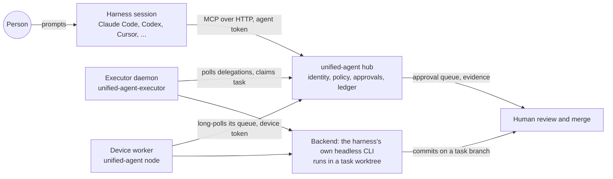

# Connecting agents and harnesses

This page shows how to put Claude Code, Codex, Cursor, GitHub Copilot,
Antigravity, Hermes, Devin, OpenCode, LangGraph graphs, and ACP agents to work
through one hub, in two modes:

- **Interactive.** A person runs a harness in a terminal or editor, and the
  harness calls hub tools over MCP.
- **Unattended.** An executor daemon or a device worker claims work from the
  hub and runs the harness's own headless command in a task worktree.

A **harness** is the program an agent runs inside. An **executor** is a daemon
that polls the hub for work addressed to one agent label. A **device worker**
(`unified-agent node`, or *ua-node*) connects out to the hub and runs dispatched
work on its machine. See [Concepts](concepts.md) for the rest of the vocabulary.



Both paths reach the same hub, so the same identity check, profile, policy,
approval gate, and evidence ledger apply to each. The unattended path adds a
lifecycle (claim, worktree, lease, retry, review hold) that the daemon owns. See
[Human in the loop and evidence](human-in-the-loop.md).

## How a harness connects

| Method | Identity comes from | Use it for |
|---|---|---|
| **HTTP hub** (recommended) | A per-agent bearer token | Every harness that shares one hub |
| **stdio** | Nothing: there is no authentication | An isolated satellite project, or a machine with no hub |
| **OAuth 2.1** | An approved OAuth grant | Remote MCP clients that cannot hold a static token |
| **Device login** | An approved device-code grant | `unified-agent node` and the executor on another machine |

**HTTP hub.** The hub serves streamable HTTP MCP at `http://127.0.0.1:8765/mcp`
by default. Register it **once, user-scoped**, in each harness, with that
agent's own token. For a hub on another machine, use its full `/mcp` URL and add
the hostname clients dial to `UA_HTTP_ALLOWED_HOSTS` on the hub, or it answers
`421`. See [Hub mode](installation.md#hub-mode-shared--remote) and
[Deployment topologies](topologies.md#3-multi-device-fleet).

**stdio.** The harness starts a private `unified-agent` process with its own
database, workspace, and no authentication. Use it only for satellite projects
that need their own `UA_WORKSPACE`, or on a machine that runs no hub. See
[Satellite projects](installation.md#satellite-projects-project-scoped-mcpjson).

> **Do not shadow the hub.** A project-scoped `unified-agent` entry, for example
> in a repository's `.mcp.json`, outranks the user-scoped hub entry. The
> harness then talks to a stdio process that has no token, sits outside the
> approval queue, and is invisible to the Control Center, while `claude mcp list`
> still shows the server connected. To check a repository, run `claude mcp list`
> inside it and look for a `[Conflicting scopes]` block naming `unified-agent`.
> See [Which transport to register](installation.md#which-transport-to-register).

**OAuth for remote MCP clients.** Off by default. Some clients, such as a hosted
bot, speak only OAuth 2.1 with dynamic client registration and PKCE. Set
`UA_MCP_OAUTH=1`, a public HTTPS `UA_MCP_OAUTH_ISSUER`, and an approver, and the
hub serves the authorization server in [`oauth.py`](../src/unified_agent/oauth.py).
A verified human approves each grant: a WorkOS session, or a tailnet login plus a
passkey. A shared passphrase approves only with
`UA_MCP_OAUTH_PASSPHRASE_FALLBACK=1`, and the ledger then records the approval as
not human-verified. The token authenticates as the approved agent label. See
[Who may approve a sign-in](agent-access.md#who-may-approve-a-sign-in-verified-human-consent)
and the worked example in [Grok Bot connector](grok-bot-connector.md). Do not
confuse this with [Hub-brokered connector OAuth](connector-oauth.md), where the
hub is the OAuth client to GitHub or Google.

**Device login** is covered under [Device workers](#device-workers). Only the
executor and `unified-agent node` read the saved sign-in. IDE MCP hosts do not:
they still use their own bearer or OAuth configuration.

**Restart after registering.** A harness reads the tool list once, when a session
starts, so start a new session after you register. After you merge changes to the
hub's tools, restart the hub and reconnect every session, because a hub restart
does not refresh a live session's snapshot. `mcp_health_telemetry` helps you
detect a stale session (see [Seeing it work](#seeing-it-work)).

## Register each harness

Every entry needs a token for that agent. Create one as in
[Getting started, step 3](getting-started.md#step-3-define-who-is-who), and keep
it out of repositories and shell history.

| Harness | Registration | Token delivery |
|---|---|---|
| Claude Code | User-scope `mcpServers` in `~/.claude.json` | A static header, written with an editor |
| Codex | `[mcp_servers.unified-agent]` in `~/.codex/config.toml` | `bearer_token_env_var` names an environment variable |
| Antigravity | `~/.gemini/config/mcp_config.json`, key `serverUrl` | Not documented in this repository |
| Cursor | `~/.cursor/mcp.json` | `${env:...}` in a header, set by `cursor-with-hub` |
| Copilot, VS Code | The MCP config of VS Code or Copilot | `UA_AGENT_BEARER_TOKEN`, set by `code-with-hub` or `copilot-with-hub` |
| Devin | `~/.config/devin/mcp_config.json` | A static header, plus `devin-with-hub` for the CLI |
| OpenCode | OpenCode's own config | `UA_AGENT_BEARER_TOKEN`, set by `opencode-with-hub` |
| Hermes | `mcp_servers:` in `~/.hermes/config.yaml` | Not documented in this repository |

`ua mcp-entry --harness <name>` prints these entries for your hub URL without
changing anything. See [one hub entry](cli-expansion.md#one-hub-entry-for-a-harness-task-1336).

**Claude Code.** Do not pass the token to `claude mcp add --header`: a
command-line argument lands in shell history and is visible in the process list.
Open `~/.claude.json` in an editor, add this entry under the top-level
`mcpServers` key (the user scope), replace the placeholder with this agent's
token, and keep the file private (`chmod 600 ~/.claude.json`). Then check it
with `claude mcp list`:

```json
{ "mcpServers": { "unified-agent": {
  "type": "http",
  "url": "http://127.0.0.1:8765/mcp",
  "headers": { "Authorization": "Bearer <this-agent-token>" } } } }
```

**Codex.** Add this to `~/.codex/config.toml` and export the token in the
environment Codex starts from (the reference
`bootstrap-server-dev.sh` loads it
from `~/.codex/unified-agent-token`):

```toml
[mcp_servers.unified-agent]
url = "http://127.0.0.1:8765/mcp"
bearer_token_env_var = "UA_AGENT_BEARER_TOKEN"
```

**Antigravity.** The HTTP key is `serverUrl`. `url` and `httpUrl` are silently
ignored. This repository does not document how Antigravity sends a bearer header,
so on an authenticated hub confirm the identity with `profile_status`.

```json
{ "mcpServers": { "unified-agent": { "serverUrl": "http://127.0.0.1:8765/mcp" } } }
```

**Cursor.** Cursor interpolates environment variables in MCP headers. The
reference bootstrap writes this `~/.cursor/mcp.json` entry, and `cursor-with-hub`
sets the variable:

```json
{ "mcpServers": { "unified-agent": {
  "url": "http://127.0.0.1:8765/mcp",
  "headers": { "Authorization": "Bearer ${env:UA_CURSOR_HUB_TOKEN}" } } } }
```

**Hermes.** The reference deploy scripts rewrite the `url:` under
`mcp_servers: unified-agent:` in `~/.hermes/config.yaml`. This repository does not
document how Hermes carries the token. Hermes silently drops its MCP tools if its
virtualenv lacks the `mcp` extra. Rebuild with
[`hermes-venv-rebuild.sh`](../scripts/hermes-venv-rebuild.sh). See
[Hermes MCP tools silently missing](troubleshooting.md#hermes-mcp-tools-silently-missing)
and the client's
[three-failure cooldown](troubleshooting.md#hermes-reports-unified-agent-unreachable-after-three-tool-errors).

### Wrappers for Cursor, Copilot, Devin, and OpenCode

Several harnesses read their bearer from the process environment. If that
variable was inherited from another agent's shell, the child acts as that agent.
The `*-with-hub` wrappers in [`scripts/`](../scripts/) prevent this. Each reads
**this agent's** token file at launch, exports it into the child's environment,
and `exec`s the real program. The wrappers hold no secrets and never print a
token.

```bash
scripts/install-with-hub-wrappers.sh --list      # print the wrapper names
scripts/install-with-hub-wrappers.sh --dry-run   # preview
scripts/install-with-hub-wrappers.sh             # install to ~/.local/bin
```

The installer also accepts `--dest DIR` and `--only NAME`. It is idempotent,
copies files only, and never mints or reads tokens.

| Wrapper | Starts | Token file (override variable) |
|---|---|---|
| `cursor-with-hub`, `agent-with-hub` | Cursor editor, Cursor Agent CLI | `~/.cursor/unified-agent-token` (`UA_CURSOR_TOKEN_FILE`) |
| `code-with-hub`, `copilot-with-hub`, `github-copilot-desktop-with-hub` | VS Code, Copilot CLI, Copilot desktop app | `~/.copilot/unified-agent-token` (`UA_COPILOT_TOKEN_FILE`) |
| `devin-with-hub` | Devin CLI | `~/.devin/unified-agent-token` (`UA_DEVIN_TOKEN_FILE`) |
| `opencode-with-hub` | OpenCode | `~/.opencode/unified-agent-token` (`UA_OC_TOKEN_FILE`) |

The executor's default binaries for Cursor, Copilot, and Devin are these wrappers,
so install them on every host that runs those backends, or a run fails with
`binary not found`. Several wrappers also pass a token for `gbrain`, a second MCP
server, when its token file exists, and `opencode-with-hub` refuses to start
without it. [`sync-agent-tokens.sh`](../scripts/sync-agent-tokens.sh) writes the
token files (mode `0600`) from `UA_AGENT_TOKENS` in `service.env`. It maps a fixed
set of labels to paths and skips tokens that do not start with `ua_`, so edit its
label map for your roster.

## One identity per agent

Give every agent its own label and token. On the hub, in
`~/.unified_agent/service.env`:

```dotenv
UA_ENFORCE_AUTH=1
UA_AGENT_LABELS=agent-laptop-agent1:agent-laptop-agent2:agent-server-agent1
UA_AGENT_TOKENS=agent-laptop-agent1:<token-1>,agent-laptop-agent2:<token-2>,agent-server-agent1:<token-3>
```

- `UA_AGENT_TOKENS` is a comma-separated list of `label:token` pairs, or a path to
  a file that holds them. A token listed under two labels authenticates no one.
- `UA_AGENT_LABELS` is a colon-separated roster. When set, `delegate` and
  `message_send` reject an unknown label.
- **Name agents `<Device>_<Harness>`**, such as `agent-laptop-agent2` or `agent-server-agent1`.
  The executor picks a backend from the harness part of its label (see
  [Executors](#unattended-work-executors)).

To confirm a registration, ask the agent to call `profile_status`. It returns the
`identity`, the active `profile`, and the `auth_method`. An empty `identity` means
the harness is not sending the token. See [Configuration](configuration.md) and
[Security model](security.md#hub-token-authentication).

## Give agents shared context

**A managed block in `CLAUDE.md` and `AGENTS.md`.**
[`unified-agent-sync`](cli-reference.md#unified-agent-sync) detects the agent's
role and writes a block between `<!-- ua-sync:begin ... -->` and
`<!-- ua-sync:end -->` markers. Text outside the markers is preserved, and a
re-run replaces the block in place. The block holds topology and protocol, and
tells the agent to call `task_list` and `memory_search` live instead of trusting
a frozen list. Frozen snapshots are opt-in with `--include-snapshots`.

```bash
unified-agent-sync --dry-run                                  # preview
unified-agent-sync --path ~/dev/my-project --client claude
```

**Startup grounding.** At the start of a session, an agent should confirm its
identity with `profile_status`, read shared broadcasts with `memory_search` (tag
`broadcast`), and read the queue with `task_list` for `doing`, `open`, and
`waiting_review`. Put this in the synced block or in your own rules file.

**Hub-served harness configuration.** One versioned bundle on the hub holds rules
text, skills, and MCP server lists
([`harness_config.py`](../src/unified_agent/harness_config.py)). A person
publishes it from the Control Center. Then `unified-agent node` pulls it every
`UA_HARNESS_CONFIG_SYNC_S` seconds (default 120), renders one file per harness
surface (`CLAUDE.md`, `AGENTS.md`, `.cursorrules`, `codex/config.toml`,
`opencode/opencode.json`) under `UA_HARNESS_CONFIG_ROOT`, and reports drift. It
writes a surface only after a person approves that exact proposal. Publish
refuses any MCP entry that uses bearer or token authentication, so per-agent
tokens stay in token files and environment variables. See
[Hub-served harness config](web-ui.md#hosts-devices-acceptance-and-harness-config).

## Unattended work: executors

The **Active Executor** is `unified-agent-executor`
([`daemon.py`](../src/unified_agent/executor/daemon.py)). One daemon serves one
agent label, and the split of duties is fixed:

- **The daemon owns the lifecycle.** It finds pending delegations addressed to its
  label, claims the delegation and the task, prepares a git worktree, renews the
  task lease, applies retry and backoff, and records `[waiting-for: review]` on
  success.
- **A backend only runs the prompt** in the directory the daemon prepared
  ([`backends.py`](../src/unified_agent/executor/backends.py)).

Work reaches an executor through `delegate`, which creates a task addressed to the
executor's label. The daemon never marks a task `done`. It leaves the branch for
the review pipeline, which validates and holds it for a person. See
[Development-pipeline automation](automation.md).

Safety properties, all enforced in the daemon:

- **The kill and budget gate fails closed.** Before a task runs, the daemon reads
  the task's autonomous cycle. A `killed` or `blocked` cycle fails the delegation,
  and if the gate cannot be read at all, the daemon does not run.
- **The commit is host-side.** After a successful run, the daemon commits the
  worktree itself, and only on a `task/...` branch inside that worktree.
- **No credential, no start.** The token comes from `UA_EXECUTOR_TOKEN`, then
  `UA_AGENT_BEARER_TOKEN`, then a matching saved device sign-in, then a matching
  `UA_AGENT_TOKENS` entry. With none, the daemon refuses to start.
- **Bounded retries.** Defaults are 5 attempts, a 10 s backoff base that doubles,
  and a circuit breaker after 3 consecutive failures. Untrusted tasks are refused
  unless `UA_EXECUTOR_ALLOW_UNTRUSTED=1`.

### Backends

With `UA_EXECUTOR_BACKEND` unset, the daemon runs the agent's **own** headless
command, chosen from the harness part of its label. Set the variable to override.

| Backend | `UA_EXECUTOR_BACKEND` | Runs | Chosen by label ending |
|---|---|---|---|
| Claude Code | `claude` | `claude -p --output-format stream-json --verbose` | `_Claude` |
| OpenAI Codex CLI | `codex` | `codex exec --json` | `_Codex` |
| Antigravity CLI | `agy` | `agy -p --output-format stream-json` | `_agy` |
| Antigravity, interactive (opt-in) | `agy-interactive` | PTY-driven `agy` | Never automatic |
| Cursor Agent CLI | `cursor` | `agent-with-hub -p --output-format stream-json --trust` | `_Cursor` |
| GitHub Copilot CLI | `copilot` | `copilot-with-hub --output-format json --allow-all-tools -p` | `_Copilot` |
| Hermes Agent | `hermes` | `hermes --oneshot` | `_Hermes` |
| Devin CLI | `devin` | `devin-with-hub --permission-mode accept-edits -p` | Exactly `agent-devin` |
| Pi headless RPC (explicit alias) | `pi` | `pi_run_task` | Labels `pi`, `pi_worker` |

A `server_` label also accepts a lowercase harness part, such as `agent-server-agent2`.
OpenCode has no executor backend and runs only through a device worker (see
[ACP agents](#other-execution-planes)). Antigravity's print mode can drop work
that a prompt backgrounds, so prefer `agy-interactive` for tasks that run long
commands. Each backend uses that CLI's own subscription login, and the executor
injects no API key. If a trust preset requires containment for an identity,
native backends refuse to launch it. Details and the upgrade canary are in
[Active Executor backends](automation.md#active-executor-backends-native-headless-persona).

### Run one

The daemon has no command-line flags. Configure it with environment variables:

```dotenv
# ~/.config/unified-agent/executor.env  (chmod 600)
UA_EXECUTOR_AGENT=agent-laptop-agent2
UA_EXECUTOR_BACKEND=codex
UA_HTTP_HUB_URL=http://127.0.0.1:8765/mcp
UA_EXECUTOR_TOKEN=<token for agent-laptop-agent2>
```

`UA_HTTP_HUB_URL` is required for `Desktop_*` and `Laptop_*` labels, while a
`server_*` process on the hub host may use the local bind. Copy a unit template,
edit its label, `ExecStart`, and `EnvironmentFile`, and start it:

```bash
cp deploy/unified-agent-executor-codex.service ~/.config/systemd/user/
systemctl --user daemon-reload && systemctl --user enable --now unified-agent-executor-codex
```

The first log line names the pair, for example
`executor starting: agent=agent-laptop-agent2 backend=codex shadow=False`.
`UA_EXECUTOR_SHADOW_MODE=1` runs with no side effects. The templates are
[`unified-agent-executor.service`](../deploy/unified-agent-executor.service)
(Antigravity) and
[`unified-agent-executor-codex.service`](../deploy/unified-agent-executor-codex.service),
both written for the reference fleet. On macOS, use the LaunchAgents under
`deploy/mac-hub/`. Two executors coexist, because
each polls only its own label.

## Device workers

A device worker lets the hub run work on a machine it cannot reach directly.

**1. Sign in.** `unified-agent login` starts the device grant against the hub's
OAuth server, which must be on (`UA_MCP_OAUTH=1` and a reachable issuer).

```bash
unified-agent login --hub https://hub.example.ts.net:8765 --agent agent-laptop-agent2
```

It prints a link and a short code. Open the link in any browser, including a
phone, check the code, confirm the agent label, and approve as a verified human.
The device receives an access token and a rotating refresh token, saved to
`~/.unified_agent/oauth-token.json` with mode `0600`. No bearer is copied between
machines. `--out PATH` saves elsewhere. Plain HTTP is refused unless the host is
loopback or on the tailnet, and `--allow-insecure` overrides that for a lab
network. See [Device sign-in](agent-access.md#device-sign-in-oauth-device-flow).

**2. Run the node.**

```bash
unified-agent node --hub https://hub.example.ts.net:8765
```

Other flags are `--name`, `--token-file`, `--heartbeat-s` (default 30),
`--claim-wait-s` (default 25), `--once` (register, claim at most one item, and
exit), and `--allow-insecure`. The node connects out and opens no listening port. In order, it:

1. **Registers** the OS, the harness binaries found on `PATH` with their versions,
   the backends it will run, its worktree roots, and the commit its code was
   imported from (`code_sha`, task #1946; null for a non-git install).
2. **Heartbeats** from a background thread, which also renews the running item's
   lease, and **long-polls** its own queue. The heartbeat repeats `code_sha` to
   a hub that advertises `node_code_sha`, and `system_doctor`'s
   `fleet_node_versions` row compares it with the hub's own commit.
   The `fleet_nodes` row checks each declared host (`UA_FLEET_NODES`) for a
   heartbeat inside the liveness window (task #1393).
3. **Runs** each claimed item through the item's backend, as the node's bound
   agent, inside a worktree root.
4. **Posts one receipt** per item. The receipt is spooled to disk first and is
   idempotent on the hub, so a resend records nothing new.

Environment settings: `UA_NODE_BACKENDS` (default `codex,agy`, kept only when the
binary exists, and `pi` is opt-in), `UA_NODE_WORKTREE_ROOTS` (default `~/dev`),
`UA_NODE_NAME` (default the host key), and `UA_HUB_URL` (default the hub of the
saved sign-in). Supervised argv commands (task #2413) are off until you list
`command` in `UA_NODE_BACKENDS` **and** each permitted program, exactly as
written, in `UA_NODE_COMMANDS`; an empty command list drops the backend so the
node never advertises it. Env contract and log cap:
[configuration.md](configuration.md).

### Supervised long commands (task #2413)

Use this when a test or build must keep running after the session that started
it dies. It is not a shell: `argv` is a list of strings (at most 64, each under
4096 characters). The hub keeps the existing `node_dispatch` approval gate, with
the argv in the approved payload.

```text
coordination_manage("node_command_start", {
  "node": "laptop",
  "argv": ["pytest", "tests/test_node_command.py", "-q"],
  "cwd": "/home/you/dev/unified_agent",
})
```

- **Start** needs a verified identity. `cwd` is required. Optional `timeout_s`,
  `task_id`, and `session_id` (one of the caller's own sessions) pass through to
  the node item. The node refuses `command_not_allowlisted:<argv[0]>` unless
  `argv[0]` matches `UA_NODE_COMMANDS` exactly (no basename match: `/usr/bin/pytest`
  is not `pytest`).
- **While it runs**, `node_command_status(item_id)` is visible to the owner, the
  starter, or a human identity. An unverified caller reads nothing (404). The
  fence token never appears in that result. `log_capture` reports pending,
  complete, error, or unknown; output past
  `UA_NODE_COMMAND_LOG_MAX_BYTES` (default 50 MiB) is drained, not rewritten
  into a posted receipt.
- **Adopt** (`node_command_adopt`) rebinds the owner session of an unfinished
  command to another session of the owner label, or a lifecycle operator may
  adopt it. It never changes the claim attempt or the fence.
- **When it ends**, the owner label gets exactly one `hub-node` message with the
  exit code, duration, and log path (never the output). Queue hygiene redelivers
  a notice whose send failed. A completion from a writer that no longer holds
  the claim's fence is refused (`409 stale_fence`). `system_doctor` row
  `command_items_unsettled` turns DEGRADED for a command 15 minutes past its
  lease or a notice unsent for 15 minutes.

Signatures: [tools-reference.md](tools-reference.md#coordination_manage).
Pitfalls: [troubleshooting.md](troubleshooting.md#supervised-node-command-never-starts).

Queue work from the Control Center's Start a session page (`/ui/sessions/new`)
or `POST /api/node/dispatch`.
Either way, the request parks an approval until a person approves that exact
payload. Service templates are
[`ua-node.service`](../deploy/systemd/ua-node.service) and
`com.unified-agent.node.plist`.
Every flag, route, and failure mode is in the
[`unified-agent node` reference](cli-reference.md#unified-agent-node).

### Waking an idle session

A session sitting at its prompt runs no hook, so hub mail for it waits until
someone types. Request/grant infrastructure exists, but automatic wakes currently
remain unavailable: inspected Herdr 0.9.3/0.9.4 cannot atomically protect retained
drafts. Inbox hooks remain active; a grant does not bypass this transport limit
(tasks #1873, #2050, #2082; upstream acceptance open under #2083; design:
[wake idle session](designs/2026-10-wake-idle-session.md)).

1. **Request at launch.** With `UA_WAKE=1` in the session's environment, the
   `hub-inbox` hook registers the session with `wake: true` on
   `POST /api/inbox/session` (a JSON boolean; anything else is a 400). Each
   registration restates it, so a registration without it withdraws the
   request and wakes stop. No MCP tool can set it. The hook uses the harness's
   own bearer, which the agent also holds, so a request alone never wakes
   anything; the answer's `wake_granted` says whether a grant stands.
2. **The operator grants the session.** On the session's page in the Control
   Center (`/ui/sessions/<id>`) a requesting session shows a "Wake requested" badge, and the operator (only
   the operator) sees Grant and Revoke. They call
   `POST /api/sessions/{id}/wake-grant` with `{"grant": true}` or
   `{"grant": false}`. The route is the verified human operator's alone
   (`UA_OPERATOR_LABEL` on a hub credential, the same check as the other
   operator-only actions); an agent bearer or a session credential gets 403.
   A grant is bound to that hub session id: it survives the session
   registering again, and a new session needs a new grant. Every grant and
   revoke is recorded on the event log (`agent.wake.grant`) with the operator
   as originator.
3. **Run the node with wakes on.** `UA_NODE_WAKE=1` on the host's ua-node
   starts a wake loop beside the heartbeat. It long-polls `POST /api/node/wake`
   and gets back only `{session_id, external_session_id, unread, newest_seq, expires_at, offer_id}`
   for requested and granted sessions on its own host (the node name is the
   host; it must match the session's registered host by short name). Every five
   minutes the poll also lists the native session ids that still have a pane
   here (`live_sessions`, hub feature `node_wake_live_sessions`). An idle session
   runs no hook, so this is what keeps a requested and granted session open past
   `UA_SESSION_ABANDON_MINUTES`; one the reaper already closed reopens and is
   recorded on `agent.wake.session_revived`. Sessions that ended any other way,
   or with no pane left, stay closed.
4. **In a TUIOS pane the node delivers through `tuios queue`.** It matches the
   pane's reported native session id, requires it unfocused, at rest for 30
   seconds, ready, not waiting on a prompt and with nothing queued, then queues
   the fixed line. The TUIOS daemon re-checks when it types: it holds for a
   person's keys or for text in the input box and never types over a prompt.
   The node gives that a few seconds, removes an entry still waiting
   (`skipped/queue_held`, retried later) and counts the wake as delivered only
   when the pane has moved and reports the wake line as its latest prompt. `UA_TUIOS_BIN` overrides the binary. The box check
   covers harnesses whose TUIOS manifest has a `[prompt_box]` rule, which
   includes Claude Code and Codex, the only two the node matches.
5. **In a Herdr pane the node refuses automatic submission.** It matches a verified
   native identity (Codex's known tuple and UUID map to `codex:<UUID>`), preserves
   focused/blocked/busy and first-seen 30-second checks, then reports
   `skipped/input_state_unavailable` before `/api/node/wake/check` admission or
   `herdr agent prompt`. The same mail generation is left to inbox hooks without
   repeated unsupported offers or consuming admission budgets. New mail remains
   eligible for its own generation; request/grant/revoke semantics remain intact.

The preserved but currently unreachable submission infrastructure uses a fixed
count-only line, one-shot admission, bounded leases, durable intent/results and
non-repeating uncertain outcomes. Synthetic tests that stub the unsupported
composer predicate verify those mechanics only; they do not enable or certify
automatic wakes. Only `node_wake_v3` nodes polling with `offer_version: 3` receive
offers; older nodes stay hook-only as well.

The hub decides who is due: only `request`, `query`, `handoff` or
reply-expected mail; a 20 s quiet debounce with a 60 s maximum hold; at most
one admitted attempt per 10 minutes and 6 an hour per session; one wake per
mail set; and a pause after 3 unanswered admitted attempts, until the session reads mail or
starts a new hub session. A busy, focused or blocked pane refused before
admission is retried after 30 s, up to 20 times per mail set. A reservation
already granted before a pane change or refusal is conservatively retained. A session in no TUIOS or herdr pane on that host, such as a
desktop-app session, is skipped and stays hook-only. `system_doctor`'s
`agent_wake` row is `DORMANT` until a requesting session is granted, lists the
sessions still awaiting a grant, is `DEGRADED` for granted sessions until one
has been woken (Herdr panes stay hook-only), and `LIVE` after that. A paused breaker is reported separately;
an inbox read clears that breaker, but cannot enable the unsupported Herdr transport.
The session's page states this limitation while preserving operator Grant/Revoke.

## Other execution planes

**ACP agents.** The Agent Client Protocol drives a harness as a subprocess over
JSON-RPC on stdio. The hub acts as an ACP **client**, through the node's `acp:`
backends. It does not run an ACP server, which
[the decision record](designs/acp-interface-decision.md) defers. A node advertises
`acp:<harness>` for `gemini`, `codex`, `claude`, `copilot`, `cursor`, `opencode`,
and `hermes` when the entry point resolves on `PATH`
([`acp_matrix.py`](../src/unified_agent/acp_matrix.py)). Permission requests go
through the hub's approval queue and are never auto-approved. The client speaks
ACP v1, and v2 is gated off. Devin, Antigravity, and Pi have no ACP surface.

**LangGraph.** `langgraph_run` (a research graph), `langgraph_workflow_run` (a
plan, build, verify, and merge chain), and `langgraph_checkpoints` run and inspect
governed graphs. `langgraph_run` needs a task that is claimed and in `doing`;
a research run paused for approval continues with
`langgraph_run(run_id=..., resume=True)`. LangGraph keeps only execution state, checkpointed in its own SQLite store. The
hub keeps identity, claims, approvals, and budgets, and re-checks them on every
start and resume. See the
[execution-plane decision](architecture/langgraph-execution-plane-adr.md),
accepted for a pilot.

**Pi.** `pi_run_task` runs the Pi headless coding agent. Pi is an explicit alias
only: never the default backend, and never a stand-in for another agent's label.

**YAML workflows.** `workflow_list` and `workflow_run` run reviewed definitions
from [`src/unified_agent/workflows/`](../src/unified_agent/workflows/), such as
`review-and-PR` and `post-merge-verify`. Each step calls a tool through the normal
guarded path. A step held for approval stops the run with status
`pending-approval`, and a step that policy denies stops it with `denied`.

## Seeing it work

- **Sessions** (`/ui/sessions`, `/ui/sessions/new`): live sessions and the ua-node
  launcher with a streamed transcript ([details](web-ui.md#ua-node-sessions-start-stream-cancel-task-1329)).
- **Agents → Hosts** (`/ui/agents/hosts`): each host with a measured freshness label,
  and signed-in devices with a revoke action ([details](web-ui.md#fleet-restart-and-device-sign-in-revoke-tasks-799-1321)).
- **Runs → Executor** (`/ui/runs/executor`): executor health, delegations, recent
  failures, and stale worktrees ([details](web-ui.md#executor-and-delegations)).
- **Inbox** (`/ui/inbox?kind=approval`): every parked request, including node dispatches and ACP
  permission requests.
- **`system_doctor`** reports each capability as LIVE, DORMANT, DEGRADED,
  MISCONFIGURED, or UNKNOWN, including hub auth and whether the executor can
  authenticate to the hub.
- **`mcp_health_telemetry`** reports MCP health and a `schema_fingerprint`. Capture
  it at session start and compare later: a change means the tool set changed under
  a live connection, so reconnect
  ([details](automation.md#post-deploy-re-list-tools-schema-fingerprint-task-1169)).

If a harness does not connect, see [Troubleshooting](troubleshooting.md). The
usual causes are a missing token (`401` on every call), a hostname missing from
`UA_HTTP_ALLOWED_HOSTS` (`421`), and a stdio entry standing in for the hub.
