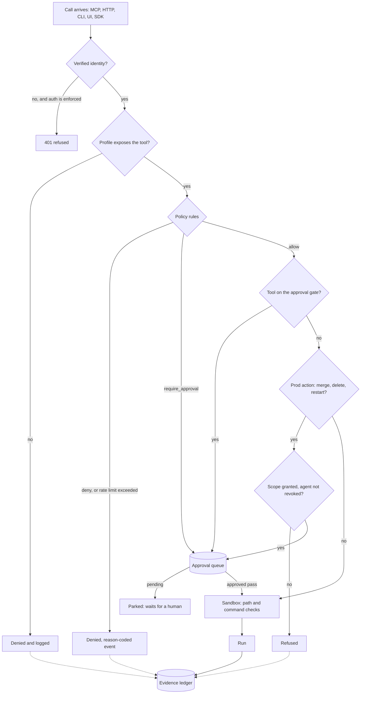
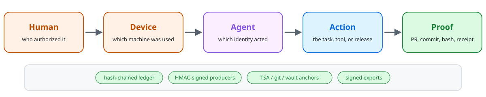

# Human in the loop and evidence

This guide brings together every control that keeps a person in charge of
agent work, and every mechanism that proves it afterwards. It is the
explanation behind the reference pages it links to.

The platform's promise has two halves:

1. **Control.** An agent cannot take an action you have reserved for a human.
   Taking it requires an authorized person's decision on that exact request.
2. **Proof.** For any piece of work, you can show who authorized it, from
   which device, which agent acted, what it did, and what it produced. That
   record resists tampering, even by the operator.

## The control stack

A call from any adapter passes through the same layers. Each layer can only
narrow what the layer before it allowed.



| Layer | Question it answers | Configure with | Reference |
|---|---|---|---|
| Identity | Who is calling? | `UA_ENFORCE_AUTH`, `UA_AGENT_TOKENS`, OAuth, device login | [Security: hub token authentication](security.md#hub-token-authentication) |
| Profile | Which tools may this session see and call? | Identity defaults, `profile_activate` | [Architecture: profiles](architecture.md#operational-profiles) |
| Policy | Is this call allowed, denied, or held for approval? | `UA_POLICY_FILE` | [Configuration](configuration.md) |
| Approval gate | Does a human need to sanction this exact request? | `UA_APPROVAL_TOOLS`, policy `require_approval` | [Tools: approvals](tools-reference.md) |
| Prod-action gate | Is this identity allowed to merge, delete, or restart at all? | `UA_AGENT_SCOPES`, `UA_REVOKED_AGENTS` | [Security: prod-action gate](security.md#prod-action-policy-gate-task-773) |
| Mission autonomy | How much must a human see or acknowledge for this mission? | `goal_manage("autonomy_set", ...)` | [Autonomy modes](autonomy-modes.md) |
| Budgets and lifecycle | Is this agent paused, terminated, or over budget? | `policy.yaml` budgets, lifecycle tools | [Budgets](budgets.md), [Agent lifecycle](agent-lifecycle.md) |
| Sandbox | Is the path or command itself safe? | `UA_WORKSPACE`, `UA_SHELL_ALLOWLIST` | [Security model](security.md) |

Two rules hold across the stack:

- **Approval never bypasses the sandbox.** An approved `fs_write` outside the
  workspace is still refused.
- **Deny beats allow.** When rules disagree, the stricter one wins.

## The approval gate

The approval gate is a queue on the hub. Gated calls never run on the
caller's say-so.

**What gets gated.**

- **Any tool listed in `UA_APPROVAL_TOOLS`.** The registered-tool wrapper gates
  every call of a listed tool, whether it comes over MCP, from a Control Center
  route that calls a registered tool, or from a
  [workflow](building-on-unified-agent.md#4-write-a-workflow) step (task #1811).
  The payload is the call's supplied arguments, with `None` meaning omitted, the
  same shape the governed HTTP event-log reads use. A policy `require_approval`
  pass already spent on the same call is not asked for twice. The gate runs
  before the tool's own argument validation, so an approved call can still
  fail validation.

  Tools in `_SELF_GATED_APPROVAL_TOOLS` in `server.py` generally apply their
  own per-action rule and payload, so listing one may not gate every call.
  `routine_fire` gates every new fire and lets only a receipt replay through.
  For example, `gcloud_ops` gates only mutating actions,
  `git_merge_task` lets a dry run through, a delegation by the
  verified human operator (login label or alias, case-insensitively;
  `config.verified_caller_is_operator()`, task #2535) is not gated, and a prod
  action the open posture admits skips its gate. That operator check reads only
  the transport-verified identity: it takes no label, so a self-claimed
  `from_agent` or `requested_by` cannot reach it, and an agent credential
  listed as an operator alias is dropped from the aliases. Check that set and
  the tool's code before relying on a listing.

  The managers `goal_manage`, `task_comment`, `skill_registry` and `org_proposal`
  are in that set but gate every configured call. Their read actions use the
  generic wrapper gate, and their write actions use a dedicated wrapper branch.
  Both paths consume one wrapper pass for the call, including when policy also
  requires approval. Native action-specific safeguards still apply; for example,
  `org_proposal` action `apply` has its own forced apply approval. A manager read
  remains ungated when neither configuration nor policy requires approval.

  A tool that forces a gate under a different name on every effective call is
  in that set too, so listing it costs one approval, the forced one:
  `horizon2_package_register` forces `horizon2_server_register` and
  `work_product_submit` forces `work_product_release`. A mixed-action manager
  that forces a gate for one action is not, because the set would ungate its
  other actions. Instead the wrapper skips its generic gate for exactly that
  action (`_action_forces_own_gate` in `server.py`, task #1896), so listing the
  manager costs one approval for it, the forced one:
  `coordination_manage` action `team_up` with `plan: false` (a boot) forces
  `team_up`, and `relay_manage` action `send` forces `relay.public.send`. Every
  other call of those tools, including a `team_up` preview and a relay `draft`
  (which can auto-send), still parks on the listed name.
- **Any tool, through policy.** A `require_approval` policy rule gates any
  registered tool by name, with no code change.
- **Every prod action** (merge, delete, restart), whether or not it is listed.
- **A fixed set of high-impact writes** that always demand approval: issuing
  agent tokens, setting managed secrets, registering or revoking governed
  connectors, and releasing work products.

> [!WARNING]
> Listing a read tool parks every read of it, including the Control Center pages
> that call it. Listing `event_log_query` parks `/api/events`,
> `/api/ledger/rows` and `/api/events/stream` (HTTP 202) as well as MCP calls.
> The approval tools themselves (`approval_pending`, `approval_resolve`) are
> never parked by the wrapper.

**How a gated call behaves.**

1. The call records a *pending* approval with the exact tool and payload, and
   returns `approval pending` to the caller. It does not run. When the
   verified caller has one current run, the row stores that `run_id` so
   Inbox and Runs can show which run is waiting; otherwise `run_id` is null.
   The value is display linkage only — resolving or consuming the approval
   does not read it. Repeating the same exact request reuses the pending row
   **across callers**: a pending row is a request, not authority. Two-phase
   flows (elicitation, the GitHub App check) depend on that reuse. The pass
   that results is still spendable only by the parties in step 4.
2. A person sees the request in the Control Center's Inbox
   (`/ui/inbox?kind=approval`), or with `approval_pending`. The detail shows the requester, the tool, and
   the arguments.
3. The person approves or denies it in the Control Center, or with
   `approval_resolve`. Approving needs a **named human identity**, and that
   person must not be the requester (the two-tool exception below never
   reaches this step).
4. Approval creates a **one-time pass** bound to that exact tool, payload and
   requester (task #2492). Two parties may spend it, and nobody else: the
   requester that queued it (aliases of one human count as the same person),
   and the human who resolved it — elicitation and the Control Center accept
   the request and then run the call from that person's own session. A second
   eligible caller making the identical call cannot spend the first caller's
   pass. A pass that named no requester stays unbound (the in-process path
   where the tool supplied no label); the registered wrapper always names the
   verified identity, so a pass created through it is always bound. Any change
   to the arguments needs a new approval.
5. An approved pass that has not been used yet can be revoked.

**Operator self-approval (task #2500).** On a hub with one human, a write the
verified operator makes from their own browser would otherwise park with nobody
able to approve it. For exactly `task_delete` and `langgraph_governed_call`
(the LangGraph workflow run), the gate records the operator's own verified
submission as an approved pass and consumes it in the same transaction, so the
call runs instead of waiting. The row keeps a reason, and the ledger appends
`agent.approval.self_approval` naming the tool, the operator, and why. The
pass is still one-shot; minting and consumption commit together so another
caller cannot spend it in between.

This path is keyed off `config.verified_caller_is_operator()` (task #2535), never a
caller-supplied label: an agent holding its own bearer token cannot reach it
by naming the operator. A call that names somebody else as `requested_by`
stays on the ordinary pending path. `approval_resolve` still refuses a
requester approving their own parked row. Work-product release, config
revision commit/rollback, harness config apply, and org proposal apply are
not in the named list; they keep separation of duties.

With `UA_ELICITATION_APPROVALS=1`, a client that declares URL-mode elicitation
is shown a link to this approval in the Control Center instead of having to
relay the request. Opening the link approves nothing; the person still decides
in step 3, and the client's call continues once they do. See
[elicitation modes](mcp-client-capability-matrix.md#331-elicitation-modes-form-vs-url-task-2256).

**Reaching the approver (task #2303).** With `UA_APPROVAL_SLACK_CHANNEL` set
to an allowlisted Slack channel ID, each new pending approval posts one Block
Kit card there: approval id, tool, requesting agent, run id, created time,
the pass lifetime after approval, the redacted `args_sha256` of the arguments,
and one button that opens the approval in the Control Center Inbox.
The card has no approve or deny button, and a Slack reply is never read as a
decision: the person still decides in step 3 through the verified-human path.
A decision posts an "approved/denied/revoked by X" follow-up threaded under
the card, never unthreaded. The raw payload, tokens and credential-bearing
URLs never reach Slack. Each delivery is first written as a durable intent
after the row commits and is sent by a worker, so Slack never blocks the
approval and a hub restart resumes unfinished cards. Every attempt and every
terminal loss is an `approval.delivery` evidence event (a loss carries
`dead_letter: true`). `system_doctor` row `approval_slack_cards` reads LIVE
only after a card has been delivered. The env contract and failure codes are
in [Slack coordination](slack-coordination.md#approval-cards-task-2303). The
ntfy-style phone push (`UA_APPROVAL_PUSH_URL`) and the signed webhook
(`UA_APPROVAL_WEBHOOK_URL`) are independent and can run beside it.

**Telling the requester (tasks #2394, #2435).** Slack, ntfy and the webhook
tell the *approver*. They do not tell the *requesting agent*. After
`approval_resolve` commits, the hub:

1. Writes a delivery intent in the same transaction (behind a savepoint, so a
   receipt failure never undoes the decision).
2. Appends one `agent.approval.receipt` event under the permanent key
   `approval-receipt:<id>:<decision>`. The payload is ids and the decision
   only — never the tool, arguments, or a reason.
3. Sends one hub `inform` from the service sender `hub-approvals` to a
   requester that is a known agent mailbox. The message id is
   `approval-receipt-<id>-<decision>`, so a redelivery is a duplicate. The
   operator or a service requester gets the event only.

Delivery is at-least-once. Deduplicate on the receipt ULID (the event) or the
message id (the inform). Do not treat a still-pending `approval_pending` poll
as proof the decision never happened: queue hygiene reconciles a committed
decision that lost its intent from a stored watermark, not a rolling window.
The env contract is in [configuration.md](configuration.md) under "Approval
decision receipts".

Every step writes an event. Resolving an approval also writes a
**signed producer event**. Its HMAC binds the resolver's verified identity to
the approval. The HMAC is keyed with the resolver's `UA_AGENT_TOKENS` token,
so it is written whenever that identity has one, including for a Control
Center session. When the resolution comes over the tailnet, the event also
records the device. The hash chain protects that device record, not the
signature.

Approvals made in a WorkOS identity-provider session take a separate path.
They are signed with `WORKOS_COOKIE_PASSWORD` instead of a `UA_AGENT_TOKENS`
token. That is a secret the operator configures on the hub. WorkOS does not
issue it. These approvals do not record a device yet.

## Work proposals

`org_proposal` covers organisation changes. The Inbox's proposals
(`/ui/inbox?kind=proposal`) cover learnings and skill clusters. Neither lets an agent propose a *batch of
work*. [`work_proposals.py`](../src/unified_agent/work_proposals.py) does
(task #2393).

**When to use it.** File one proposal of 1–50 items instead of calling
`task_add` in a loop. Each item has a title, optional notes, a repo/file
scope, and a priority.

**Who may decide.** Any verified identity may file (an agent only as itself).
Only the verified human operator may approve or reject, through
`POST /api/action/work-proposal-decide` in the Control Center or a human MCP
identity. An agent token is refused even when it names the operator as
`approver`. The operator may edit an item's title, notes, scope or priority as
part of approving it.

**What approval does.** Each approved item becomes one task. The notes carry
`[proposal: …#n]`, `[contract: <digest>]`, `[scope: …]` and `[reporting: …]`.
`task_claim` re-checks that contract and fails closed if the title, frozen
notes or scope drifted. The proposer may withdraw only before any item is
decided. An item stuck in `approving` after a crash is recovered by queue
hygiene (`work_proposal_recover`): forward if the task exists, otherwise back
to `pending`.

Tool signatures live in [tools-reference.md](tools-reference.md).

## Policy rules

A policy file turns organizational rules into enforced ones. Point
`UA_POLICY_FILE` at a reviewed YAML file:

```yaml
version: 2
enabled: true
default_action: allow

rules:
  - name: approve_run_cmd          # shell commands wait for a human
    type: tool
    tool: run_cmd
    action: require_approval

  - name: deny_task_delete         # never, by anyone
    type: tool
    tool: task_delete
    action: deny

  - name: steward_only_approval_resolve
    type: role                     # only these profiles may call it
    tool: approval_resolve
    roles: [steward, chief-of-staff]
    action: allow

  - name: budget_cap               # big spends need a pass
    type: threshold
    tool: "*"
    field: budget_usd
    max: 5.0
    action: require_approval

  - name: web_search_burst         # at most 30 searches a minute per caller
    type: rate_limit
    tool: web_search
    max_calls: 30
    window_seconds: 60
    bind:
      agent: "*"
```

Rules can also be **bound** to a company, agent, project, or task, so a rule
applies only inside that scope. Each decision writes a reason-coded
`agent.gateway.decision` event. The event never includes arguments, return
values, or exception text. With no policy file, the built-in default rules
apply. A policy file that exists but cannot be parsed or evaluated denies the
call rather than letting it through. A complete example lives in
[`examples/policy.phase3.yaml`](../examples/policy.phase3.yaml). The
[pilot kit](pilot/README.md) ships starting templates for legal, accounting,
healthcare administration, and professional services.

Changes to policy, profile, and org documents are kept as immutable
[config revisions](config-revisions.md): who changed what, when, and why.

## Separation of duties

Some actions must be approved by someone other than the requester. For
[work product release](work-product-release.md), the submitting identity can
withdraw (deny) its own request but can never approve it, under any profile.
More generally, `approval_resolve` refuses any approval where the approver is
the requester, and refuses an anonymous approver: without a name, separation
of duties cannot be shown. The operator self-approval path above is not a
resolve of a parked row: it mints and spends a pass at the gate for two named
tools, and it does not widen `approval_resolve`.

## Autonomy modes, budgets, and the kill switch

For missions (goals) you can choose how much a human sees before work
proceeds:

| Mode | You see | Pauses for you |
|---|---|---|
| `observe` | Everything, live | Nothing beyond the existing gates |
| `exception` | Only failures, denials, and budget warnings | Nothing new |
| `checkpoint` | Declared checkpoints and anything already gated | `merge`, `deploy`, `external_write` by default |
| `action-review` | Every side-effecting action | Every action class without a standing grant |

Only a human with authority over the mission can change its mode or grant a
standing exemption. Every change is kept in a revision history. Modes add
pauses on top of the other gates. They never remove one. See
[Autonomy modes](autonomy-modes.md).

**Budgets** set per-agent spending ceilings. When a `block` budget is
exhausted, that agent can no longer claim work. **Agent lifecycle** controls
pause, resume, or terminate an agent across every path that claims or
updates work. **Autonomous cycles** carry their own budgets and a kill
switch. An executor that cannot read the kill switch fails closed and stops.

## Review: validate and hold

The review pipeline runs tests, audits, and checks on work that agents
submit. It never merges, pushes, or opens pull requests on its own. It marks
work as validated and **holds** it. A human-controlled merge policy decides
what happens next. For example, "the claiming agent may merge its own pull
request on green CI plus one independent review, except for red-tier
changes". The opt-in shipping preflight also requires that review to be
**human-attested on the exact head** (version-1 `independent_review`
metadata on the existing release approval — not a CI comment alone). When a
read is recorded for an earlier head, the same preflight holds a later head
that added red-tier files without a delta read (task #2259). See
[Automation](automation.md#shipping-preflight-human-attested-independent-review-2158)
and the [head-moved hold](automation.md#shipping-preflight-head-moved-red-tier-hold-2259).

## Recording human decisions

A decision nobody can find is not a decision. Write it where the consumer
reads it:

| Decision | Write it as | Read by |
|---|---|---|
| A convention or design choice | `memory_save(tags=["decision", "project:<name>"])` | Agents at session start |
| Something agents must change next session | A `broadcast` memory note (human identities only) | Every agent at startup |
| Releasing one blocked task | A parsed annotation in the task's notes | The review pipeline |
| One parked tool call | `approval_resolve` | The approval gate |
| A go/no-go on architecture or scope | A committed `docs/` page | People and agents |

See [Recording decisions](decisions.md).

## The evidence ledger

<p align="center">
  <picture>
    <source media="(prefers-color-scheme: dark)" srcset="assets/evidence-chain-dark.svg">
    
  </picture>
</p>

The ledger is built in layers. Each layer closes a gap the one below it
leaves open.

| Layer | What it proves | What it does not prove |
|---|---|---|
| **Hash-chained event log.** Every event carries the hash of the previous one. | No event was edited, removed, or reordered after it was written. | That the operator did not rewrite the whole database. |
| **Signed producer events.** An HMAC over the identity, the approval or delegation, and the task. It is keyed with the identity's `UA_AGENT_TOKENS` token, or, for a WorkOS session, with the operator-configured `WORKOS_COOKIE_PASSWORD`. The calling device is recorded beside it when known. | Which credential produced the claim. The device record is covered by the hash chain, not the HMAC. | That a *human* stood behind it. An agent's signature stays agent evidence. |
| **External anchors.** The chain head is witnessed by an RFC 3161 timestamp authority, a separate signed git repository, or a locked vault note. | A wholesale rewrite of the database is detectable against a record the operator does not solely control. | Anything recorded after the anchored head, beyond the hash link. |
| **Signed exports.** A detached `.sig.json` sidecar over each exported report. | The report file was not altered after it was generated. | That the underlying events are true. That is the job of the layers above. |

Anchor and verify from the CLI:

```bash
unified-agent audit verify                       # walk the hash chain
unified-agent audit re-anchor --backend tsa      # witness today's head externally
unified-agent evidence --task 777 --json --out evidence.json
unified-agent evidence verify evidence.json      # check the detached signature
```

### Reading an evidence report

An evidence report walks the chain **human → device → agent → action →
proof** for each task or action in scope. It can be filtered by task,
project, agent, or time window. It exports as JSON, Markdown, text, CSV, or
PDF. It is also served at `GET /api/evidence` and in the Control Center's
Settings → Audit page (`/ui/settings/audit`).

The report keeps different kinds of truth apart:

- `chain_integrity.verified`: the event hash chain is intact.
- `actor_authentication_verified`: a signed producer event verifies for the
  records in scope.
- `human_provenance.human_authority`: `credential-attributed` only when a
  credential bound to a **human** identity signed. That proves the
  credential, not a present human. It is `unknown` for an agent signature,
  however valid, and `conflict` when the evidence disagrees with itself.
- `sod`: `not_applicable_single_operator` when one human is configured;
  otherwise `pass`, `fail` or `no_data` over the approvals in scope.
- `attribution_coverage`: at least 95% of recent completions carry the
  identity that claimed them.
- `clean_pass`: the chain verifies **and** coverage passes. It is a
  platform-wide gate, not a per-row attestation.

The same data is available as a graph of `human`, `device`, `agent`, `task`,
`action`, `approval`, and `work_product` nodes. That lets you ask "what did
this person authorize?" or "what stands behind this release?". See the
[Provenance graph](provenance-graph.md).

### Credential-attributed human authority

The report distinguishes an actor it can authenticate from a *human* whose
credential it can attribute. It never claims a human was present: a
credential proves which credential was used. A record is
`credential-attributed` only when its verifying producer signature comes from
an identity the hub classifies as human: the configured operator login and
its names (see [Settings](settings.md#the-human-operator)). The credential
class rides along as `verified_via`:

1. `"agent_bearer"`: the human identity's bearer HMAC signed the claim.
2. `"idp"`: the claim was made in a session verified by an identity provider.
   The [WorkOS pilot adapter](workos-pilot.md) is the first.

`presence-verified`, a statement-bound passkey assertion, is reserved and not
emitted yet.

A person named only in configuration (`UA_OPERATOR_NAME`) or in a task note is
recorded as an *inferred* candidate. It never becomes attributed authority.

## Releasing work products

When the output of agent work is a document rather than a code change (a
report, a filing, an audit workpaper), use
[work product release](work-product-release.md). It is off by default: set
`UA_WORK_PRODUCT_ENABLED=1` to enable it.


1. The agent submits a file. The hub hashes it and checks the required tags
   for the chosen template pack (for example `matter` and `client` for legal).
2. The submission always parks for approval. The reviewer sees the title,
   content hash, pack, and reviewer role.
3. A different, named person approves.
4. The retry releases an exact copy to the destination. It never overwrites a
   different file. A changed file, title, tag, or model starts a new review.

The chain gains two links: **human → device → agent → model → document hash →
approval**.

## Mapping to compliance frameworks

[Controls narrative](controls-narrative.md) maps these features to the EU AI
Act, ISO/IEC 42001, and SOC 2. It is explicit about which controls the
platform provides and which remain the organization's responsibility.
[Evidence export](connectors.md#evidence-export-a-scheduled-outbound-connector-task-1266)
can push signed reports to an outside store on a schedule.

## Checklist for a human-in-the-loop deployment

- [ ] `UA_ENFORCE_AUTH=1`, with one token per identity and a closed roster
      (`UA_AGENT_LABELS`).
- [ ] The people who approve have human identities (see the limitation
      above).
- [ ] `UA_APPROVAL_TOOLS` lists the gate-aware tools you want to see first
      (such as `run_cmd` and `fs_write`), and a policy `require_approval` rule
      covers every other tool you want to hold.
- [ ] A reviewed `UA_POLICY_FILE` with deny rules for anything nobody should
      do.
- [ ] `UA_AGENT_SCOPES` limits who may merge, delete, or restart at all.
- [ ] Budgets for every agent that runs unattended.
- [ ] An external anchor backend (`tsa` or `git`) scheduled for the chain
      head.
- [ ] Evidence signing configured, so exports carry a detached signature.
- [ ] A daily database backup, restored at least once as a test.
- [ ] Agents listen for `agent.approval.receipt` / `hub-approvals` informs
      rather than polling `approval_pending` forever.
