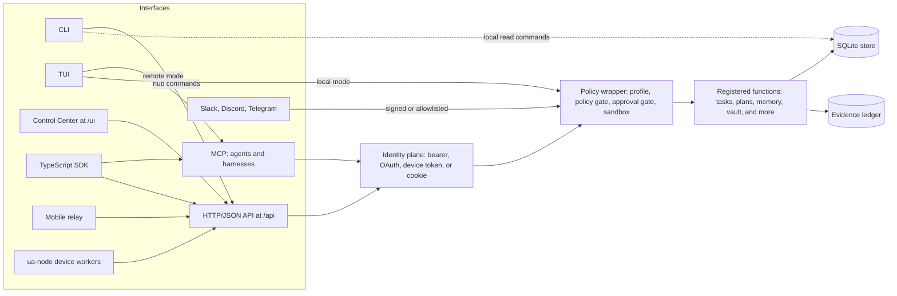

# Ways to use unified-agent

`unified-agent` has one hub and many ways in. Agents use MCP. People use the
Control Center, the CLI, or the terminal dashboard. Programs use the HTTP API
or the TypeScript SDK. Chat and mobile surfaces bring the hub to where people
already are.

Every interface is an adapter. Each one reaches the same registered functions
through the same identity check, session profile, policy gate, and approval
gate, and each one writes to the same store and ledger. Pick an interface for
who is calling, not for what it can do.

## At a glance

| Interface | Who it is for | Start it with | Auth | Best for |
|---|---|---|---|---|
| [MCP](#1-mcp) | Agents and harnesses | `UA_TRANSPORT=http unified-agent` (hub) or `unified-agent` (stdio) | Bearer or OAuth token over HTTP. None over stdio. | Agents that do the work |
| [CLI](#2-cli) | Operators, scripts, cron | `unified-agent <subcommand>` | Local commands read the database. Hub commands use a bearer or device sign-in. | Setup, health, evidence, backups |
| [TUI](#3-tui) | Operators at a terminal | `unified-agent-tui` | Local database, or a bearer for a remote hub | A quick look and small task edits |
| [Control Center](#4-control-center-web-ui) | People | Open `http://127.0.0.1:8765/ui` | Token exchanged once for an HttpOnly cookie | Approvals, queue, fleet, evidence |
| [HTTP/JSON API](#5-httpjson-api) | Programs and integrations | `curl` against `/api/*` | Bearer, or cookie plus CSRF token | Custom dashboards and integrations |
| [TypeScript packages](#6-typescript-packages-and-the-sdk) | People changing this repo's TypeScript layer | `packages/`; the SDK itself is `ua-rust` `sdk/typescript` | Bearer | Typed apps on top of the hub |
| [Chat and notifications](#7-chat-and-notification-surfaces) | People away from a desk | Slack endpoint, `unified-agent-ts-worker`, `notify` | Slack signature, or user-ID allowlists | Requests in, alerts out |
| [Mobile and watch](#8-mobile-and-watch) | Companion apps | `UA_MOBILE_WATCH_ENABLED=1` | Same as the API | Attention summaries, one safe action |
| [Knowledge vault](#9-knowledge-vault-obsidian) | Agents and people | `UA_VAULT_PATH` | Tool profile and write directories | Durable notes and journals |
| [Editor and desktop](#10-editor-and-desktop-integrations) | Developers | `*-with-hub` launchers | Per-agent bearer token | Editors that need their own identity |

## How they connect



Local CLI commands such as `unified-agent evidence` and `unified-agent audit
verify` open the database directly. Most `/api` routes dispatch through the same
registered tools as MCP. A few read routes call payload builders directly,
behind the same identity plane.

## 1. MCP

MCP is the interface for agents. A harness such as Claude Code, Codex, or Cursor
connects once and gets the hub's tools, resources, and notifications.

**Connect.** There are two transports.

| Transport | Start it | Use it for |
|---|---|---|
| Streamable HTTP | `UA_TRANSPORT=http unified-agent` serves `/mcp` on `127.0.0.1:8765` by default | The shared hub. Many agents, one state. |
| stdio | `unified-agent` (the default when `UA_TRANSPORT` is unset) | One isolated process with its own workspace, such as a satellite repo. |

`unified-agent` takes no flags. With no subcommand it starts the MCP server.
Register an HTTP hub with Claude Code, using the agent's own token, then start
a new session, because harnesses load the tool list once. Put the token in the
client config file rather than on a command line, as
[harnesses.md](harnesses.md#register-each-harness) shows: an entry under
`mcpServers` in `~/.claude.json` with
`"headers": { "Authorization": "Bearer <agent-token>" }`. To explore the tools
without a harness:

```bash
uv run mcp dev src/unified_agent/server.py    # the MCP Inspector
```

**What you can do.** The [tool catalog](tool-catalog.md) groups the registered
tools into four bands. The families stay stable as individual tools change.

| Band | Families | Examples |
|---|---|---|
| Research, workspace, quality | Web and docs, files, commands, security review | `web_search`, `fs_read`, `run_cmd`, `security_audit` |
| Source control and durable state | Git and worktrees, memory, tasks, goals, exports | `git_worktree_add`, `memory_search`, `task_claim` |
| Plans, delegation, execution | Plans, delegation, cycles, workflows, approvals, LangGraph | `plan_create`, `delegate`, `workflow_run`, `approval_resolve` |
| Vault, operations, integrations | Vault, Obsidian, profiles and registry, observability, notifications | `vault_journal`, `profile_status`, `system_doctor`, `notify` |

**Agent mailbox.** `message_send` and `message_list` carry typed messages
between agents (`request`, `inform`, `query`, `done`, `handoff`). Each message is
an event-log row plus a derived per-recipient index, so mail is read by
recipient with a commit-order cursor (`after_seq`, returned as `next_seq`; the
ULID `since` cursor is retired), an unread count, read and ack
state, and reply tracking (`delivered`, `read`, `answered`). A verified caller lists only
its own mail; the operator login and the chief-of-staff profile list all of it.
Read and ack changes go through the `coordination_manage` actions
`message_inbox` and `message_ack`. A message can name one session of the
recipient (`message_send(to_session=...)`, a hub `session_id` taken from the
live sessions `agent_context` lists per peer); only that session sees it, while
mail addressed to the label reaches all of them, each with its own read state.
Details:
[tools reference](tools-reference.md).

Beyond tools, the hub serves three other kinds of MCP traffic:

- **Resources.** Read-only `unified-agent://` URIs for live state. The most
  useful are `unified-agent://board`, `unified-agent://tasks/{task_id}`, and
  `unified-agent://runs/{run_id}`. The hub serves more kinds, such as approvals
  and plans. See [MCP resources](tools-reference.md#mcp-resources-live-board-state).
  Each URI is gated by the profile rule of the matching tool. Clients can
  subscribe and get `notifications/resources/updated` for the board, task, and
  run URIs.
- **Progress notifications.** Long-running tools such as `pi_run_task`,
  `langgraph_run`, and `langgraph_workflow_run` report milestones when the
  client sends a progress token. Without one, they run normally.
- **In-client approvals (opt-in).** With `UA_ELICITATION_APPROVALS=1` and a
  client that supports elicitation, a pending approval shows as a form in the
  client and resolves the same approval row. A client that declares URL mode
  gets a link to the approval in the Control Center instead, and its call
  continues once a person resolves it there. By default, people resolve
  approvals in the Control Center.

**Auth and permissions.**

- Set `UA_ENFORCE_AUTH=1` and give each identity a token in `UA_AGENT_TOKENS`.
  The hub attaches the verified identity to every call.
- With `UA_MCP_OAUTH=1`, an issuer, and a human approver, remote OAuth clients
  can connect too. An opt-in WorkOS session leg exists for human identities.
- **Profiles filter `tools/list` on authenticated HTTP sessions.** A `developer`
  session sees fewer tools than `chief-of-staff`, and `operator` and `public`
  sessions see short allow lists. Call `profile_status` to see yours. Stdio and
  unauthenticated HTTP are not filtered.
- Policy rules and the approval gate apply to every call, whatever the profile.
- `/mcp` accepts bearer and OAuth credentials only. It never accepts the
  Control Center cookie.

**Go deeper:** [Tools reference](tools-reference.md), [Tool catalog](tool-catalog.md),
[MCP 2.x operator guide](mcp-2x-operator-guide.md), [Security model](security.md#session-profiles),
[Connecting agents and harnesses](harnesses.md).

## 2. CLI

The `unified-agent` command runs the hub and a set of subcommands. Separate
`unified-agent-*` commands cover setup, governance, automation, and maintenance.

| Subcommand | What it does |
|---|---|
| `init` | Creates `~/.unified_agent/`, an empty database, a workspace, and a `service.env` with one bearer token. Safe to re-run. |
| `doctor` | Reports LIVE, DORMANT, DEGRADED, or MISCONFIGURED for every capability. `--json`, `--strict`, and `--whoami` change the output or the gate. |
| `verify` | Proves this client's bearer works and prints its identity and profile. |
| `audit` | With a path, runs the security audit. `audit verify` checks the ledger hash chain. `audit re-anchor` anchors the chain head to an external witness. |
| `evidence` | Builds the human, device, agent, action, proof report. Also `evidence report --project <id>`, `evidence export`, and `evidence verify <file>`. |
| `db` | `backup`, `restore`, `verify`, and `status` for the SQLite database. |
| `platform` | Read-only reads from a running hub: `manifest`, `get <kind> [id]`, `provenance-graph`. Needs `UA_HTTP_HUB_URL` set to the hub's `/mcp` URL. |
| `login` | Signs this device in with the OAuth device flow. `--configure` writes a harness config that uses a local proxy. |
| `llm-proxy` | Runs the local refresh-aware proxy that `login --configure` points a harness at. |
| `node` | Runs this device as a `ua-node` worker that connects out to the hub and runs dispatched work. |
| `work-product` | Submits and releases documents for named-human review: `submit`, `release`, `verify`, `list`, `evidence`, `diff`, `packs`. |

The console scripts fall into five groups:

| Group | Commands |
|---|---|
| Setup and health | `unified-agent-init`, `unified-agent-doctor` (same as the subcommands), `unified-agent-new-project` (scaffold a satellite), `unified-agent-sync` (sync workspace context), `unified-agent-tui` |
| Governance and evidence | `unified-agent-audit` (security audit gate for CI), `unified-agent-audit-ledger` (verify the hash chain), `unified-agent-evidence-export` (one signed export), `unified-agent-review` (`scan`, `task`, `label-held`), `unified-agent-merge` (validate and merge a task branch), `unified-agent-tool-classification` (tool exposure drift check) |
| Automation and workers | `unified-agent-executor` (background task executor), `unified-agent-dispatch-scheduler` (approved-dispatch poller), `unified-agent-routines` (`tick`, for a timer), `unified-agent-bug-worker` (opt-in bug-to-patch worker), `unified-agent-pr-watch` (GitHub PR state into memory), `unified-agent-eventbus` (standalone event bus), `unified-agent-planning-loop` (weekly plan and decision packet), `unified-agent-ts-worker` (Discord and Telegram), `unified-agent-zulip-worker` and `unified-agent-zulip-automation` (deprecated) |
| Knowledge and vault | `unified-agent-wiki` (link audit, rebuilds `Health.md`), `unified-agent-vault-sync` (pull hub-authoritative trees), `unified-agent-session-end` and `ua-session-end` (write `RESUME.md`), `unified-agent-evolve` (skill-cluster proposals) |
| Maintenance | `unified-agent-sleep-pass` (nightly memory upkeep), `unified-agent-consolidate` (proposal-based memory consolidation), `unified-agent-lane-reaper` (clean up orphaned lane processes) |

Everyday commands:

```bash
unified-agent init                                          # first-time setup
unified-agent doctor                                        # is everything wired?
unified-agent verify --hub-url http://127.0.0.1:8765/mcp   # who does the hub think I am?
unified-agent evidence --task 42 --markdown                 # who approved what for task 42
unified-agent audit verify                                  # does the ledger hash chain hold?
unified-agent db backup                                     # online backup of memory.db
unified-agent db status                                     # path, schema version, integrity
unified-agent platform manifest                             # read the hub's object manifest
unified-agent-audit . --fail-on high                        # security audit, CI style
unified-agent-review scan                                   # run the review pipeline once
```

**Auth and permissions.** Commands that open the database (`evidence`,
`audit verify`, `db`, `doctor`) need filesystem access to it, so they run on
the hub host. Commands that call a hub (`platform`, `verify`) send a bearer from
`UA_AGENT_BEARER_TOKEN`, or use the saved device sign-in. `login` runs the OAuth
device flow, and `node` reuses its saved sign-in.

**Go deeper:** [CLI reference](cli-reference.md), [Configuration](configuration.md),
[Installation](installation.md).

## 3. TUI

`unified-agent-tui` is a Textual dashboard for a terminal. It is an operator's
console for a hub on the same machine, not a full client.

```bash
unified-agent-tui
UA_TUI_REMOTE=http://127.0.0.1:8765/mcp unified-agent-tui   # force remote mode
```

The command takes no flags. Passing `--help` starts the dashboard.

- **System Operations.** Status of the `unified-agent` and
  `unified-agent-executor` systemd user units, with start, stop, and restart
  buttons, beside a `system_doctor` table.
- **Tasks Queue.** The queue with a detail pane. Buttons claim, run
  `review_and_notify`, set status, edit notes, mark done, and delete.
- **Memory & Vault.** Search over shared memory notes, with a detail view.
- **MCP Playground.** Run a short fixed list of tools with JSON arguments.
- **Live Logs Streamer.** The `journalctl` stream for the hub and executor units.
- **Collaboration Journal.** Recent daily journal entries from the vault `Logs`
  directory.
- **Git Worktrees.** Active worktrees from `git_worktree_list`.

Key bindings: `q` quit, `r` refresh, `a` add a task, `m` System Operations,
`t` Tasks Queue, `l` Live Logs.

**How it finds the hub.** Remote mode is chosen when `UA_TUI_REMOTE` is set,
when `UA_TRANSPORT=http` (the URL comes from `UA_HTTP_HOST` and `UA_HTTP_PORT`),
or when `~/.claude.json` has an HTTP `unified-agent` server entry. Its bearer
comes from `UA_TUI_BEARER_TOKEN`, then `UA_AGENT_BEARER_TOKEN`, then that same
`~/.claude.json` entry, then `UA_AGENT_TOKENS`. Otherwise it runs in local mode
against the local database (`memory.db` under `UA_HOME`).

**Limitations.**

- If the remote connection fails, the TUI warns and falls back to local mode.
  Check the title bar. The local database is not the hub's unless the hub runs
  on this machine with the same `UA_HOME`.
- It has no approvals pane. Approve in the Control Center.
- The service and log tabs use `systemctl --user` and `journalctl`, so they are
  useful on Linux with systemd only.
- The identity comes from `UA_AGENT_LABEL`. The claim dialog offers a fixed list
  of labels, not your roster.

**Go deeper:** [CLI reference: `unified-agent-tui`](cli-reference.md#unified-agent-tui).

## 4. Control Center (web UI)

The Control Center is a React 19 app served by the HTTP hub at `/ui`. It is where
people watch the fleet and make decisions.

**Open it** at `http://127.0.0.1:8765/ui`. The hub redirects `/` there. `/ui`
serves the build packaged inside an installed wheel, or `packages/web/dist` in
an editable source checkout. If that build is missing, it answers 503 with a
build hint. The Docker image builds it. From a source checkout, build
`protocol`, `client`, then `web` with Node.js before installing; an install
from an unbuilt checkout still works but serves that build hint.
`UA_WEB_DIST_DIR` overrides the packaged build for a custom or development UI
(a stale path keeps serving an older build). [Installation](installation.md)
has the steps.

**Sign in.**

1. The page asks for a token. Its identity becomes the identity of the session.
2. The page posts the token once to `POST /api/session`. The hub sets a `ua_ui`
   cookie that is `HttpOnly` and `SameSite=Strict`. It lasts 12 hours by default
   (`UA_UI_SESSION_TTL_HOURS`) and can be revoked.
3. The app keeps no token in browser storage. Sign-out is `DELETE /api/session`, sent with the CSRF token of the session the cookie names (the hub answers 403 `csrf_session_mismatch` and revokes nothing otherwise).

**`/mcp` never accepts this cookie.** A page in your browser cannot call an
agent tool, even if it tricks the browser into sending the cookie.

Passkeys do a different job. When OAuth device sign-in is enabled, a verified
human can register an approver passkey through `/api/oauth/passkeys`. It
approves OAuth consent and device sign-ins as a person. Passkeys do not sign
you in to `/ui`.

**The destinations.** The sidebar has eight destinations, and every page has
its own URL under `/ui`. `/ui/` opens Home.
[`packages/web/src/app/routes.ts`](../packages/web/src/app/routes.ts) is the
authoritative list (`DESTINATIONS` and every route in `ROUTE_SAMPLES`).

| Destination | Path | Use it to |
|---|---|---|
| Home | `/ui/home` | See what needs you, what is running, and what just finished. |
| Inbox | `/ui/inbox` | Act on everything waiting on a person: approvals, operator questions, holds, proposals, anomalies, and messages (`/ui/inbox/messages`). |
| Work | `/ui/work` | Create and track tasks (list, board, tree, graph), goals, plans, and the planning canvas. |
| Agents | `/ui/agents` | See and add agents, teams, skills, the org chart, topology, hosts and devices, and capabilities. |
| Sessions | `/ui/sessions` | Watch live and past sessions, start one (`/ui/sessions/new`), send follow-ups, adopt sessions found on devices. |
| Knowledge | `/ui/knowledge` | Search, write and edit memory notes; read and write the vault. |
| Runs | `/ui/runs` | Run workflows and graphs, manage routines and cycles, read receipts, telemetry, insights, and executor health. |
| Settings | `/ui/settings` | Check health, platform, cloud, usage, credentials, the audit ledger and provenance, integrations, and appearance. |

- **Classic links.** Links from the classic UI (`/ui/?view=<id>` and
  `/ui/#<id>`) still work: the app rewrites them to the matching new page
  before it starts. The full map is in
  [Web control center](web-ui.md#classic-links).
- **Command palette.** `Cmd/Ctrl+K` jumps to destinations, pages, and create
  actions. It only navigates. It never changes a task or an approval.
- **Approvals.** A write that the hub parks for approval shows as "Waiting for
  approval", never as done, with a link to the Inbox item.
- **Live updates.** The app opens one server-sent event stream per tab at
  `/api/events/stream` that refreshes matching data. Pages also refetch on
  their own cadence, so a dropped stream leaves nothing stale for long.
- **Themes and accessibility.** Light, dark, and high contrast. CI runs an
  axe-core gate against WCAG 2.2 AA on every destination and every route, in
  all three themes, and fails on any violation.
- **Legacy UI.** The 39-view classic app and the older `/ui/legacy` shell are
  gone. `/ui/legacy` returns 404.

**Auth and permissions.** The UI acts as the signed-in identity. Each browser
mutation goes through the same registered tools, policy gate, and approval gate
as an MCP call, and carries a CSRF token. Resolving an approval needs a human
identity. The `operator` profile is an allow list for approvals and read-only
status. It is the default for the built-in human identity only. See the known
limitation in step 3 of [Getting started](getting-started.md#step-3-define-who-is-who).

**Go deeper:** [Web control center](web-ui.md), [Human in the loop and
evidence](human-in-the-loop.md).

## 5. HTTP/JSON API

The Control Center's own routes are an API you can call. They live under `/api`
and share the hub's identity plane.

| Group | Routes | Notes |
|---|---|---|
| Session and identity | `POST` and `DELETE /api/session`, `GET /api/whoami` | Token to cookie. `whoami` returns your identity and, for cookie sessions, the CSRF token. |
| Work | `/api/tasks`, `/api/tasks/search`, `/api/tasks/holds`, `/api/board`, `/api/queue-health`, `/api/goals`, `/api/plans`, `/api/work-graph` | Compact, UI-shaped reads. |
| People and approvals | `/api/approvals`, `/api/approvals/{id}`, `/api/attention`, `/api/digest`, `/api/org` | `POST /api/approvals/request` only queues a request. |
| Fleet | `/api/agents`, `/api/sessions`, `/api/runs`, `/api/runs/{run_id}`, `/api/devices`, `/api/nodes`, `/api/cloud`, `/api/quota` | Devices report doctor snapshots. Runs is the uniform read-only projection over dispatch, self-pickup and session records. |
| Costs and telemetry | `/api/costs`, `/api/telemetry`, `/api/perf`, `/api/scorecards`, `/api/events` | Per-agent cost rollups and budget status. |
| Live events | `GET /api/events/stream` | Server-sent events. Accepts `channels`, `since` (ULID) and `after_seq`. Frames carry `seq`, the gap-free cursor. A valid `Last-Event-ID` header resumes the stream and takes precedence over a cursor parameter (see [web-ui](web-ui.md#event-stream-resume-and-capacity-task-1811)). A full stream is `429` with `Retry-After`. |
| Ledger rows | `GET /api/ledger/rows?after_seq=&limit=` | Raw hash-chained `event_log` rows in commit order, with the unparsed `payload_raw`, for external chain verifiers. |
| Evidence | `GET /api/evidence` (`format=json`, `markdown`, `text`, `csv`, or `pdf`), `POST /api/evidence` | The evidence report. Returns 403 under the core edition. |
| Platform (read-only) | `/api/platform/manifest`, `/api/platform/objects/{kind}[/{id}]`, `/api/platform/provenance-graph` | Same objects and profile gates as MCP resources. |
| Actions | `POST /api/tasks` and `POST /api/action/*` (`task`, `approval`, `plan`, `workflow`, `dispatch`, `handoff`, `dependency`, `cycle`, and more) | A parked action returns a pending approval, not a result. |
| Device workers | `POST /api/node/register`, `heartbeat`, `claim`, `receipt`, `events`, `permission`, `dispatch`, `session_credential`; `GET` and `POST /api/node/config` | Used by `unified-agent node`. Workers need a device sign-in unless `UA_NODE_ALLOW_BEARER=1`; `session_credential` (task #1744, off unless `UA_ACP_SESSION_MCP=on`) always needs one. |
| Mobile | `GET /api/mobile/v1/projection`, `POST /api/mobile/v1/action` | Off by default. See [section 8](#8-mobile-and-watch). |
| Health | `GET /api/health`, `GET /healthz` | `/api/health` is the doctor payload and needs auth. `/healthz` needs none and reveals nothing. |

The [route inventory](web-ui.md#route-inventory) lists every path. Slack's
`POST /api/slack/events` also lives under `/api`, but it uses Slack's signature
instead of a hub credential.

**Auth: bearer or cookie.**

- **Bearer.** Send `Authorization: Bearer <token>`. This suits scripts and
  services and needs no CSRF token.
- **Cookie plus CSRF.** A browser session uses the `ua_ui` cookie. Every
  mutation must also send the `x-ua-csrf` header. Read its value from
  `GET /api/whoami` after signing in.

The cookie works on `/ui` and `/api` only. Under `UA_ENFORCE_AUTH=1`, every
`/api` route except `/healthz`, `/api/session`, and the Slack webhook refuses a
request with no credential. The hub also checks the `Origin` and `Host` headers.

**Route authorization scopes.** Authentication is one gate; who may call a route is
declared in one table, `src/unified_agent/webui/route_scopes.py`. Every
`(method, path)` the hub serves has an entry, and a route with no entry answers
403 before its handler runs, so a new route cannot ship authenticated but with no
authorization decision. An entry has one of four access levels:

| Access | Meaning |
|---|---|
| `public` | Reachable without a hub credential (`/healthz`, `/ui`, login, the Slack webhook, OAuth endpoints). The route may still verify its own credential. |
| `own-auth` | The route authenticates the caller itself, such as the device-bound LLM broker route. |
| `any-authenticated` | The shared origin, host and identity guard only. A mutating entry says in its note who else gates it. |
| `capability` | The shared guard plus named capabilities. |

A capability is a hub tool name (`tools`) or a consolidated-manager action such as
`delegation_manage` / `delegate` (`actions`), judged by the same profile ceiling the
MCP surface uses. The profile is resolved from the verified identity: the MCP
session's activated profile when the request is bound to one, else the identity's
default. A Control Center request has no MCP session id, so the ambient MCP check
would admit every tool; the route uses the pure check instead. `operator` lets the
verified human operator (`UA_OPERATOR_LABEL` on a hub credential) past the ceiling:
the operator profile is read-only over MCP (no `task_update`, no `crew_intervene`)
while the Control Center is the operator's write surface. The exemption follows the
identity, not the profile, so an agent moved onto the operator profile does not pass.
`csrf` marks routes whose cookie sessions must send the CSRF header.
Checks that depend on the request body or on the caller's identity stay in the
handler and are tagged from a closed list (`human`, `bearer`, `identity-profile`,
`approval`, and so on); the route is mapped to the weakest capability any call
needs. The handlers keep their own checks as defence in depth.

Every action route carries the ceiling of its MCP twin (task #1865):

| Route | Ceiling | Profiles (plus the operator) |
|---|---|---|
| `POST /api/tasks` | `task_add` | developer, steward, chief-of-staff, research, public |
| `POST /api/action/task` | `task_update` | developer, steward, chief-of-staff |
| `POST /api/action/proposal` | `task_add`, `vault_ingest_status` | developer, steward, chief-of-staff, research |
| `POST /api/action/dependency` | `coordination_manage` dependency add and remove | developer, chief-of-staff, research |
| `POST /api/action/workflow` | `workflow_run` | developer, chief-of-staff |
| `POST /api/action/crew-intervene` | `crew_intervene` | developer, chief-of-staff |
| `POST /api/action/dispatch`, `/api/action/dispatch-stack` | `delegation_manage` delegate, `task_update` | developer, chief-of-staff |
| `POST /api/action/node-session`, `/api/node/dispatch` | `delegation_manage` delegate | developer, chief-of-staff |
| `POST /api/action/handoff` | `coordination_manage` handoff | developer, chief-of-staff |
| `POST /api/tasks/holds`, `/api/tasks/holds/{hold_id}/release` | `task_update`, `coordination_manage` task_hold | developer, chief-of-staff; a release only by the hold's creator or an operator |
| `POST /api/action/cycle` | `autonomous_cycle_manage` start, transition, usage, kill | developer, chief-of-staff |
| `POST /api/action/plan` | `plan_manage` review | developer, chief-of-staff |
| `PUT /api/graph-canvas` | `graph_canvas_write` | steward, chief-of-staff |
| `POST /api/action/oauth-revoke` | `oauth_device_manage` | steward, chief-of-staff |
| `POST /api/action/fleet`, `/api/action/harness-config`, `/api/action/session-credential-revoke` | none: no MCP twin | the operator only |

The task reads that used to apply `task_list` only inside an MCP session (goals,
why-chain, comments, task search, the next-work projection and org proposals) now
apply it to HTTP callers too.

`tests/test_route_scopes.py` fails when a served route has no entry, when an entry
matches no served route, when a mutating route lacks the CSRF guard without being
listed as exempt, when the table disagrees with the central authentication gate,
or when a route `server.py` serves outside `web_routes()` (the MCP transport, the
root redirect, the OAuth endpoints) is declared anything but `public` or
`own-auth`, since nothing would enforce a capability there. It also freezes the
allowed matrix per profile. To add a route, add its
entry in the same change and choose the narrowest access that its handler enforces.

**Inbox endpoints for hooks.** A Claude Code hook is a short-lived process with no
MCP session. Two bearer-only routes let it register its session and learn about
unread mail over plain HTTP, using the agent's hub token. A cookie or OAuth
session is refused with 401, so neither route needs a CSRF token. They need the
`session_start` and `message_list` tools in the caller's profile.

`POST /api/inbox/session` with `{"external_session_id": "<id>", "host": "<optional>",
"cwd": "<optional>"}` registers the session under the token's own label (the agent
is never taken from the body) and returns `{"session_id": "...", "agent": "..."}`.
It is idempotent on `(agent, external_session_id)`: repeat calls return the same
`session_id` and refresh its heartbeat, so call it at session start and again as a
heartbeat. `external_session_id` is required; each field is at most 512 characters.

`GET /api/inbox/summary?session_id=<id>&limit=5&after_seq=<n>` returns

```json
{"agent": "...", "session_id": "...", "unread": 7, "newest_seq": 412,
 "messages": [{"message_id": "...", "seq": 412, "from_agent": "...", "act": "request",
               "conversation_id": "...", "task_id": null, "expects_reply": true,
               "created_at": "...", "preview": "first line, at most 160 characters"}]}
```

`messages` is newest first, at most `limit` (default 5, cap 20). `unread` and
`newest_seq` cover all of the caller's unread mail, not just the page, so a hook can
compare `newest_seq` with the last one it showed. `after_seq` limits the snapshot
to newer mail. The summary is a snapshot, not a pager, so it returns no resume
cursor: read mail in order with `message_inbox` (`after_seq` / `next_seq`). Unread means
label mail plus, when `session_id` is given, that session's own mail, under the same
rules as `message_list`. The call never marks anything read; ack through
`message_ack`. A `session_id` that is not the caller's own, or does not exist, is a
403 with the same message, and a valid one counts as a heartbeat. Cost per request: one
SQLite connection and two indexed queries (a count and a limited page joined to the
event body for the preview), plus a primary-key lookup and heartbeat update when a
session is named.

Keep the token out of curl's command line: an argument such as
`-H "Authorization: Bearer $UA_AGENT_BEARER_TOKEN"` is expanded by the shell
before curl starts, so any local user can read the token with `ps`. Write the
header to a private file instead and pass it with `-H @file` (curl 7.55 or
later). `printf` is a shell builtin, so the token never appears as a process
argument:

```bash
# UA_AGENT_BEARER_TOKEN is already set in your shell (never typed inline).
UA_AUTH_HEADER="$(mktemp)"                     # created mode 0600
printf 'Authorization: Bearer %s\n' "$UA_AGENT_BEARER_TOKEN" > "$UA_AUTH_HEADER"
curl -sS -H @"$UA_AUTH_HEADER" http://127.0.0.1:8765/api/platform/manifest
rm -f "$UA_AUTH_HEADER"
```

**Go deeper:** [Web control center: route inventory](web-ui.md#route-inventory),
[Platform object model](platform-object-model.md),
[Building on unified-agent](building-on-unified-agent.md),
[Security model](security.md#hub-token-authentication).

## 6. TypeScript packages and the SDK

**The SDK for new integrations is [`anonb3ll/ua-rust`](https://github.com/anonb3ll/ua-rust) →
`sdk/typescript`.** That is where the canonical SDK is developed. The packages are
not published to a registry yet, so build them from source. The old
`unified-agent-sdk` repository is retired and frozen.

The packages below are this repository's own TypeScript layer: they build the Control
Center and the clients used inside this repo. They are still the right place to
change that layer, but they are not the SDK for outside applications.

Three TypeScript packages live in `packages/`. Build them from source.

| Package | Purpose |
|---|---|
| `@unified-agent/client` | `UnifiedAgentClient` calls tools over MCP. `ControlCenterClient` calls the `/api` routes. |
| `@unified-agent/protocol` | Zod schemas as the source of truth, with generated JSON Schema and Pydantic models. |
| `@unified-agent/conformance` | Golden fixtures that check TypeScript consumers keep the Python decision shape. |

The client is a typed remote. It has no local fallback and no second copy of
policy. The hub decides every call. Build `packages/protocol` first, then
`packages/client`, each with `npm`.

```ts
import { UnifiedAgentClient } from "@unified-agent/client";

const hubOrigin = process.env.UA_HUB_URL!;   // for example http://127.0.0.1:8765
const token = process.env.UA_AGENT_BEARER_TOKEN!;
const client = new UnifiedAgentClient({ url: `${hubOrigin}/mcp`, bearerToken: token });

try {
  await client.ping();
  const profile = await client.profileStatus();
  const open = await client.taskList({ status: "open", limit: 5 });
  console.log(profile.identity, open.length);
} finally {
  await client.close();
}
```

`ControlCenterClient` wraps the `/api` routes the same way. In this release its
`platformManifest()` rejects the hub's current manifest, because one object type
has no backing table and the client's schema expects one. Read the manifest
over HTTP until the client is fixed.

Auth is the caller's bearer. The hub derives the actor from it, so a caller
cannot supply an actor or a resolver. When policy parks a write, the client
returns a typed pending result with an approval id.

**Go deeper:** [`packages/client/README.md`](../packages/client/README.md),
[`packages/protocol/README.md`](../packages/protocol/README.md),
[`packages/conformance/README.md`](../packages/conformance/README.md),
[Building on unified-agent](building-on-unified-agent.md).

## 7. Chat and notification surfaces

Chat surfaces send requests in. Notifications send alerts out. Neither resolves
approvals or runs free-form commands.

| Surface | What it does | Start it | Default state |
|---|---|---|---|
| Slack | Signed HTTP ingress at `POST /api/slack/events`. Commands: `/contact`, `/task`, `/assign`, `/progress`, `/blocker`, `/review`, `/plan`, `/approve`. A read-only `status` lookup is separately opt-in. | `UA_SLACK_ENABLED=1`, `SLACK_SIGNING_SECRET`, user and channel allowlists | Off |
| Discord and Telegram | A worker polls channels and acts on `[target: <label>]` messages. Verbs: `task`, `assign`, `progress`, `blocker`, `review`. It replies in chat. | `unified-agent-ts-worker` with `UA_TS_DISCORD_TOKEN` or `UA_TS_TELEGRAM_TOKEN` | Off. Idles without tokens. |
| Notifications | `notify` sends one message. `batch_notify` and `flush_digest` group messages. `notify_delivery_status` reports outcomes. | See below | Needs an iMessage bridge |
| Zulip | Deprecated. Slack is authoritative. | `unified-agent-zulip-worker` | Retired |

- **Slack.** The hub checks the Slack signature and a five-minute replay window,
  then requires a user-ID allowlist and a channel allowlist. Commands run through
  the same registered tools as any other caller. `/approve` hands the decision to
  a human. Slack never resolves an approval. Outbound posts need
  `SLACK_BOT_TOKEN`. The Control Center's Slack page (`/ui/settings/integrations/slack`) shows
  gateway status.
- **Discord and Telegram.** Only allowlisted user IDs produce an actionable
  record. Every message is written to the event log first. A refused verb gets a
  visible refusal and changes nothing.
- **Notifications.** `notify` delivers an iMessage through a separately installed
  `imessage-bridge`. Set `UA_BRIDGE_DIR` to it. The digest tools hold
  non-critical messages in SQLite so they can go out as one summary. The
  Notifications page (`/ui/settings/integrations/notifications`) and
  `notify_delivery_status` show outcomes, never message text.
- **Zulip.** The worker, tools, and Zulip page remain for historical records and
  read-only audit. Do not start new work on Zulip.

**Go deeper:** [Slack coordination](slack-coordination.md),
[Task-space chat worker](ts-worker.md),
[Zulip coordination (deprecated)](zulip-coordination.md),
[Configuration](configuration.md).

## 8. Mobile and watch

The hub has two opt-in routes for a phone companion. Both return 404 unless you
set `UA_MOBILE_WATCH_ENABLED=1`.

- `GET /api/mobile/v1/projection` returns a small `mobile.v1` envelope: attention
  counts, a fixed safe title per item, a health state, and a deep-link reference.
  It never carries task notes, approval bodies, URLs, or credentials.
- `POST /api/mobile/v1/action` accepts a `mobile-action.v1` request. The only
  allowed action is `acknowledge`. It hides one attention item for a limited time
  and changes no task, approval, or run.

The iPhone is the authenticated gateway. By design, a Watch never holds a token.
It shows a projection and sends an intent to the phone. The phone calls the action
route with its own credentials, and the hub applies policy and records an event.

| Ships in this repository | Contract or design only |
|---|---|
| The two routes, with envelope validators and tests | The Apple Watch architecture, data inventory, transport, and test-matrix documents |
| A Swift package in `native/UnifiedAgentMobile` (models, a SwiftUI projection view, an action relay interface) for iOS 17 and watchOS 10 | An iPhone app, a Watch app, and a push or notification transport. None is in the repository. |

Swift tests need a macOS toolchain.

**Go deeper:** [Mobile projection contract](mobile-projection-contract-v1.md),
[Mobile action contract](mobile-action-contract-v1.md),
Apple Watch architecture.

## 9. Knowledge vault (Obsidian)

The hub bridges to an Obsidian-style vault of Markdown notes. Agents use it for
journals, plans, and durable prose. People read it in Obsidian.

- **Vault tools.** `vault_read`, `vault_list`, `vault_search`, `vault_links`,
  `vault_query`, `vault_write`, `vault_move`, `vault_journal`, and related tools.
  `vault_read` takes `expand_embeds=True` to expand `![[embed]]` blocks.
  `vault_write` takes `template=` to instantiate a note.
- **Obsidian tools.** `obsidian_status`, `obsidian_open`, `obsidian_active_note`,
  `obsidian_search`, and `obsidian_append` drive a running Obsidian through its
  Local REST API plugin. Set `UA_OBSIDIAN_API_URL` and `UA_OBSIDIAN_API_KEY`.
- **Location.** `UA_VAULT_PATH` (default `~/vaults/main`). An empty value disables
  the vault tools.
- **Write scope.** Reads work anywhere in the vault. Writes go only to
  `UA_VAULT_WRITE_DIRS` (default `00 - Inbox`, `Logs`, `Wiki`), and a profile can
  narrow that. The `operator` and `public` profiles cannot write.
- **Locked notes.** A note with `locked: true` in its front matter refuses
  overwrite and append. `force=True` overrides it, and only with human or
  steward approval.
- **Around it.** The Control Center vault page (`/ui/knowledge/vault`), `unified-agent-wiki` for link audits, and
  `unified-agent-vault-sync` for keeping a second machine in step.

**Go deeper:** [Memory, tasks, and vault](memory-tasks-vault.md#vault-obsidian-bridge),
[Security model](security.md).

## 10. Editor and desktop integrations

Editors and desktop apps use the same MCP and Control Center interfaces. The
repository ships the launchers, not the apps.

- **`*-with-hub` launchers.** Each script in `scripts/` starts one tool with one
  agent's bearer token, isolated from whatever token the parent shell holds. The
  scripts read a token file at run time and never print it. The wrappers are
  `agent-with-hub`, `code-with-hub`, `copilot-with-hub`, `cursor-with-hub`,
  `devin-with-hub`, `github-copilot-desktop-with-hub`, and `opencode-with-hub`.
  The executor's default binaries for Cursor, Copilot, and Devin point at these
  names.

  ```bash
  scripts/install-with-hub-wrappers.sh --list      # print the wrapper names
  scripts/install-with-hub-wrappers.sh --dry-run   # show what would be installed
  ```

- **T3 Code.** Embedding the Control Center in the T3 Code desktop app was an
  unmerged 2026-08 experiment; it is not supported upstream, and upstream reads
  no Control Center URL variable. This repository does not read one either. Use
  the hub's `/ui` URL in a browser.

**Go deeper:** [Connecting agents and harnesses](harnesses.md),
[Installable governance](installable-governance.md),
[Configuration](configuration.md).

## Next steps

[Getting started](getting-started.md) runs a hub and connects an agent, and
[Deployment topologies](topologies.md) shows how the interfaces fit across
machines.
