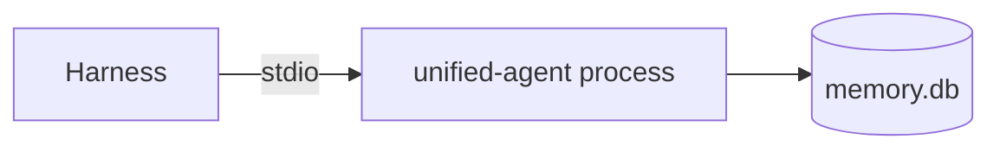
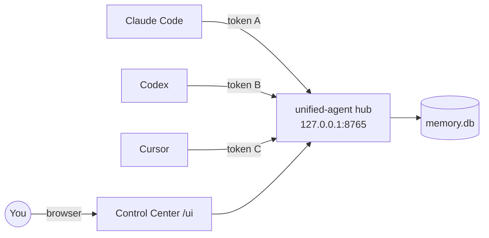
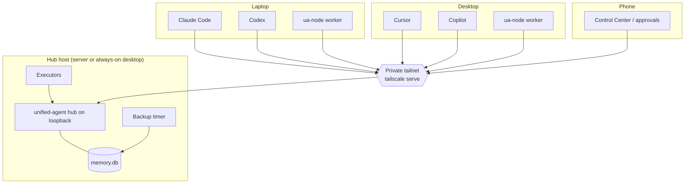
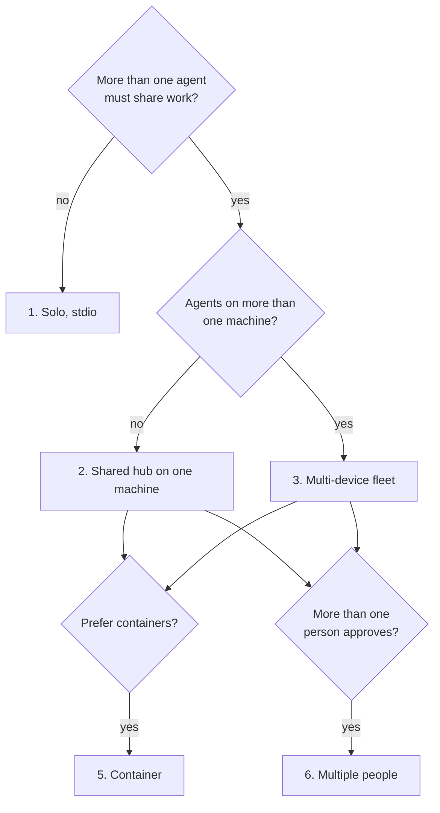

# Deployment topologies

`unified-agent` scales from one agent on one laptop to a fleet of agents on
several machines, directed by several people. This page describes the common
shapes and when to use each. The steps for each shape are in
[Installation](installation.md).

| Topology | Machines | Agents | People | Auth and Control Center |
|---|---|---|---|---|
| [1. Solo, stdio](#1-solo-stdio) | 1 | 1 per process | 1 | No |
| [2. Shared hub on one machine](#2-shared-hub-on-one-machine) | 1 | Many | 1 or more | Yes |
| [3. Multi-device fleet](#3-multi-device-fleet) | Many | Many | 1 or more | Yes |
| [4. Isolated satellites and cloud sessions](#4-isolated-satellites-and-cloud-sessions) | Any | 1 per satellite | n/a | No |
| [5. Container](#5-container) | 1 host or VM | Many | 1 or more | Yes |
| [6. Multiple people](#6-multiple-people) | Any hub | Many | Several | Yes |

## 1. Solo, stdio

The harness starts a private `unified-agent` process over stdio. It has its
own workspace and its own database under `UA_HOME`.



**Use it for** trying the tools, a machine that will never run a hub, or a
project that needs its own sandbox root.

**Limits.** No authentication and no Control Center. Profiles do not filter
tools over stdio. Two stdio processes share a database only if they share
`UA_HOME` (by default they do, at `~/.unified_agent`). Give each one its own
`UA_HOME` when you want them isolated.

## 2. Shared hub on one machine

One long-running hub serves every harness on the machine over HTTP on
loopback. Each harness uses its own token, so the ledger attributes each call
to the right agent.



**Use it for** running several agents as one team on a workstation. This is
the shape [Getting started](getting-started.md) builds.

Register the hub **once, user-scoped**, in each harness. Do not also add a
project-scoped stdio entry to the same repositories: project scope outranks
user scope and would silently bypass authentication and approvals.

## 3. Multi-device fleet

One machine owns the hub and the only authoritative database. Other machines
connect to it over a private network. Every agent on every device shares the
same queue, memory, policy, and ledger.



How the pieces fit:

- **The hub binds to loopback.** Expose it to your tailnet with
  `tailscale serve --bg --tcp 8765 127.0.0.1:8765`, or put a reverse proxy in
  front. Add each client hostname to `UA_HTTP_ALLOWED_HOSTS`. Never bind the
  hub to `0.0.0.0`.
- **Clients keep no local database.** A client must not also run a local hub
  or a stdio registration. Either would create a second database outside the
  hub's controls. Remote clients and executors set `UA_HTTP_HUB_URL` to the
  full `/mcp` URL and fail closed without it.
- **Devices sign in like connectors.** On a new machine, run
  `unified-agent login`. It shows a short code. You approve it from any
  browser, including a phone, and the device receives a refreshable,
  device-bound token in a `0600` file. No bearer is copied between machines.
  Only `unified-agent node` and the executor use that sign-in. Interactive
  harnesses keep their own token or OAuth configuration.
- **Device workers run dispatched work.** `unified-agent node` connects out
  to the hub. It needs no listening port. It registers the device's OS,
  installed harnesses, and worktree roots, then heartbeats. It long-polls its
  own queue, runs each item through an executor backend, and posts exactly one
  idempotent receipt. The Control Center's **Agents → Hosts** page (`/ui/agents/hosts`) shows each
  host with a measured
  freshness label.
- **Harness configuration can come from the hub.** A versioned bundle of
  rules files, skills, and MCP server lists is published once. `ua-node`
  renders it per harness and reports drift. It changes protected files only
  after you approve the exact proposal.

Three channels carry state between machines. Use each for what it is good at:

| Channel | Carries | Example |
|---|---|---|
| The hub | Operational state: tasks, memory, approvals, events | "Task 42 is claimed by `agent-laptop-agent2`." |
| Git | Code and anything that wants a diff | A task branch pushed from a worktree |
| A synced notes vault | Prose meant for people | A weekly briefing or design note |

Rule of thumb: if it wants a diff, it goes in the repository. If it wants a
reader, it goes in the vault.

**Resilience.** The hub host holds the only copy of the database. Install the
daily backup timer ([Installation](installation.md#scheduled-database-backup)).
Consider off-site copies. Rehearse a restore with
[Database operations](database-operations.md).

## 4. Isolated satellites and cloud sessions

A **satellite** is a project, or a disposable environment, that deliberately
runs its own stdio instance with its own `UA_WORKSPACE`. Its state is separate
from the hub's, and it is not governed by the hub's approvals.

**Use it for** projects that must not share a sandbox root with the fleet,
and for ephemeral cloud sessions that cannot reach your tailnet. For example,
Claude Code on the web gets its own throwaway instance to
test features against.

Treat anything a satellite returns as local. It is not fleet state. Work done
in a satellite reaches the fleet through a pushed branch and a pull request
that a hub-connected agent or a person reviews.

## 5. Container

The hub ships as a container image. Everything durable lives in the `/data`
volume: the database, `service.env`, and the default workspace. On first
start, the container initializes itself and prints the generated bearer token
**once** to its log. Authentication is always enforced in the container.

```bash
docker compose -f deploy/docker/compose.yaml up -d
```

Publish the port on loopback only, and put a tailnet or reverse proxy in
front for remote reach. See [Installation: Docker](installation.md#docker).

## 6. Multiple people

A hub can be directed by more than one person. Each person needs their own
identity and token, so the ledger can tell them apart.

- **Roles through offices.** The [org chart](../src/unified_agent/org.yaml)
  groups identities into offices with a lead, members, and decision rights.
  Task lists can be filtered by office, and `system_doctor` flags an active
  identity that belongs to no office.
- **Approvals are personal.** An approval records the named person who
  resolved it. That person may not be the requester, and must have a human
  identity. See the current
  [limitation on human identities](getting-started.md#step-3-define-who-is-who).
- **The Control Center login is an operator session.** It can resolve
  approvals and read status. It cannot write the workspace or the vault, and
  it cannot call agent tools, because `/mcp` never accepts the browser cookie.
- **Identity-provider sign-in.** A single-organization pilot adapter for
  [WorkOS](workos-pilot.md) runs as a separate process with its own database.
  Its sessions produce verified human authority in evidence reports. It is a
  pilot and is not mounted on the main hub.
- **Notification and chat surfaces.** People can follow and steer work from
  [Slack](slack-coordination.md), [Discord or Telegram](ts-worker.md), and a
  phone surface built on the [mobile projection](mobile-projection-contract-v1.md)
  and [mobile action](mobile-action-contract-v1.md) contracts.

**Not provided today.** Hosted multi-tenant accounts, and self-service user
management on the main hub. A hub serves one organization. See
[Hosted capability boundary](deploy/hosted-capability-boundary.md) for what a
hosted hub can and cannot do.

## Choosing a topology



A sandboxed or ephemeral environment that cannot reach the hub is a
[satellite](#4-isolated-satellites-and-cloud-sessions) in every case.
